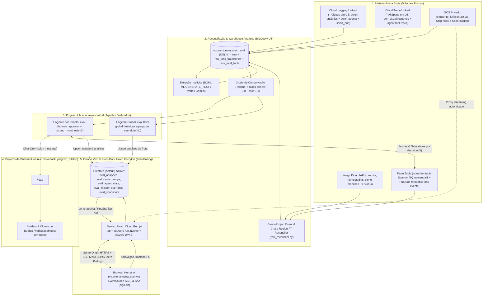
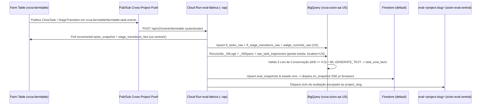
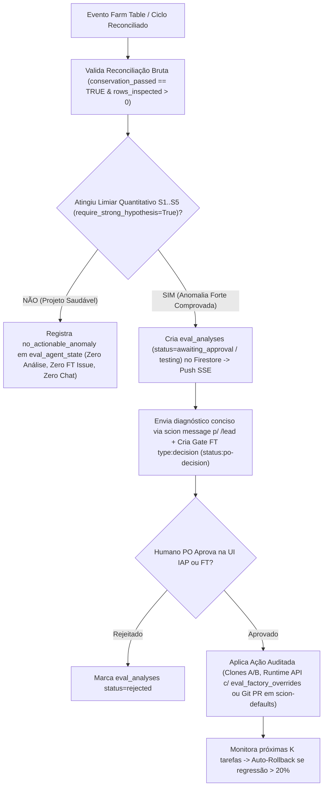

# Especificação Técnica e de Produto: `EVAL FÁBRICA` (Arquitetura v2)

> [!IMPORTANT]
> **Status:** Especificação Canônica v2 (Aprovada para Implementação) · **Ambiente de Referência:** `vcxa-scion-aa` (`tfhaa-main`, `EVAL_BQ_LOCATION=US`) + `vcxa-farmtable` (`farmtable-gcp`) · **Escopo Primário:** Fase 1 (`TAREFA` + `FÁBRICA` + `Análises` + Agentes `eval-<project-slug>` + `Clones de Tarefas` + Cloud Run Direct IAP + SSE Zero-Polling + Reconciliação Bruta) · **Fases Evolutivas:** Fase 2 (`PROCESSO`) e Fase 3 (`PRODUTO`).

---

## 1. Visão Geral, Diagnóstico Pós-Auditoria v1 e Princípios Arquiteturais v2

### 1.1 Motivação da Arquitetura v2 e Diagnóstico Empírico (`vcxa-scion-aa` & `vcxa-farmtable`)

O **`EVAL FÁBRICA`** transforma o `scion-eval` em um sistema fechado de **Observabilidade Analítica sobre Matéria-Prima Bruta, Experimentação Paralela (`Clones de Tarefas`) e Otimização Científica Governada** para fábricas multi-agente no Scion.

A auditoria técnica completa da implementação v1 em produção (`vcxa-scion-aa` + `vcxa-farmtable`) expôs cinco limitações estruturais que motivam esta **Arquitetura v2**:

1. **Fragilidade Estrutural de Firebase Hosting + GCS Estático + CORS:**
   - Na v1, servir uma SPA estática via Firebase Hosting (`vcxa-scion-aa.web.app`) fazendo `fetch` autenticado cross-origin contra `storage.googleapis.com` / `firebasestorage.googleapis.com` exigiu OAuth Client ID manual, popups/fragments de token (`GoogleAuthProvider.signInWithPopup` / `#access_token=`), regras de CORS no bucket GCS, quebras com URLs assinadas e escrita concorrente (*read-modify-write*) em arquivos JSON estáticos de índice (`registry.json`, `analyses/index.json`).
   - **Solução v2:** **Serviço Único Fechado no Cloud Run protegido por Direct IAP (`--iap`)**, servindo UI + APIs REST + stream **Server-Sent Events (SSE)** na mesma origem (*same-origin*: zero Firebase Hosting, zero CORS, zero OAuth Client ID manual, zero URLs assinadas, zero polling no navegador).
2. **Desconexão entre a Matéria-Prima Bruta e `scion_eval` (`rows_inspected = 0`):**
   - Em `vcxa-scion-aa`, os coletores brutos do GCP já continham **29.668 linhas** em `scion_logs_linked._AllLogs` (incluindo **9.643 eventos OTel/hook** em `scion-agents`) e **37.316 spans** em `scion_trace_linked._AllSpans` (**2.426** `gen_ai.api.response` e **2.321** `agent.tool.result`), além de `scion_analytics` populado (`agent_logs_fact=9.838`, `trace_spans_fact=30.724`).
   - Apesar disso, `scion_eval.task_eval_facts` tinha **0 linhas** porque:
     1. O SQL v1 (`04_materialize_task_eval_facts.sql`) partia exclusivamente de `raw_task_trajectories WHERE task_id IS NOT NULL` (que estava vazio porque o shipper não havia drenado os containers) e aplicava uma heurística sintética fixa (`0.65` produtivo / `0.35` retrabalho e `0.0` de `heartbeat_tax_usd`);
     2. O `AnalyticsDrainer` (`pkg/sciontool/telemetry/analytics_drainer.go`) chamava `GET <hub>/healthz` sem credencial contra o Hub em Cloud Run Direct IAP (recebendo `HTTP 404` do GFE), enquanto os hooks reais do Antigravity (`agy`) gravavam em `scion-agents` e `_AllSpans`.
   - **Solução v2:** **Motor de Ingestão e Reconciliação sobre Matéria-Prima Bruta (`raw_reconciler.py`)**, partindo diretamente de `_AllLogs`, `_AllSpans`, `transcript_full.jsonl.gz`, diffs/commits do Walgit e transições brutas do Farm Table, regido por **3 Leis de Conservação** matemáticas.
3. **Isolamento Cross-Project e Cross-Region entre `vcxa-farmtable` e `vcxa-scion-aa`:**
   - O `farmtable-gcp` opera no projeto compartilhado `vcxa-farmtable` (`dual` backend: Spanner `vcx-spanner` + shadow Firestore), gravando `vcxa-farmtable.farmtable_analytics` na região **`us-central1`** (5 coleções, 34 tasks `completed`, 84 transições de estágio, 307 mudanças) e publicando eventos em `projects/vcxa-farmtable/topics/farmtable-task-events`.
   - Já `vcxa-scion-aa` possui seus datasets (`scion_eval`, `scion_analytics`, `scion_logs_linked`, `scion_trace_linked`) na multi-região **`US`** (`EVAL_BQ_LOCATION=US`), tinha `vcxa-scion-aa.farmtable_analytics` vazio (`0` tabelas) e escutava o tópico errado (`projects/vcxa-scion-aa/topics/farmtable-task-events`).
   - **Solução v2:** Ponte explícita **Cross-Project Pub/Sub** (assinando `projects/vcxa-farmtable/topics/farmtable-task-events`) + **Cross-Region BQ Reconciler** (lendo `vcxa-farmtable.farmtable_analytics` em `us-central1` com filtro temporal e replicando os fatos brutos reconciliados para `vcxa-scion-aa.scion_eval.ft_*_raw` em `US`, permitindo JOIN nativo em `US` com `_AllLogs` e `_AllSpans`).
4. **Agente Único Ocioso (`eval-auditor`) vs. Isolamento de Domínio por Projeto:**
   - Em `scion-eval-central`, um único agente genérico `eval-auditor` permaneceu sem ação (`reason=NO_TOOL_CALL`, `0` análises) e, em escala, misturaria regras de negócio de projetos distintos (`movr-flask`, `pingcrm`, `pitstop`, `micronaut-microservices-poc`).
   - **Solução v2:** **1 Agente de Eval Dedicado por Projeto dentro de `scion-eval-central`** (`eval-<project-slug>` para cada projeto + `eval-fleet-global` para métricas agregadas de engenharia), operando em modo semiautônomo (`human_approval`), conversando exclusivamente via chat (`scion message`) com o `<project-slug>/lead` e via issues no Farm Table (`ft`), sob **Gate Estrito de Hipótese Forte** (`no_actionable_anomaly` quando saudável — proibido forçar recomendações).

---

### 1.2 Mapa de Evolução de Código v1 → v2 (Depreciação vs. Reuso)

| Categoria | Caminhos nos Repositórios / Infraestrutura | Ação na v2 |
|---|---|---|
| **Remover / Deprecar (Firebase Hosting + GCS Static Shell + CORS)** | - `scion-extensions/custom/eval-kit/firebase/{firebase.json,.firebaserc,auth-config.json,firestore.rules,storage.rules}`<br>- Lógica de Firebase Auth popup / fetches GCS CORS em `custom/eval-kit/shell/{index.html,styles.css,app.js}` e cópias em `custom/eval-kit/skills/eval-publish/resources/eval-kit/`<br>- Subcomandos `setup-firebase`, `deploy-firebase` e escrita de `analyses/index.json` / `registry.json` no GCS (`publish_analysis_to_gcs` em `eval_agent.py`)<br>- Configuração de CORS no bucket GCS em `custom/infra/setup-eval-fabrica.sh` (`L204-216`) e site ativo `vcxa-scion-aa.web.app` | **Remover do fluxo operacional.** Desativar Firebase Hosting do Eval Fábrica, limpar CORS do bucket `gs://<project>-eval-reports` (`--clear-cors`), eliminar leitura direta do GCS pelo browser e migrar 100% dos índices/estado de UI para Firestore `(default)`. |
| **Evoluir / Estender (`custom/eval-fabrica/`)** | - **Novos módulos v2:** `eval_fabrica/web_service.py` (servidor Cloud Run Direct IAP + verificação JWT ES256 + SSE `on_snapshot`/PubSub + proxy de transcripts GCS) e `eval_fabrica/raw_reconciler.py` (ingestão e reconciliação das 5 matérias-primas brutas + leis de conservação)<br>- **Módulos evoluídos:** `eval_agent.py` (topologia `eval-<slug>` + `scion message` ao `lead` + Firestore-first sem `analyses/index.json`), `gcp_clients.py` (`EVAL_BQ_LOCATION=US` + cross-project FT BQ), `transcript_shipper.py`, `clone_orchestrator.py`, `llm_extractor.py`<br>- **SQL v2:** `custom/eval-fabrica/sql/01..05` reescritos para `US` sem heurística `0.65/0.35` | **Núcleo da implementação v2**, empacotado na imagem do serviço Cloud Run `eval-fabrica` e nos containers de agentes em `custom/antigravity/`. |
| **Evoluir / Estender (`scion-defaults/` & `farmtable-extensions/`)** | - `scion-defaults/scripts/factory_store.py`: adicionar coleção `eval_snapshots` (`put-snapshot`, `get-snapshot`, `list-snapshots`) às 4 coleções `eval_*` existentes<br>- `scion-defaults/scripts/` & `custom/infra/setup-eval-fabrica.sh`: provisionar Cloud Run `--iap`, IAM Two-Gate, cross-project Pub/Sub e agentes `eval-<project-slug>` em `scion-eval-central`<br>- `farmtable-extensions/internal/analytics/` & `internal/events/pubsub_dispatcher.go`: garantir `Labels` + `RemoteData` no sync e publicação confiável em `farmtable-task-events` | **Reuso total e extensão limpa**, mantendo zero alteração intrusiva no código Go upstream de `cmd/sciontool/` e `pkg/telemetrycontract/`. |

---

### 1.3 Os Três Pilares Faseados e Arquitetura de Estado v2

A mesma fundação de dados suporta três fases evolutivas sem quebra de schema:

| Fase | Pilar | Foco Principal | Entidades / Métricas-Chave |
|---|---|---|---|
| **Fase 1 (Escopo Primário v2)** | **`TAREFA`** | Eficiência, custo real reconciliado e qualidade na execução de cada tarefa individual (`TAREFA`) e seus `Clones de Tarefas`, atuando de forma governada na **`FÁBRICA`** (`Modelos`, `Templates`, `Distribuição`). | `task_id`, `parent_task_id`, `clone_group_id`, FinOps 3-buckets físicos (`productive`, `rework`, `heartbeat_tax` com `conservation_drift_usd == 0.0`), thrashing real, aderência a `AGENTS.md`, comparações A/B pareadas. |
| **Fase 2 (Extensível)** | **`PROCESSO`** | Saúde macro e fluxo organizacional da fábrica ao longo de múltiplas tarefas e sprints. | WIP vs `max_wip`, gargalos no DAG (`GetCriticalPath`, `GetBottlenecks`), tempo em fila (`ft_stage_transitions_raw`), `heartbeat_tax` agregado do `lead`. |
| **Fase 3 (Extensível)** | **`PRODUTO`** | Qualidade funcional e runtime black-box do software produzido (SUT) segundo a pirâmide `L1–L5` ([`docs/verification-and-eval.md`](file:///usr/local/google/home/vixavier/sources/scion-workspace/scion-repos/scion-defaults/docs/verification-and-eval.md)). | Probes reais (`http`, `browser` CDP, `gcp-trace`, `gcp-monitoring`, `prom-query`) correlacionados por `commit_sha` / `task_id` em `eval_runs` e `eval_snapshots`. |

#### Papéis Estritos das 4 Camadas de Infraestrutura na v2

| Camada | Papel na Arquitetura v2 | Regras Inegociáveis | Artefatos / Coleções / Tabelas |
|---|---|---|---|
| **1. Cloud Run Único (`eval-fabrica`) sob Direct IAP (`--iap`)** | **Único Front-Door Web, Push SSE & Proxy de Artefatos** | 1 único serviço multi-tenant por ambiente Scion (zero Cloud Run por projeto de build). `allUsers` em `roles/run.invoker` + ACL estrita em `roles/iap.httpsResourceAccessor`. Zero CORS, zero Firebase Hosting. | UI SPA same-origin (`/`, `/?view=factory`), REST (`/api/v2/*`), SSE (`/api/v2/stream`), Proxy GCS (`/api/v2/transcripts/*`), Webhook Pub/Sub (`/api/v2/events/*`). |
| **2. Firestore `(default)` Native** | **Fonte Única da Verdade Operacional & de UI (Tempo Real)** | 100% do estado renderizado pela UI vive no Firestore. Atualizações empurradas via `on_snapshot` → SSE para os browsers conectados (zero `setInterval` polling). | `eval_analyses`, `eval_clone_groups`, `eval_agent_state`, `eval_factory_overrides`, `eval_snapshots` (+ `factory_agent_status`, `eval_runs`, `factory_fleet`). |
| **3. GCS Privado (`gs://<project>-eval-reports`)** | **Armazenamento Frio de Blobs Brutos Pesados Imutáveis** | `uniform-bucket-level-access`, `public-access-prevention=enforced`, `cors=[]`. **Proibido** salvar índices mutáveis (`registry.json`, `analyses/index.json`) ou expor URLs diretas do GCS ao navegador. | `transcripts/<project_id>/<task_id>/<agent_id>/<incarnation_id>/transcript_full.jsonl.gz`, `diffs/<clone_group_id>/<clone_id>.patch.gz`. |
| **4. BigQuery (`EVAL_BQ_LOCATION=US`)** | **Warehouse Analítico & Reconciliação da Matéria-Prima Bruta** | Datasets de Scion unificados em `US` (`scion_logs_linked`, `scion_trace_linked`, `scion_analytics`, `scion_eval`). Toda query exige filtro temporal explícito e `maximumBytesBilled`. | `_AllLogs`, `_AllSpans`, `ft_tasks_raw`, `ft_stage_transitions_raw`, `ft_changes_raw`, `walgit_commits_raw`, `raw_task_trajectories`, `task_agent_sessions`, `task_llm_extractions`, `task_eval_facts`. |

---

### 1.4 Diagrama Geral da Arquitetura v2



---

## 2. Serviço Único Cloud Run sob Direct IAP (`--iap`) e UI Zero-Polling (SSE)

### 2.1 Arquitetura de Segurança: A Regra dos Dois Portões (Direct IAP)

O serviço Cloud Run **`eval-fabrica`** substitui integralmente o Firebase Hosting e qualquer acesso direto do navegador ao GCS ou ao Firestore. Seguindo o padrão canônico validado no ecossistema Scion ([`.agents/skills/cloudrun-direct-iap/SKILL.md`](file:///usr/local/google/home/vixavier/sources/scion-workspace/.agents/skills/cloudrun-direct-iap/SKILL.md) e [`iapauth.go`](file:///usr/local/google/home/vixavier/sources/scion-workspace/scion-repos/farmtable-extensions/internal/serverapp/iapauth.go)), toda requisição atravessa **três camadas de verificação**:

1. **Portão 1 — Cloud Run IAM (`roles/run.invoker`):**
   - `allUsers` **DEVE** permanecer vinculado a `roles/run.invoker` (`--allow-unauthenticated`), juntamente com o IAP Service Agent (`service-<PROJECT_NUMBER>@gcp-sa-iap.iam.gserviceaccount.com`).
   - *Motivo físico no GFE:* sem `allUsers` em `roles/run.invoker`, o Google Frontend rejeita o navegador com `HTTP 403` antes que o Direct IAP possa iniciar o redirecionamento interativo do Google Sign-In.
2. **Portão 2 — Cloud Run Direct IAP (`--iap` + `roles/iap.httpsResourceAccessor`):**
   - Habilitado diretamente no serviço (`gcloud beta run services update eval-fabrica --iap`).
   - Apenas identidades explicitamente autorizadas recebem `roles/iap.httpsResourceAccessor` no recurso `cloud-run`:
     - Humanos autorizados: `domain:vixavier.altostrat.com` e `user:admin@vixavier.altostrat.com` (parametrizados por ambiente);
     - Service Accounts autorizadas: SA dos agentes/Hub (`tfhaa-main-agent@vcxa-scion-aa.iam.gserviceaccount.com`), SA do worker/scheduler (`eval-fabrica-sa@vcxa-scion-aa.iam.gserviceaccount.com`) e SA de push do Pub/Sub.
   - Para chamadas programáticas (CLI `scion-eval`, agentes `eval-<slug>`, scripts de verificação e pushes cross-project), a Service Account possui **`roles/iam.serviceAccountTokenCreator` + `roles/iam.serviceAccountUser`** sobre si mesma e assina um JWT via `iamcredentials.googleapis.com/...:signJwt` com **`aud: "https://<eval-fabrica-url>/*"`**, enviado em `Authorization: Bearer <signed_jwt>`.
3. **Portão 3 — Validação Criptográfica `X-Goog-IAP-JWT-Assertion` dentro do Container (`web_service.py`):**
   - O processo HTTP valida **em 100% das rotas** (incluindo `/`, `/api/v2/*` e `/api/v2/stream`) o cabeçalho `X-Goog-IAP-JWT-Assertion` injetado pelo IAP contra o JWKS ES256 oficial do Google (`https://www.gstatic.com/iap/verify/public_key-jwk`):
     - Verifica assinatura `ES256`, `iss == "https://cloud.google.com/iap"`, `aud` igual ao audience canônico do serviço Cloud Run (`IAP_EXPECTED_AUDIENCE`), `exp` e `iat` (tolerância de `30s`).
     - **Separação Humano vs. Service Account:**
       - **Humano no Browser** (`!email.endswith(".gserviceaccount.com")`): verifica pertença a `ALLOWED_IAP_DOMAINS` (`vixavier.altostrat.com`) ou `ALLOWED_IAP_USERS` (`admin@vixavier.altostrat.com`). Login instantâneo zero-token (sem tela de login secundária, sem popup OAuth).
       - **Service Account** (`email.endswith(".gserviceaccount.com")`): nunca provisiona sessão humana; valida que `email` pertence à allowlist `AUTHORIZED_SA_EMAILS` (e, em rotas mutantes de webhook/admin, valida escopo da operação).
     - **Trava Anti-Bypass em Produção:** Na inicialização, se `K_SERVICE` estiver definido (ambiente Cloud Run) e `EVAL_DEV_BYPASS_IAP` estiver ativo ou `IAP_EXPECTED_AUDIENCE` estiver vazio, o processo aborta imediatamente (`sys.exit(1)`). Qualquer requisição sem JWT válido retorna `HTTP 401 Unauthorized`.

---

### 2.2 Contrato de APIs Same-Origin, Streaming SSE (Zero Polling) e Proxy GCS

O navegador carrega a interface e recebe atualizações em tempo real sobre uma única conexão persistente **Server-Sent Events (`EventSource`)**, eliminando qualquer `setInterval` ou polling HTTP.

| Método & Rota | Autenticação | Papel Funcional | Fonte de Dados Backend |
|---|---|---|---|
| `GET /` | Humano IAP | Serve a SPA unificada (`Time Travel` de snapshots + aba `Factory Analyses`, Clones, Agentes `eval-<slug>` e Gates de Aprovação). | Assets estáticos empacotados dentro da imagem Docker do `eval-fabrica` (zero bucket público/Hosting). |
| `GET /api/v2/me` | Humano / SA IAP | Retorna `{email, sub, domain, principal_type, server_time}` extraídos do `X-Goog-IAP-JWT-Assertion`. | Middleware IAP JWT em memória. |
| `GET /api/v2/bootstrap?project=<slug\|all>` | Humano / SA IAP | Hidratação inicial única ao abrir a página: retorna projetos registrados, `eval_agent_state`, `eval_analyses`, `eval_clone_groups`, `eval_factory_overrides`, últimos `eval_snapshots` e `factory_agent_status`. | Leitura indexada no Firestore `(default)` Native. |
| `GET /api/v2/stream?project=<slug\|all>` | Humano IAP (`EventSource`) | **Canal SSE Zero-Polling (`text/event-stream`)**: empurra mutações em tempo real assim que qualquer documento `eval_*` muda no Firestore ou um evento Pub/Sub chega. Envia `: keepalive` a cada `25s`. Suporta retomada via `Last-Event-ID`. | Watch `on_snapshot` gRPC/streaming do Firestore `(default)` no processo Cloud Run + fan-out em memória. |
| `GET /api/v2/snapshots/<project_slug>/<snapshot_id>` | Humano / SA IAP | Carrega o documento detalhado de um snapshot específico para Time Travel (`trajectories`, `agents`, `system`, `conservation_check`). | Documento `eval_snapshots/<project_slug>__<snapshot_id>` no Firestore `(default)`. |
| `GET /api/v2/transcripts/<project_slug>/<task_id>/<agent_id>/<incarnation_id>` | Humano / SA IAP | **Streaming Proxy Seguro do GCS**: lê `gs://<EVAL_GCS_BUCKET>/transcripts/.../transcript_full.jsonl.gz` usando a SA do Cloud Run, descomprime em stream (suportando `?offset=<step>&limit=<n>` ou `?format=raw_gz`) e entrega via HTTPS autenticado pelo IAP. | GCS Privado (`uniform-bucket-level-access`, `public-access-prevention=enforced`, `cors=[]`). |
| `POST /api/v2/analyses/<analysis_id>/decision` | Humano IAP (PO) | Aprova (`approve`) ou rejeita (`reject`) uma análise em `awaiting_approval`, gravando `governance.approved_by = iap_user.email`, atualizando o gate `type:decision` no Farm Table e notificando `eval-<project_slug>`. | Transação Firestore `eval_analyses` + Farm Table API (`ft`) + Hub Message API. |
| `POST /api/v2/events/farmtable` | SA IAP / PubSub Push | Recebe eventos em tempo real de `projects/vcxa-farmtable/topics/farmtable-task-events`, dispara reconciliação incremental da tarefa fechada/transicionada e acorda `eval-<project_slug>`. | `raw_reconciler.py` + `ScionHubClient.send_message` + fan-out SSE. |

#### Regras de Engenharia para o Canal SSE no Cloud Run
- Configurar o serviço Cloud Run com `--timeout=3600`, `--session-affinity` e cabeçalhos `Content-Type: text/event-stream; charset=utf-8`, `Cache-Control: no-cache, no-transform`, `X-Accel-Buffering: no`.
- O listener do Firestore no backend mantém **1 único watch por coleção `eval_*`** por instância Cloud Run e faz broadcast assíncrono (`asyncio.Queue` por cliente conectado, filtrando por `project_slug` quando solicitado), evitando abrir $M$ conexões ao Firestore para $M$ abas abertas.
- No frontend (`web/app.js`), **é proibido o uso de `setInterval` ou loops `setTimeout` para buscar dados**. Toda atualização após `GET /api/v2/bootstrap` ocorre exclusivamente pelos eventos SSE (`analysis_upserted`, `clone_group_upserted`, `agent_state_upserted`, `override_upserted`, `snapshot_upserted`).

---

## 3. Ingestão sobre Matéria-Prima Bruta ("Rawest Material") & Leis de Conservação

### 3.1 As 5 Fontes Brutas Autoritativas e Resolução Cross-Project / Cross-Region

Em `vcxa-scion-aa`, todos os datasets analíticos do Scion residem na multi-região **`US`** (`EVAL_BQ_LOCATION=US`), enquanto o dataset analítico do Farm Table reside em **`vcxa-farmtable.farmtable_analytics` (`us-central1`)**. O motor **`eval_fabrica/raw_reconciler.py`** elimina pontos cegos reconciliando diretamente as **5 fontes físicas mais brutas**:

| # | Fonte Física Bruta | Localização Exata (Ref: `vcxa-scion-aa` / `vcxa-farmtable`) | O que Extrai Fisicamente | Como Entra na Reconciliação (`US`) |
|---|---|---|---|---|
| **1** | **Cloud Logging `_AllLogs`** | `vcxa-scion-aa.scion_logs_linked._AllLogs` (`US`) | **Ambos** `scion-analytics` (`agent.usage`, `agent.lifecycle`) **e** `scion-agents` / `scion_hub` (eventos de hook OTel do `agy`/`sciontool`, turns, `NO_TOOL_CALL`, dispatches e erros de container). | Query direta em `US` com predicado obrigatório `` `timestamp` BETWEEN @w_start AND @w_end ``. |
| **2** | **Cloud Trace / OTel `_AllSpans`** | `vcxa-scion-aa.scion_trace_linked._AllSpans` & `scion_analytics.trace_spans_fact` (`US`) | Spans brutos `agent.turn/<slug>`, `gen_ai.api.response/<model>` (tokens reais `input`/`output`/`cache`, modelo, latência `end_time - start_time`, `session_id`, `trace_id`) e `agent.tool.result/<tool>` (erros e status por ferramenta). | Query direta em `US` com predicado obrigatório `start_time BETWEEN @w_start AND @w_end`. Fonte primária de tokens/latência quando `agent.usage` ou transcript faltar! |
| **3** | **Transcripts Brutos (`.jsonl.gz`)** | `gs://vcxa-scion-aa-eval-reports/transcripts/.../transcript_full.jsonl.gz` → `scion_eval.raw_task_trajectories` (`US`) | Raciocínio passo a passo, `step_type`, `tool_calls`, `tool_errors_count`, prompts, contexto e `trace_id` capturados no hook `Stop`/`session.idle` + `scion-tracker`. | `scion-eval transcript-ship` grava `.jsonl.gz` no GCS privado e insere steps incrementais em `scion_eval.raw_task_trajectories` (`US`). |
| **4** | **Walgit Commits & Diffs** | `https://walgit-875766756321.us-central1.run.app/scion-aa/<slug>` (Direct IAP `signJwt`) | `commit_sha`, `parent_sha`, `branch` (`main` ou `task/<id>/clone-<k>`), `git diff --numstat` (linhas adicionadas/removidas, re-edição dos mesmos arquivos = *churn*), mensagens de commit com `task_id` e status de execução de testes. | `raw_reconciler.py` coleta commits novos por janela/branch e grava em `scion_eval.walgit_commits_raw` (`US`). |
| **5** | **Transições Brutas do Farm Table** | `vcxa-farmtable.farmtable_analytics.{collections_dim, tasks_snapshot, stage_transitions_fact, changes_fact}` (`us-central1`) + `projects/vcxa-farmtable/topics/farmtable-task-events` | Ciclo de vida completo da `TAREFA` (`triage` → `accepted` → `working` → `in_review` → `completed`, regressões `in_review` → `working`, `Labels`, `RemoteData`, `ParentTaskId`, `AssigneeId`, timestamps exatos). | `raw_reconciler.py` consulta `vcxa-farmtable.farmtable_analytics` (`location="us-central1"`, janela `DATE(updated_at)`) e faz upsert em `vcxa-scion-aa.scion_eval.{ft_tasks_raw, ft_stage_transitions_raw, ft_changes_raw}` (`location="US"`). |

> [!NOTE]
> **Correção complementar de `scion-analytics` em Direct IAP:** Além de ler `_AllLogs` (`scion-agents`) e `_AllSpans` diretamente, o bootstrap em `custom/` configura o `AnalyticsDrainer` / hooks para não depender de `GET <hub>/healthz` não-autenticado em Hubs com Direct IAP, restaurando também a emissão de `agent.usage` nos novos turnos.

---

### 3.2 Algoritmo de Reconciliação Determinística e Decomposição Física dos 3 Buckets

Nenhuma constante arbitrária (como `0.65 / 0.35`) é permitida na v2. Cada chamada de modelo / turno reconciliado $u$ (unificando deduplicadamente `_AllSpans` `gen_ai.api.response`, `_AllLogs` `agent.usage`/`scion-agents` e `raw_task_trajectories` pela chave `(agent_id, session_id, trace_id, span_or_step_id)`) recebe seu custo físico `cost_usd(u)` (`reported_cost_micros / 1e6` ou cálculo exato via `scion_eval.model_pricing_dim` sobre `input_tokens`, `output_tokens`, `cache_read_tokens`, `cache_write_tokens`, `reasoning_tokens`) e é classificado deterministicamente:

1. **Vínculo de Tarefa (`task_id`):**
   - **Nível 1 (Sessão Explícita):** match `(agent_id, incarnation_id, session_id)` em `task_agent_sessions` com `u.ts BETWEEN claimed_at AND COALESCE(closed_at, CURRENT_TIMESTAMP())`;
   - **Nível 2 (Commit / Branch Walgit):** match de `branch` (`task/<task_id>/...`) ou referência explícita ao `task_id` em `walgit_commits_raw` / `ft_changes_raw` pelo mesmo agente na janela;
   - **Nível 3 (Janela de Estágio `working` no Farm Table):** interseção de `(project_slug, assignee_agent_id)` com intervalo `[entered_working_at, exited_working_at]` em `ft_stage_transitions_raw` (ou tarefa única ativa da coleção quando o builder opera sobre 1 task em `working`);
   - **Nível 4 (Sem Tarefa Ativa / Acordada Ociosa):** turnos de cron/schedule onde nenhuma tarefa está vinculada e o agente encerra com `NO_TOOL_CALL` ou apenas checagem de fila vazia (`ft ready` / `scion-tracker` sem `claim`).
2. **Classificação Física nos 3 Buckets FinOps:**
   - **`heartbeat_tax_usd`:** `100%` do custo dos turnos classificados no Nível 4 (acordadas de heartbeat sem avanço nem mutação de tarefa). Quando atribuído ao nível de projeto/snapshot ou proporcionalizado sobre as tarefas ativas da janela, permanece explicitamente separado em `heartbeat_tax_usd`.
   - **`rework_cost_usd`:** `100%` do custo dos turnos vinculados a uma `task_id` que ocorrem:
     1. **Após uma transição regressiva de estágio** em `ft_stage_transitions_raw` (ex.: `in_review → working`, `in_qa → working`, `reopened`); **OU**
     2. **Em ciclos consecutivos de falha de ferramenta/teste** (`agent.tool.result` com `status = ERROR` / exit code `!= 0` seguido de nova invocação corretiva no mesmo turno/sessão); **OU**
     3. **Em reversão/reescrita do mesmo arquivo após falha de CI** detectada em `walgit_commits_raw`.
   - **`productive_cost_usd`:** `100%` do custo dos demais turnos vinculados à `task_id` que conduzem a implementação, revisão aprovada e fechamento (`completed`).

---

### 3.3 As 3 Leis de Conservação Obrigatórias

Todo job de reconciliação calcula e grava um registro de auditoria em `scion_eval.reconciliation_ledger` (e no campo `conservation_check` de `eval_snapshots`). Se qualquer lei falhar, a reconciliação marca `conservation_passed = FALSE` e levanta erro explícito:

1. **Lei 1 — Conservação e Deduplicação de Tokens Brutos:**
   Para cada `(project_id, session_id)` na janela $[T_0, T_1]$:
   $$\text{Tokens}_{\text{reconciliados}}(s) = \max\Big(\sum \text{Tokens}_{\text{\_AllSpans}}(s),\; \sum \text{Tokens}_{\text{\_AllLogs}}(s),\; \sum \text{Tokens}_{\text{transcript}}(s)\Big)$$
   Nenhum turno é contado em duplicidade entre `_AllSpans` e `raw_task_trajectories`, e nenhum span `gen_ai.api.response` registrado no Cloud Trace pode resultar em `0` tokens reconciliados.
2. **Lei 2 — Conservação FinOps Exata (`conservation_drift_usd == 0.0`):**
   - **Por tarefa:** `ROUND(total_cost_usd - (productive_cost_usd + rework_cost_usd + heartbeat_tax_usd), 6) == 0.000000`.
   - **Por projeto na janela $[T_0, T_1]$:** a soma de `total_cost_usd` de todas as linhas de `task_eval_facts` + `unassigned_project_heartbeat_tax_usd` iguala exatamente (diferença `<= $0.000001`) o custo total calculado diretamente sobre todos os eventos brutos `gen_ai` do projeto em `_AllSpans` / `_AllLogs` na mesma janela.
3. **Lei 3 — Conservação de Cardinalidade de Tarefas (Tracker ↔ Warehouse):**
   Toda tarefa com `phase = 'CLOSED'` (ou `stage = 'completed'`) em `ft_tasks_raw` pertencente a um projeto monitorado na janela $[T_0, T_1]$ **DEVE** produzir exatamente 1 linha correspondente em `scion_eval.task_eval_facts` (`COUNT(DISTINCT closed_ft_tasks) == COUNT(DISTINCT materialized_task_facts)`). É fisicamente impossível o reconciliador reportar `rows_inspected = 0` quando existem tarefas concluídas em `ft_tasks_raw`.



---

### 3.4 Tabelas Adicionais de Matéria-Prima em `vcxa-scion-aa.scion_eval` (`location = 'US'`)

Além das tabelas `task_agent_sessions`, `raw_task_trajectories`, `task_llm_extractions`, `task_eval_facts` e `model_pricing_dim` (todas provisionadas com `location = 'US'` em `vcxa-scion-aa`), o DDL v2 (`01_linked_datasets_and_tables.sql`) adiciona as tabelas espelho de matéria-prima para permitir JOIN 100% em `US`:

```sql
CREATE TABLE IF NOT EXISTS `${PROJECT_ID}.scion_eval.ft_tasks_raw` (
  task_id STRING NOT NULL,
  collection_id STRING NOT NULL,
  project_slug STRING NOT NULL,
  parent_task_id STRING,
  title STRING,
  task_type STRING,
  phase STRING,
  stage STRING,
  priority STRING,
  assignee_id STRING,
  branch STRING,
  ci_status STRING,
  labels ARRAY<STRING>,
  remote_data_json STRING,
  created_at TIMESTAMP,
  updated_at TIMESTAMP NOT NULL,
  closed_at TIMESTAMP,
  synced_at TIMESTAMP NOT NULL
)
PARTITION BY DATE(updated_at)
CLUSTER BY project_slug, task_id;

CREATE TABLE IF NOT EXISTS `${PROJECT_ID}.scion_eval.ft_stage_transitions_raw` (
  transition_id STRING NOT NULL,
  task_id STRING NOT NULL,
  project_slug STRING NOT NULL,
  from_stage STRING,
  to_stage STRING,
  actor_id STRING,
  is_regression BOOL NOT NULL,           -- TRUE quando in_review/in_qa -> working ou reopened
  transitioned_at TIMESTAMP NOT NULL,
  synced_at TIMESTAMP NOT NULL
)
PARTITION BY DATE(transitioned_at)
CLUSTER BY project_slug, task_id;

CREATE TABLE IF NOT EXISTS `${PROJECT_ID}.scion_eval.walgit_commits_raw` (
  commit_sha STRING NOT NULL,
  project_slug STRING NOT NULL,
  branch STRING NOT NULL,
  task_id STRING,
  clone_group_id STRING,
  clone_id STRING,
  author_agent STRING,
  files_changed INT64,
  insertions INT64,
  deletions INT64,
  rewritten_files_count INT64,           -- arquivos re-editados na mesma task (sinal físico de churn)
  committed_at TIMESTAMP NOT NULL,
  synced_at TIMESTAMP NOT NULL
)
PARTITION BY DATE(committed_at)
CLUSTER BY project_slug, task_id;

CREATE TABLE IF NOT EXISTS `${PROJECT_ID}.scion_eval.reconciliation_ledger` (
  reconciliation_id STRING NOT NULL,
  project_slug STRING NOT NULL,
  window_start TIMESTAMP NOT NULL,
  window_end TIMESTAMP NOT NULL,
  raw_logs_count INT64 NOT NULL,
  raw_spans_count INT64 NOT NULL,
  raw_transcript_steps INT64 NOT NULL,
  ft_closed_tasks_count INT64 NOT NULL,
  materialized_tasks_count INT64 NOT NULL,
  raw_genai_cost_usd FLOAT64 NOT NULL,
  reconciled_total_cost_usd FLOAT64 NOT NULL,
  conservation_drift_usd FLOAT64 NOT NULL,
  conservation_passed BOOL NOT NULL,
  reconciled_at TIMESTAMP NOT NULL
)
PARTITION BY DATE(reconciled_at)
CLUSTER BY project_slug;
```

**Guardrails Inegociáveis de Query no BigQuery:**
1. `EVAL_BQ_LOCATION=US` padrão para todos os datasets em `vcxa-scion-aa` (`FARMTABLE_BQ_LOCATION=us-central1` isolado exclusivamente no conector de leitura de `vcxa-farmtable.farmtable_analytics`).
2. `validate_time_windowed_sql(sql)` bloqueia em tempo de execução qualquer `SELECT` sobre `_AllLogs`, `_AllSpans`, `ft_*_raw`, `raw_task_trajectories`, `task_llm_extractions` ou `task_eval_facts` que não contenha predicado explícito de partição/janela temporal.
3. `maximumBytesBilled` positivo obrigatório (`default = 2 GiB`) em 100% dos jobs BigQuery.

---

## 4. Modelo Operacional e de UI no Firestore `(default)` Native (`eval_*`)

Na v2, **nenhum arquivo JSON de índice ou snapshot de UI é lido do GCS**. Todas as visões da aplicação Cloud Run Direct IAP (e todos os eventos SSE) leem e observam **5 coleções `eval_*`** no Firestore `(default)` Native (estendendo [`scripts/factory_store.py`](file:///usr/local/google/home/vixavier/sources/scion-workspace/scion-repos/scion-defaults/scripts/factory_store.py)):

| Coleção Firestore | ID do Documento | Papel na Arquitetura v2 | Campos-Chave Obrigatórios |
|---|---|---|---|
| **`eval_agent_state`** | `<project_slug>` (ex: `movr-flask`, `pingcrm`, `pitstop`, `micronaut-microservices-poc`) + `fleet-global` | Estado vivo, configuração de governança, cursores e último veredito saudável/anômalo de cada agente `eval-<project-slug>` em `scion-eval-central`. | `project_slug`, `hub_project_id` (`"scion-eval-central"`), `hub_agent_name` (`"eval-<project_slug>"`), `governance_mode` (`"human_approval"` default), `require_strong_hypothesis` (`true`), `enabled`, `policy` (`{daily_experiment_budget_usd, monthly_experiment_budget_usd, min_sample_size, max_clone_variants, rollback_window_tasks, rollback_regression_threshold_pct, cooldown_hours}`), `last_evaluation` (`{at, status: "no_actionable_anomaly" \| "hypothesis_opened", rows_inspected, reconciliation_id}`), `cursors`, `spend`, `cooldown_until`, `updated_at`. |
| **`eval_analyses`** | `<analysis_id>` | **Objeto científico de 1ª classe ("Análise")**, criado **apenas** quando o gate de hipótese forte é superado (ou por demanda explícita humana). | `analysis_id`, `level` (`1` \| `2`), `project_slug`, `eval_agent_name` (`"eval-<project_slug>"`), `status` (`drafting` \| `testing` \| `awaiting_approval` \| `applying` \| `monitoring` \| `completed` \| `rolled_back` \| `rejected`), `task_ids`, `bq_evidence` (`{query_sql_hash, reconciliation_id, summary_metrics, strong_signals_triggered: []}`), `hypothesis` (`{statement, target_dimension, target_role, proposed_change, expected_delta}`), `experiment` (`{type, clone_group_ids, override_id}`), `results` (`{control_metrics, treatment_metrics, delta_pct, statistical_verdict, winner_variant, net_roi_usd}`), `governance` (`{mode: "human_approval", approval_task_id, approval_status, approved_by, decided_at}`), `lead_communications` (`[{sent_at, target: "<slug>/lead", summary}]`), `action_log`, `created_at`, `updated_at`. |
| **`eval_clone_groups`** | `<clone_group_id>` | Rastreia execuções paralelas de `Clones de Tarefas` no Walgit + Scion Hub + Farm Table. | `clone_group_id`, `project_slug`, `source_task_id`, `base_commit_sha`, `triggered_by` (`leader` \| `eval_agent` \| `human`), `analysis_id`, `isolation_mode` (`worker_branch` \| `ephemeral_project`), `decision_task_id`, `variants` (`[{clone_id, ft_task_id, branch, agent_id, model, thinking_level_int, template, status, cost_usd, duration_s, ci_passed, transcript_proxy_path}]`), `winner_clone_id`, `merged_commit_sha`, `created_at`, `closed_at`. |
| **`eval_factory_overrides`** | `<override_id>` | Snapshot auditável e reversível de mutações aplicadas via Scion Hub Runtime API pós-aprovação humana. | `override_id`, `analysis_id`, `project_slug`, `hub_project_id`, `target_scope` (`project_settings` \| `template` \| `agent_patch` \| `schedule`), `api_endpoint`, `target_id`, `mechanism`, `previous_state`, `applied_state`, `status` (`active` \| `promoted_to_git` \| `rolled_back` \| `expired`), `rollback_after_tasks`, `tasks_observed_since_apply`, `applied_at`, `resolved_at`. |
| **`eval_snapshots`** *(Nova na v2)* | `<project_slug>__<snapshot_id>` | **Substitui `registry.json`, `manifest.json` e `snapshots/<id>/*.json` no GCS**: armazena os snapshots imutáveis de Time Travel diretamente no Firestore para renderização instantânea e push SSE. | `snapshot_id`, `project_slug`, `git_sha`, `git_branch`, `trigger`, `reconciliation_id`, `finops` (`{total_cost_usd, productive_cost_usd, rework_cost_usd, heartbeat_tax_usd, conservation_drift_usd}`), `trajectories_summary` (por task/step sem blobs gigantes), `agents_summary` (`context_curve`, `cache_bloat_slope`, `thrashing_incidents`, `anti_gaming_audit`, `protocol_compliance`), `system_summary` (`verdict`, `checks`), `transcript_refs` (`[{task_id, agent_id, incarnation_id, proxy_url: "/api/v2/transcripts/..."}]`), `published_at`. |

---

## 5. Topologia em `scion-eval-central`: 1 Agente Dedicado por Projeto & Hipótese Forte

### 5.1 Um Agente Dedicado `eval-<project-slug>` por Projeto + `eval-fleet-global`

O projeto administrativo central **`scion-eval-central`** no Hub (`tfhaa-main`) hospeda a frota de auditores isolados por projeto, aposentando definitivamente o agente único genérico `eval-auditor`:

| Agente em `scion-eval-central` | Escopo de Dados & Permissão | Responsabilidade |
|---|---|---|
| **`eval-<project-slug>`** *(1 por projeto ativo; em `vcxa-scion-aa`: `eval-movr-flask`, `eval-pingcrm`, `eval-pitstop`, `eval-micronaut-microservices-poc`)* | `EVAL_LEVEL=1`, `EVAL_TARGET_PROJECT=<project-slug>`. Queries BQ e leituras Firestore estritamente filtradas por `project_id = '<project-slug>'`. | Audita a matéria-prima reconciliada daquele único projeto, verifica as leis de conservação, avalia o Gate de Hipótese Forte, dialoga via chat com `<project-slug>/lead` e abre gates `type:decision` na coleção `<project-slug>` do Farm Table quando necessário. |
| **`eval-fleet-global`** *(1 por ambiente Scion)* | `EVAL_LEVEL=2`. Lê **apenas** métricas agregadas cross-project (`template_name`, `template_hash`, `model`, `thinking_level`, `harness`, `stack`, `complexity_tier`) em `scion_eval.task_eval_facts` — **zero** acesso a código, prompts de produto ou transcripts brutos individuais. | Identifica regressões sistêmicas de templates base ou modelos em múltiplos projetos (`distinct_projects >= 2`) e propõe melhorias transversais em `scion-defaults` sob aprovação humana. |

**Regras de Isolamento Estrutural:**
1. **Zero Agente `eval-*` dentro dos Projetos de Build:** Nos projetos `movr-flask`, `pingcrm`, `pitstop` e `micronaut-microservices-poc` rodam apenas `lead` e builders/clones. Isso impede conflito de interesse (*anti-gaming*), auto-aprovação e poluição do workspace do produto.
2. **Provisionamento Idempotente de Frota:** Sempre que um projeto `<slug>` é registrado na fábrica (`provision_factory.py` / `setup-eval-fabrica.sh`), o provisionador garante automaticamente o documento `eval_agent_state/<slug>` no Firestore e o agente `eval-<slug>` em `scion-eval-central` (e remove `eval-auditor` legado).

---

### 5.2 Modo Semiautônomo (`human_approval`) e Protocolo de Comunicação Chat-Only com `lead`

Todos os agentes em `scion-eval-central` operam por padrão em **`governance_mode = "human_approval"`** com fronteiras operacionais rígidas:

1. **Comunicação Exclusiva via Chat (`scion message`) com `<project-slug>/lead`:**
   - O agente `eval-<project-slug>` **nunca** edita código no repositório do projeto avaliado, **nunca** faz push na branch `main` do produto e **nunca** envia instruções diretas para agentes workers (`backend`, `frontend`, `worker-dev`).
   - Quando uma anomalia forte requer contexto ou quando uma recomendação tática / hipótese aprovada precisa ser coordenada, `eval-<project-slug>` envia mensagem estruturada **apenas** ao líder do projeto (`POST /api/v1/projects/<project-slug>/agents/lead/message` / `scion message <project-slug>/lead "<resumo + analysis_id>"`) e registra o envio em `eval_analyses.lead_communications`.
2. **Coordenação Formal via Farm Table (`ft`):**
   - Para toda hipótese forte validada que proponha alteração em `Modelos`, `Templates`, `Settings` ou disparo de experimento controlado acima do teto canário, `eval-<project-slug>` cria uma issue de decisão na coleção `<project-slug>` do Farm Table:
     - `Type = "decision"`, `Stage = "accepted"`, `Priority = "HIGH"`
     - `Labels = ["status:po-decision", "hold:waiting_for_input", "eval-finding", "eval-analysis:<analysis_id>", "factory:<project-slug>"]`
   - A `Ação` na fábrica (Runtime API com `eval_factory_overrides` ou Git Config PR em `scion-defaults`) **só é executada após aprovação humana explícita** (pelo botão `Approve` na UI Cloud Run Direct IAP ou fechamento/label `status:approved` na task `decision` pelo PO).

---

### 5.3 Gate Estrito de Hipótese Forte (`Strong-Hypothesis Gating` — Proibido Forçar Recomendações)

Um defeito clássico de agentes avaliadores baseados em LLM é "inventar recomendações" em toda rodada para parecerem úteis, gerando fadiga de alertas e *parametric thrashing*. Na v2, **`EVAL_REQUIRE_STRONG_HYPOTHESIS=1` é obrigatório e inegociável**:

1. **Comportamento Padrão em Projeto Saudável (`no_actionable_anomaly`):**
   - Se as métricas reconciliadas do projeto estiverem saudáveis (ou a amostra for insuficiente), `eval-<project-slug>` conclui imediatamente com **`status = "no_actionable_anomaly"`**:
     - Atualiza apenas `eval_agent_state.<project-slug>.last_evaluation` (com timestamp, `reconciliation_id` e `rows_inspected > 0`);
     - **NÃO** cria documento em `eval_analyses`;
     - **NÃO** abre issue no Farm Table;
     - **NÃO** envia mensagem no chat do `<project-slug>/lead` (silêncio operacional em estado saudável!).
2. **Limiar Quantitativo Objetivo para Abertura de Hipótese (`Level 1` — Projeto):**
   Uma hipótese só pode ser formulada se `conservation_passed == TRUE` **E** pelo menos uma das seguintes condições severas for comprovada nos dados brutos reconciliados:
   - **Sinal S1 (Retrabalho Alto com Causa Verificada):** `tasks_count >= 2` **E** `rework_pct >= 20.0%` **E** `rework_root_cause IN ('tool_error_loop', 'missing_context', 'ambiguous_spec', 'bad_handoff', 'harness_failure')` (ou `stage_thrash_count >= 2` em `ft_stage_transitions_raw`);
   - **Sinal S2 (Degradação de Qualidade / CI):** `tasks_count >= 2` **E** `ci_pass_rate_pct < 80.0%`;
   - **Sinal S3 (Explosão de Contexto / Cache Bloat):** `tasks_count >= 2` **E** `avg_cache_bloat_slope > 1200.0` tok/turn representando `>= 35%` do custo dos turnos;
   - **Sinal S4 (Desperdício Severo de Heartbeat):** `heartbeat_tax_pct >= 25.0%` do gasto total do projeto em janela com `>= 10` acordadas `NO_TOOL_CALL`;
   - **Sinal S5 (Loop Crítico de Ferramenta):** `total_tool_errors >= 5` repetidos na mesma ferramenta comprovados nos spans `agent.tool.result`.
3. **Limiar Quantitativo Objetivo (`Level 2` — `eval-fleet-global`):**
   Exige simultaneamente `distinct_projects >= 2`, `sample_size >= 5` tarefas reconciliadas e (`avg_rework_pct >= 20.0%` **ou** `ci_pass_rate_pct < 80.0%`).



---

## 6. `Clones de Tarefas` e Execução Governada de `Ação` na `FÁBRICA`

### 6.1 Isolamento e Contratos Reais de `Clones de Tarefas` (`clone_orchestrator.py`)
Os **Clones de Tarefas** executam $N$ variantes (`2..5`) sobre exatamente o mesmo `base_commit_sha` no Walgit:
- **Tracker (Zero Poluição no GitHub):** Subtarefas criadas exclusivamente no Farm Table (`--parent <source_task_id>`, `--branch task/<id>/clone-<k>`, labels `clone-group:<cg_id>`, `clone:c<k>`, `clone-role:control|treatment`, `factory:<slug>`) + 1 task `type:decision` bloqueada via `--blocked-by` por todos os clones.
- **Scion Hub & Walgit:** Requer `workspaceMode: "per-agent"`. Na chamada `POST /api/v1/projects/{pid}/agents`, `ScionConfig.config.thinking_level` **DEVE** ser serializado como inteiro (`int`: `low=25`, `medium=50`, `high=100`, conforme `pkg/api/types.go:510`), nunca como string. Cada clone faz push exclusivamente para `task/<id>/clone-<k>` no Walgit via Direct IAP (`signJwt` + `X-Walgit-Authorization`).
- **Comparação Pareada:** `compare_clones_in_bq()` compara `control` vs `treatment` agrupados por `clone_group_id` em `scion_eval.task_eval_facts` (`location=US`), exigindo `ci_passed == TRUE`, zero `anti_patterns` críticos e cálculo explícito de ROI líquido (`projected_monthly_savings_usd - eval_experiment_cost_usd`).

### 6.2 Execução Dual de `Ação` Pós-Aprovação Humana
Após aprovação humana registrada em `eval_analyses.governance`:
1. **Via A — Scion Hub Runtime API (Canário Reversível):**
   - Salva `previous_state` em `eval_factory_overrides` antes de qualquer mutação.
   - Respeita estritamente os tiers `T0–TX` (`pkg/hub/agent_config_mutability.go`): usa `PATCH /api/v1/agents/{id}` para `T0/T1`, `reincarnate` para `T2/T3` compatíveis, e criação de agente substituto + stop limpo quando houver campos `TX` ou overrides não suportados por `reincarnate` (`harnessConfig`, `env`, `templateHash`, ou `worktree-per-agent`).
   - Monitora `rollback_window_tasks` (default `10` tarefas); se houver regressão `> 20%`, restaura `previous_state` automaticamente (`status = "rolled_back"`).
2. **Via B — Git Config PR em `scion-defaults`:**
   - Cria branch `eval/analysis-<analysis_id>` alterando `presets/*.factory.yaml` ou `templates/<role>/*`, referenciando `analysis_id`, `reconciliation_id` e deltas pareados, seguido de `scion-factory compile` + `push-templates.py --apply`.

---

## 7. Oráculos Independentes de Verificação (`Verification Oracles` O1–O6)

Para garantir prova empírica sem viés de autor, a aceitação da Arquitetura v2 em `vcxa-scion-aa` é governada por **6 Oráculos Automatizados Independentes** (`custom/eval-fabrica/tests/oracles/verify_v2_oracles.py`), executados contra a infraestrutura viva e reportando veredito binário (`PASS` / `FAIL`):

| Oráculo | O que Prova | Procedimento Automatizado Independente (Sem Mocks) | Critério Binário de Aceite (`PASS`) |
|---|---|---|---|
| **O1: Fechamento Direct IAP & Fim do Firebase/CORS** | O serviço Cloud Run único está 100% fechado sob Direct IAP (`--iap`) com Two-Gate correto, e a superfície legada Firebase/CORS foi eliminada. | 1. `GET https://<eval-fabrica-url>/` e `/api/v2/bootstrap` sem headers → inspeciona status/Location.<br>2. `GET /api/v2/me` com OIDC `print-identity-token` comum → inspeciona rejeição.<br>3. `GET /api/v2/me` com `signJwt` de SA sem `iap.httpsResourceAccessor` → inspeciona `403`.<br>4. `GET /api/v2/me` e `/api/v2/bootstrap` com `signJwt` (`aud: "https://<url>/*"`) de SA autorizada e sessão browser de `admin@vixavier.altostrat.com`.<br>5. Inspeciona metadados de `gs://vcxa-scion-aa-eval-reports` (`gcloud storage buckets describe`). | 1. Sem credencial retorna `302` (Google Sign-In IAP) ou `401` (nunca `200`).<br>2. `print-identity-token` retorna `401`; SA não autorizada retorna `403`.<br>3. SA autorizada (`signJwt`) e humano autorizado retornam `200 OK` com identidade verificada pelo JWKS ES256.<br>4. Bucket GCS possui `public_access_prevention: enforced`, `cors: []` (vazio), zero `allUsers`/`allAuthenticatedUsers`, e a UI faz `0` requests para `*.web.app`, `storage.googleapis.com` ou `firebasestorage.googleapis.com`. |
| **O2: Prova Estática e Dinâmica de Zero Polling (SSE)** | A UI não faz polling sob nenhuma hipótese e reflete mutações do Firestore em tempo real via SSE. | 1. Scan estático no código JS/HTML servido por `GET /`: busca `setInterval(` ou loops recursivos de `fetch`.<br>2. Abre a UI autenticada em Headless Chromium (Playwright/CDP), aguarda `GET /api/v2/bootstrap` concluir e grava 100% do tráfego de rede por `60s` ociosos.<br>3. Com a página aberta sem interação, o oráculo grava externamente um doc `eval_analyses/an-oracle-sse-<ts>` no Firestore `(default)` e mede o tempo até renderizar no DOM. | 1. `0` chamadas `setInterval` de rede no bundle JS.<br>2. Durante `60s` ociosos: exatamente `0` requests `fetch`/XHR adicionais e `1` stream `EventSource` ativo (`GET /api/v2/stream`, `200`, `text/event-stream`).<br>3. O card `an-oracle-sse-<ts>` aparece no DOM em `< 3.0s` via evento SSE, mantendo `0` requests de polling. |
| **O3: Leis de Conservação sobre Matéria-Prima Bruta (`US`)** | Ingestão parte de `_AllLogs`, `_AllSpans`, transcripts, Walgit e Farm Table sem heurísticas sintéticas e respeita as 3 Leis de Conservação. | 1. Executa `raw_reconciler` contra `vcxa-scion-aa` (`US`) + `vcxa-farmtable` (`us-central1`).<br>2. Consulta diretamente `vcxa-scion-aa.scion_eval` (`location=US`) comparando `ft_tasks_raw`, `task_eval_facts`, `reconciliation_ledger`, `_AllLogs` e `_AllSpans`.<br>3. Inspeciona `sql/*.sql` e `raw_reconciler.py` contra constantes sintéticas (`0.65`) e executa query sem filtro de tempo em `BigQueryClient` para testar bloqueio. | 1. `ft_tasks_raw` contém todas as `>= 34` tasks concluídas de `vcxa-farmtable`, e `COUNT(DISTINCT task_id)` concluídas bate `1:1` com `task_eval_facts` (`rows_inspected > 0`).<br>2. `MAX(ABS(total_cost_usd - (productive_cost_usd + rework_cost_usd + heartbeat_tax_usd))) == 0.0` e `conservation_passed == TRUE` em `reconciliation_ledger`.<br>3. Zero constante `0.65` no SQL/código; query sem janela temporal levanta `ValueError` com `0` bytes faturados. |
| **O4: Limiar Estrito de Hipótese Forte (`Strong-Hypothesis`)** | O agente nunca força recomendações em projetos saudáveis e exige evidência forte quantitativa antes de abrir análise/gate. | 1. **Teste Negativo (Saudável):** Executa `eval-<slug>` sobre dataset/projeto com métricas saudáveis (`rework_pct < 20%`, `ci_pass_rate >= 80%`, `tool_errors < 5`, `cache_bloat_slope <= 1200`).<br>2. **Teste Positivo (Anômalo):** Executa sobre tarefa/janela com anomalia física acima do limiar (ex.: `tool_error_loop` com `>= 5` erros em `agent.tool.result` e `rework_pct >= 25%`) em modo `human_approval`. | 1. Caso saudável retorna `status == "no_actionable_anomaly"`, gera `0` docs em `eval_analyses`, `0` tasks no Farm Table e `0` mensagens ao `lead`.<br>2. Caso anômalo gera `1` doc em `eval_analyses` (`status == "awaiting_approval"`), `1` gate `type:decision` (`status:po-decision`) no Farm Table e aplica `0` mutações diretas em settings/templates do Hub antes da aprovação. |
| **O5: Isolamento `scion-eval-central` & Chat-Only** | Existe 1 agente `eval-<slug>` por projeto em `scion-eval-central`, zero `eval-auditor` legado, zero misturas nos projetos de build e comunicação restrita ao `lead` + `ft`. | 1. Consulta `GET /api/v1/projects` e `GET /api/v1/projects/{pid}/agents` em `tfhaa-main`.<br>2. Verifica `eval_agent_state` no Firestore.<br>3. Audita logs de despacho de mensagens e commits no Walgit dos projetos de build. | 1. `scion-eval-central` contém `eval-movr-flask`, `eval-pingcrm`, `eval-pitstop`, `eval-micronaut-microservices-poc` e `eval-fleet-global`; `eval-auditor` não existe.<br>2. Projetos de build contêm `0` agentes `eval-*` e `0` commits feitos por `eval-*`.<br>3. 100% das mensagens `scion message` emitidas por `eval-<slug>` têm como destinatário `<slug>/lead`. |
| **O6: Fluxo Vivo Ponta-a-Ponta (E2E Live Flow em `vcxa-scion-aa`)** | O circuito completo funciona ao vivo do container do agente e do Farm Table até a UI SSE e o streaming seguro do transcript no GCS. | 1. Executa/fecha uma tarefa real em um projeto vivo (ex.: `movr-flask`) com `scion-eval transcript-ship` enviando `.jsonl.gz` para `gs://vcxa-scion-aa-eval-reports/transcripts/...` e `CloseTask` em `vcxa-farmtable`.<br>2. Observa recepção do evento em `/api/v2/events/farmtable`, materialização em `vcxa-scion-aa.scion_eval` (`US`), atualização em `eval_snapshots` / `eval_agent_state`, execução de `eval-movr-flask`, entrega SSE e download via `GET /api/v2/transcripts/movr-flask/...`. | 1. Evento cross-project de `vcxa-farmtable` aciona reconciliação automática em `< 60s`.<br>2. `transcript_full.jsonl.gz` existe no GCS privado e `GET /api/v2/transcripts/...` via IAP retorna `200 OK` com JSONL íntegro.<br>3. Snapshot reconciliado (`drift == 0.0`) chega via SSE ao cliente conectado e `eval-movr-flask` registra sua avaliação em `eval_agent_state/movr-flask`. |

---

## 8. Plano de Implementação e Migração em `vcxa-scion-aa` (Workstreams W1–W5)

| Workstream | Escopo Técnico | Arquivos / Recursos Alvo | Critério de Pronto (DoD) |
|---|---|---|---|
| **W1: Serviço Único Cloud Run Direct IAP + UI SSE + Remoção Firebase/CORS** | Implementar `eval_fabrica/web_service.py` (middleware `X-Goog-IAP-JWT-Assertion` ES256 JWKS, `/api/v2/me`, `/api/v2/bootstrap`, `/api/v2/stream` SSE com `on_snapshot`, `/api/v2/transcripts/*` streaming proxy, `/api/v2/analyses/*/decision`, `/api/v2/events/farmtable`). Reescrever `web/{index.html,styles.css,app.js}` com `EventSource` puro (zero polling, zero Firebase SDK, zero fetches GCS). Remover `custom/eval-kit/firebase/*`, limpar CORS do bucket GCS e desativar Hosting no fluxo. Estender `factory_store.py` com `eval_snapshots`. | `scion-extensions/custom/eval-fabrica/eval_fabrica/web_service.py`, `custom/eval-fabrica/web/*`, `custom/eval-fabrica/Dockerfile`, `scion-defaults/scripts/factory_store.py`, deploy Cloud Run `eval-fabrica` (`--iap`) em `vcxa-scion-aa`. | Oráculos **O1** e **O2** passando 100% ao vivo em `vcxa-scion-aa`. |
| **W2: Reconciliador de Matéria-Prima Bruta & Ponte Cross-Project (`US`)** | Implementar `eval_fabrica/raw_reconciler.py` e atualizar `sql/01..05` (`EVAL_BQ_LOCATION=US`): ler `_AllLogs` (`scion-analytics` + `scion-agents`), `_AllSpans` (`gen_ai.api.response` + `agent.tool.result`), `raw_task_trajectories`, commits/diffs do Walgit e `vcxa-farmtable.farmtable_analytics` (`us-central1` → `scion_eval.ft_*_raw` em `US`). Eliminar heurística `0.65/0.35`, gravar `reconciliation_ledger` e `eval_snapshots`, e conectar assinatura Pub/Sub ao tópico `projects/vcxa-farmtable/topics/farmtable-task-events`. | `scion-extensions/custom/eval-fabrica/eval_fabrica/{raw_reconciler.py,gcp_clients.py,transcript_shipper.py}`, `custom/eval-fabrica/sql/*.sql`, `custom/infra/setup-eval-fabrica.sh`. | Oráculo **O3** passando 100% sobre as 34+ tasks reais e 37k+ spans de `vcxa-scion-aa` / `vcxa-farmtable`. |
| **W3: Frota `eval-<project-slug>` em `scion-eval-central` & Gate de Hipótese Forte** | Provisionar `eval-movr-flask`, `eval-pingcrm`, `eval-pitstop`, `eval-micronaut-microservices-poc` e `eval-fleet-global` em `scion-eval-central` (`tfhaa-main`), remover `eval-auditor` legado, configurar `governance_mode=human_approval` + `EVAL_REQUIRE_STRONG_HYPOTHESIS=1`, implementar envio chat-only (`scion message <slug>/lead`) + gates `ft` `type:decision`, e remover escrita legada de `analyses/index.json` no GCS em `eval_agent.py`. | `scion-extensions/custom/eval-fabrica/eval_fabrica/eval_agent.py`, `custom/infra/setup-eval-fabrica.sh`, `scion-defaults/scripts/provision_factory.py`. | Oráculos **O4** e **O5** passando 100% em `vcxa-scion-aa`. |
| **W4: Hardening de Transcripts & Clones/Ações Governadas** | Garantir disparo de `scion-eval transcript-ship` nos hooks `Stop`/`session.idle` e `scion-tracker` nos agentes vivos (ex.: `movr-flask`), validar `thinking_level: int` em `clone_orchestrator.py` e fluxo de aprovação PO na UI → execução controlada / rollback. | `scion-extensions/custom/antigravity/*`, `custom/eval-fabrica/eval_fabrica/clone_orchestrator.py`. | Transcripts `.jsonl.gz` reais fluindo para GCS privado e servidos via `/api/v2/transcripts/*`. |
| **W5: Suite Executável de Oráculos Independentes (O1–O6)** | Implementar `custom/eval-fabrica/tests/oracles/verify_v2_oracles.py` executando os 6 oráculos automatizados ponta a ponta contra `vcxa-scion-aa` e `vcxa-farmtable` (incluindo Playwright/CDP para zero-polling SSE, testes HTTP/IAP `signJwt`, reconciliação SQL em `US` e fluxo vivo E2E). | `scion-extensions/custom/eval-fabrica/tests/oracles/verify_v2_oracles.py`, `custom/Makefile`. | Oráculo **O6** (e todos **O1–O6**) retornando `PASS` verificável de forma independente. |
