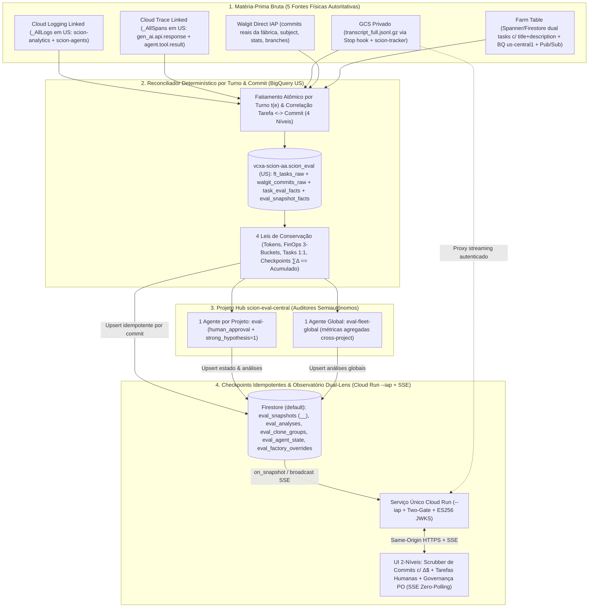

# Especificação Técnica e de Produto: `EVAL FÁBRICA` (Arquitetura v2.1)

> [!IMPORTANT]
> **Status:** Especificação Canônica v2.1 (Aprovada para Implementação) · **Ambiente de Referência:** `vcxa-scion-aa` (`tfhaa-main`, `EVAL_BQ_LOCATION=US`) + `vcxa-farmtable` (`farmtable-gcp` / Spanner `vcx-spanner`) + Walgit (`walgit/scion-aa/<slug>`) · **Escopo v2.1:** Checkpoints Imutáveis Ancorados em Commits de Produto (Zero Duplicatas de Re-Run), Ledger FinOps Dual-Lens (`Δ deste Checkpoint` + `Acumulado até aqui`, Lei 4), Semântica Humana 100% para Tarefas (Títulos, Descrições, Critérios de Aceite e Correlação de Commits) e Arquitetura de Informação em 2 Níveis (`O1–O8`).

---

## 1. Visão Geral, Diagnóstico Empírico (v1 → v2.0 → v2.1) e Princípios Arquiteturais

### 1.1 Papel do `EVAL FÁBRICA` e Fundamentos Consolidados na v2.0

O **`EVAL FÁBRICA`** transforma o `scion-eval` em um sistema fechado de **Observabilidade Analítica sobre Matéria-Prima Bruta, Time-Travel por Entregas Reais de Produto, Experimentação Paralela (`Clones de Tarefas`) e Otimização Científica Governada** para fábricas multi-agente no Scion.

A fundação v2.0 resolveu quatro problemas estruturais da v1 que permanecem **inegociáveis na v2.1**:
1. **Fim de Firebase Hosting + GCS Estático + CORS (`O1`):** Serviço único fechado no **Cloud Run protegido por Direct IAP (`--iap`)**, servindo SPA + REST + **Server-Sent Events (SSE)** na mesma origem (*same-origin*: zero Firebase Hosting, zero CORS, zero OAuth Client ID manual, zero URLs assinadas).
2. **Zero Polling no Browser (`O2`):** Hidratação inicial única via `GET /api/v2/bootstrap` seguida exclusivamente por push reativo via `GET /api/v2/stream` (`EventSource` alimentado por `on_snapshot` do Firestore `(default)` e Pub/Sub).
3. **Reconciliação sobre Matéria-Prima Bruta em `US` (`O3`):** Leitura direta das 5 fontes físicas brutas (`_AllLogs` incluindo `scion-agents`, `_AllSpans`, `transcript_full.jsonl.gz` via proxy GCS privado, commits/diffs do Walgit e eventos/snapshots cross-project de `vcxa-farmtable`) sem heurísticas sintéticas (`0.65 / 0.35` banido).
4. **Isolamento `scion-eval-central` & Gate de Hipótese Forte (`O4`, `O5`, `O6`):** 1 agente dedicado `eval-<project-slug>` por projeto em `scion-eval-central` (+ `eval-fleet-global`), operando em `governance_mode = "human_approval"` com `EVAL_REQUIRE_STRONG_HYPOTHESIS=1` (silêncio operacional `no_actionable_anomaly` quando saudável) e comunicação estritamente *chat-only* com `<project-slug>/lead` + gates `type:decision` no Farm Table.

---

### 1.2 Diagnóstico Empírico Pós-Deploy v2.0 e Motivação da Evolução v2.1

A auditoria empírica sobre o serviço v2.0 em produção (`vcxa-scion-aa`, `vcxa-farmtable`, `vcx-spanner` e Walgit `scion-aa/*`) identificou quatro lacunas semânticas e de UX que impediam um engenheiro ou Product Owner de responder *"o que foi entregue em cada commit, quanto custou este avanço específico e quais tarefas humanas o compõem?"*:

1. **Snapshots Falsos por Relógio de Parede (`12x $1.1785` Idênticos em vez de Commits Reais do Produto):**
   - No Firestore `eval_snapshots` (`vcxa-scion-aa`), existiam **21 documentos**, sendo **12 para `movr-flask`** (`1` execução pré-sync de `$0.014438` + **11 clones idênticos de `$1.178467` → `$1.1785`** criados entre `03:31Z` e `03:55Z`, todos exibindo a pílula repetida `movr-flask@379d7a38be`).
   - **Causas-raiz verificadas no código:**
     1. `raw_reconciler.py` gerava IDs baseados em `utcnow()` (`snap-YYYYMMDDTHHMMSSZ-<hash>`), criando um novo documento a cada invocação CLI/PubSub/cron mesmo com **0 commits novos e 0 tarefas novas**;
     2. A query em `walgit_commits_raw` não possuía `ORDER BY committed_at` e sobrescrevia `latest_sha` na ordem arbitrária do loop (`micronaut-microservices-poc` recebeu `8a997cd0` de `04:23Z` em vez do `HEAD` `fa5ec221` de `04:35Z`; `pingcrm` recebeu `0c274289` de `03:57Z` em vez do `HEAD` `5042e00c` de `04:36Z`);
     3. `pull_walgit_commits()` buscava `/api/commits` (`subject`, `body`, `author`, `commit_date`) e `/api/commit/<sha>` (`stats[].path`), mas descartava `commit_subject` e a lista de arquivos alterados, exibindo na UI apenas a data do reconciliador (`published_at: 2026-11-14`) em vez da data real do commit do produto (`committed_at: 2026-11-13`).
   - **Realidade física nos repositórios Walgit (`walgit/scion-aa/<slug>`):** Existem **21 commits reais produzidos pelos agentes Scion** (`movr-flask`: `1` commit `379d7a38` + fases pré/pós-commit com `7` tasks fechadas; `pingcrm`: `3` commits em `4` branches; `pitstop`: `7` commits em `5` branches; `micronaut-microservices-poc`: `10` commits em `7` branches).
2. **FinOps Estático (`$1.1785` Congelado ao Trocar de Snapshot) — Falha Dupla Backend + Frontend:**
   - **No Backend:** `raw_reconciler.py` gravava o custo acumulado da janela inteira (`7d`/`14d`) em `finops` de todos os snapshots e colapsava os `505` steps do agente `movr-flask/lead` (`03:25:04Z–04:09:35Z`, `$1.164029`) em uma única unidade de sessão, impedindo o fatiamento temporal entre checkpoints.
   - **No Frontend:** `renderHeadlineStrip()` ignorava `selectedSnapshotDocId` (somando sempre `snaps[0]`) e os seletores de snapshot nunca re-renderizavam os KPIs superiores, mantendo `$1.1785` congelado até ao clicar no snapshot de `$0.0144`.
   - **Solução v2.1:** Todo checkpoint passa a carregar **duas lentes FinOps matematicamente reconciliadas** em microdólares inteiros: **`delta_finops`** (*Custo deste Checkpoint $\Delta$*, gasto estritamente em $(T_{k-1}, T_k]$) e **`cumulative_finops`** (*Acumulado no Projeto até $T_k$*), regidas pela **Lei de Conservação 4** ($\sum_{k=1}^K \Delta_k \equiv \text{Acumulado}_K$, `drift == $0.000000`) e vinculadas dinamicamente a toda a UI.
3. **Mistério de UUIDs Crus, Perda de Descrições do Farm Table e Bug no Botão de Transcript:**
   - No Farm Table (`vcx-spanner` tabela `Tasks` e Firestore sombra `tasks` em `vcxa-farmtable`), **100% das 34 tarefas concluídas de build** possuem `Title` humano real e **33/34 possuem `Description` rica** (`80–230` caracteres, além de `AcceptanceCriteria` em `pingcrm`; apenas o épico guarda-chuva `ea941b74` de `movr-flask` tem `Description` vazia pois suas `6` subtarefas detalham o escopo).
   - **Por que desapareceram na v2.0:**
     1. `farmtable-extensions/internal/analytics/sync.go` lia `Description` e `AcceptanceCriteria` do Spanner, mas projetava apenas `BYTE_LENGTH(Description) AS description_len` em `tasks_snapshot`;
     2. A Service Account do Cloud Run (`tfhaa-operator@vcxa-scion-aa.iam.gserviceaccount.com`) não possuía `roles/datastore.viewer` em `vcxa-farmtable` para ler a coleção sombra síncrona `tasks` do modo `dual`;
     3. Todas as `21` linhas de `walgit_commits_raw` tinham `task_id = NULL` porque os workers commitaram em branches `feature/*` e `main` sem UUID na mensagem de commit;
     4. Na UI (`web/app.js`), o UUID de 36 caracteres aparecia em negrito como título principal, o fallback `refs.find(...) || refs[0]` conectava erroneamente o transcript da tarefa `2b52b74e` a todas as outras `6` tarefas sem transcript, e o gráfico de contexto plotava `7` tarefas rotuladas falsamente como `Turn 1..7`.
4. **Arquitetura de Informação Fragmentada:**
   - Faltava uma hierarquia visual clara de cima para baixo conectando o **Repositório de Produto (Commits & Entregas)** ao **Custo Incremental vs. Acumulado**, às **Tarefas Humanas Entregues** e, finalmente, às **Decisões Semiautônomas do Agente de Eval**.

---

### 1.3 Mapa Consolidado de Evolução v2.0 → v2.1

| Camada / Componente | Caminhos Alvo | Evolução Canônica na v2.1 |
|---|---|---|
| **Ingestão Farm Table & IAM Cross-Project** | - `farmtable-extensions/internal/analytics/sync.go`<br>- IAM em `vcxa-farmtable` (`custom/infra/setup-eval-fabrica.sh`)<br>- `eval_fabrica/raw_reconciler.py` (`pull_farmtable_raw`) | 1. Projetar `description`, `acceptance_criteria` e `repo` em `tasks_snapshot` (`sync.go`).<br>2. Conceder `roles/datastore.viewer` em `vcxa-farmtable` para a SA do `eval-fabrica` / operador ler diretamente a coleção sombra síncrona `tasks` (`FARMTABLE_GCP_BACKEND=dual`) + fallback via API Direct IAP do `farmtable-gcp`.<br>3. Gerar `description_excerpt` limpo (com síntese automática das subtarefas para épicos sem corpo próprio), garantindo cobertura humana `100%` (`34/34`). |
| **Commits de Produto Walgit & Checkpoints Idempotentes** | - `eval_fabrica/raw_reconciler.py` (`pull_walgit_commits`, `reconcile_window`)<br>- `custom/eval-fabrica/sql/01..05` | 1. Filtrar apenas commits da fábrica (`committed_at >= factory_epoch`, preservando `base_upstream_sha`), ordenados por `committed_at ASC, commit_sha ASC`, persistindo `commit_subject`, `commit_body`, `changed_paths` e `commit_url`.<br>2. Vincular commits às tarefas em 4 níveis (incluindo `feature/*`, merges e janela `[created_at, closed_at + 5m]` por worker).<br>3. Substituir snapshots por relógio (`snap-<ts>`) por **Checkpoints Determinísticos Endereçados por Conteúdo** (`<slug>__genesis`, `<slug>__<git_sha8>`, `<slug>__post-<head_sha8>`) e expurgar duplicatas legadas `snap-*`. |
| **Fatiamento Atômico por Turno & Dual-Lens FinOps (Lei 4)** | - `eval_fabrica/raw_reconciler.py`<br>- `scion-defaults/scripts/factory_store.py`<br>- `eval_snapshots` & `eval_snapshot_facts` | 1. Precificar cada turno/step atômico em microdólares inteiros com seu timestamp físico $t(e)$ (sem colapsar sessões longas do `lead` em um único bloco).<br>2. Particionar a linha do tempo nos intervalos disjuntos $I_k = (T_{k-1}, T_k]$ e gravar `delta_finops` e `cumulative_finops` em cada `eval_snapshot`, validando a **Lei de Conservação 4** (`drift == $0.000000`). |
| **UI 2-Níveis, Binding Dinâmico & Semântica Humana** | - `custom/eval-fabrica/web/{index.html,styles.css,app.js}`<br>- `eval_fabrica/{web_service.py,eval_agent.py,clone_orchestrator.py}` | 1. Scrubber visual de Commits com barras proporcionais de `Δ $` por commit, banner de proveniência Walgit e seletor de lente FinOps (`Δ deste Checkpoint` em destaque + `Acumulado até aqui`).<br>2. Re-render completo de KPIs, FinOps, tarefas, curva de contexto *per-turn* real e diffs ao trocar de checkpoint.<br>3. Zero UUID cru como título em tarefas, clones e análises; drawer expansível com Markdown completo + critérios de aceite + links diretos p/ Farm Table e Walgit; botão de transcript restrito a match exato de `task_id`. |
| **Oráculos Independentes de Verificação (`O1–O8`)** | - `custom/eval-fabrica/tests/oracles/verify_v2_oracles.py` | Preservar `O1–O6` intactos e adicionar **`O7`** (Idempotência de Checkpoints por Commit, Zero Duplicatas, Lei 4 `∑Δ == Acumulado` e Binding Dinâmico no DOM) e **`O8`** (100% Cobertura de Títulos/Descrições, Correlação de Commits Walgit e Zero UUID Cru / Zero Transcript Falso no DOM). |

---

### 1.4 Os Três Pilares Faseados e Papéis Estritos das 4 Camadas de Infraestrutura

| Fase | Pilar | Foco Principal | Entidades / Métricas-Chave |
|---|---|---|---|
| **Fase 1 (Escopo Ativo v2.1)** | **`TAREFA` & `ENTREGAS`** | Eficiência, custo incremental ($\Delta$) e acumulado reconciliado por commit/tarefa, semântica humana completa e experimentação governada na **`FÁBRICA`** (`Modelos`, `Templates`, `Clones`). | Checkpoints `<slug>__<sha8>`, `delta_finops` + `cumulative_finops` (`Laws 1–4`, `drift == 0.0`), `title` + `description_excerpt` + commits Walgit, curva de contexto *per-turn*, `Clones de Tarefas` A/B. |
| **Fase 2 (Extensível)** | **`PROCESSO`** | Saúde macro e fluxo organizacional da fábrica ao longo de múltiplas tarefas e sprints. | WIP vs `max_wip`, gargalos no DAG (`GetCriticalPath`, `GetBottlenecks`), tempo em fila (`ft_stage_transitions_raw`), `heartbeat_tax` agregado do `lead`. |
| **Fase 3 (Extensível)** | **`PRODUTO`** | Qualidade funcional e runtime black-box do software produzido (SUT) segundo a pirâmide `L1–L5` ([`docs/verification-and-eval.md`](file:///usr/local/google/home/vixavier/sources/scion-workspace/scion-repos/scion-defaults/docs/verification-and-eval.md)). | Probes reais (`http`, `browser` CDP, `gcp-trace`, `gcp-monitoring`, `prom-query`) correlacionados ao `git_sha` do checkpoint em `eval_snapshots`. |

| Camada | Papel na Arquitetura v2.1 | Regras Inegociáveis | Artefatos / Coleções / Tabelas |
|---|---|---|---|
| **1. Cloud Run Único (`eval-fabrica`) sob Direct IAP (`--iap`)** | **Único Front-Door Web, Push SSE & Proxy de Artefatos** | 1 único serviço multi-tenant por ambiente Scion. `allUsers` em `roles/run.invoker` + ACL estrita em `roles/iap.httpsResourceAccessor` + verificação JWT ES256 interna. Zero CORS, zero Firebase Hosting. | SPA same-origin (`/`, `/?view=snapshot`, `/?view=factory`), REST (`/api/v2/*`), SSE (`/api/v2/stream`), Proxy GCS (`/api/v2/transcripts/*`), Webhook Pub/Sub (`/api/v2/events/*`). |
| **2. Firestore `(default)` Native** | **Fonte Única da Verdade Operacional & de UI (Tempo Real)** | 100% do estado renderizado pela UI vive no Firestore. Checkpoints são idempotentes por commit (`<slug>__<sha8>`). Atualizações chegam via `on_snapshot` → SSE (zero `setInterval`). | `eval_snapshots`, `eval_analyses`, `eval_clone_groups`, `eval_agent_state`, `eval_factory_overrides` (+ `factory_agent_status`, `eval_runs`). |
| **3. GCS Privado (`gs://<project>-eval-reports`)** | **Armazenamento Frio de Blobs Brutos Pesados Imutáveis** | `uniform-bucket-level-access`, `public-access-prevention=enforced`, `cors=[]`. **Proibido** salvar índices mutáveis (`registry.json`, `analyses/index.json`) ou expor URLs do GCS ao browser. | `transcripts/<project_id>/<task_id>/<agent_id>/<incarnation_id>/transcript_full.jsonl.gz`, `diffs/<clone_group_id>/<clone_id>.patch.gz`. |
| **4. BigQuery (`EVAL_BQ_LOCATION=US`)** | **Warehouse Analítico & Reconciliação da Matéria-Prima Bruta** | Datasets Scion unificados em `US`. Toda query exige filtro temporal explícito e `maximumBytesBilled`. | `_AllLogs`, `_AllSpans`, `ft_tasks_raw`, `ft_stage_transitions_raw`, `walgit_commits_raw`, `raw_task_trajectories`, `task_agent_sessions`, `task_llm_extractions`, `task_eval_facts`, `eval_snapshot_facts`, `reconciliation_ledger`. |



---

## 2. Segurança Cloud Run Direct IAP (`--iap`), APIs Same-Origin e Arquitetura de UI em 2 Níveis

### 2.1 A Regra dos Três Portões (Cloud Run Direct IAP)

O serviço Cloud Run **`eval-fabrica`** opera 100% fechado sob Direct IAP ([`.agents/skills/cloudrun-direct-iap/SKILL.md`](file:///usr/local/google/home/vixavier/sources/scion-workspace/.agents/skills/cloudrun-direct-iap/SKILL.md)):

1. **Portão 1 — Cloud Run IAM (`roles/run.invoker`):** `allUsers` + IAP Service Agent (`service-<PROJECT_NUMBER>@gcp-sa-iap.iam.gserviceaccount.com`) vinculados a `roles/run.invoker` para permitir que o Google Frontend (GFE) inicie o fluxo OAuth do Direct IAP sem bloquear o browser com `403` prévio.
2. **Portão 2 — Cloud Run Direct IAP (`--iap` + `roles/iap.httpsResourceAccessor`):** Concedido exclusivamente a humanos autorizados (`domain:vixavier.altostrat.com`, `user:admin@vixavier.altostrat.com`) e Service Accounts autorizadas (SA do Hub/agentes, SA do reconciliador/operador e SA de push Pub/Sub). Chamadas programáticas assinam JWT via IAM `signJwt` com `aud: "https://<eval-fabrica-url>/*"`.
3. **Portão 3 — Verificação `X-Goog-IAP-JWT-Assertion` ES256 no Container (`web_service.py`):** Valida assinatura `ES256` contra `https://www.gstatic.com/iap/verify/public_key-jwk`, `iss`, `aud` (`IAP_EXPECTED_AUDIENCE`), `exp`/`iat`, separa humanos (`ALLOWED_IAP_DOMAINS` / `ALLOWED_IAP_USERS`) de Service Accounts (`AUTHORIZED_SA_EMAILS`) e aborta o processo (`sys.exit(1)`) se `K_SERVICE` estiver definido com bypass ativo.

---

### 2.2 Contrato de APIs Same-Origin e Canal SSE (Zero Polling)

| Método & Rota | Autenticação | Papel Funcional na v2.1 | Fonte de Dados Backend |
|---|---|---|---|
| `GET /` | Humano IAP | Serve a SPA v2.1 com **Arquitetura de Informação em 2 Níveis** (`/?view=snapshot` Time-Travel por Commits de Produto e `/?view=factory` Governança & Otimização da Fábrica). | Assets estáticos empacotados na imagem Docker (`web/{index.html,styles.css,app.js}`). |
| `GET /api/v2/me` | Humano / SA IAP | Retorna `{email, sub, domain, principal_type, server_time}` extraídos do JWT ES256 do IAP. | Middleware `IAPVerifier` em memória. |
| `GET /api/v2/bootstrap?project=<slug\|all>` | Humano / SA IAP | Hidratação única na abertura: retorna projetos, metadados de links externos (`walgit_base_url`, `walgit_owner`, `farmtable_base_url`), `eval_agent_state`, `eval_analyses` (enriquecidas com títulos de tarefas), `eval_clone_groups`, `eval_factory_overrides`, `eval_snapshots` (ordenados cronologicamente por `checkpoint_ts`) e `factory_agent_status`. | Leitura indexada no Firestore `(default)` Native (excluindo docs legados `snap-*`). |
| `GET /api/v2/stream?project=<slug\|all>` | Humano IAP (`EventSource`) | **Canal SSE Zero-Polling (`text/event-stream`)**: entrega mutações em tempo real (`snapshot_upserted`, `snapshot_deleted`, `analysis_upserted`, `clone_group_upserted`, `agent_state_upserted`, `override_upserted`) + `: keepalive` a cada `25s`. | Multiplexador `FirestoreMultiplexWatcher` + broadcast em memória. |
| `GET /api/v2/snapshots/<project_slug>/<snapshot_id>` | Humano / SA IAP | Retorna o documento completo do checkpoint `<project_slug>__<snapshot_id>` (`commit_provenance`, `delta_finops`, `cumulative_finops`, `tasks_breakdown`, `agents_summary`, `system_summary`, `conservation_check`). | Documento `eval_snapshots/<project_slug>__<snapshot_id>` no Firestore `(default)`. |
| `GET /api/v2/transcripts/<project_slug>/<task_id>/<agent_id>/<incarnation_id>` | Humano / SA IAP | **Streaming Proxy Seguro do GCS**: descomprime `gs://<EVAL_GCS_BUCKET>/transcripts/.../transcript_full.jsonl.gz` em stream com paginação `?format=json&offset=<step>&limit=<n>` ou download `?format=raw_gz`. | GCS Privado (`uniform-bucket-level-access`, `public-access-prevention=enforced`, `cors=[]`). |
| `POST /api/v2/analyses/<analysis_id>/decision` | Humano IAP (PO) | Aprova (`approve`) ou rejeita (`reject`) uma análise em `awaiting_approval`, gravando `governance.approved_by = iap_user.email`, atualizando o gate `type:decision` no Farm Table e notificando `eval-<project_slug>`. | Transação Firestore `eval_analyses` + Farm Table API + Hub Message API. |
| `POST /api/v2/events/farmtable` | SA IAP / PubSub Push | Recebe eventos de `projects/vcxa-farmtable/topics/farmtable-task-events`, executa reconciliação idempotente por commit/checkpoint e aciona `eval-<project_slug>`. | `raw_reconciler.py` + `eval_agent.py` + fan-out SSE. |

---

### 2.3 Arquitetura de Informação em 2 Níveis e Modelo Mental de 4 Faixas (UI v2.1)

Para eliminar qualquer ambiguidade cognitiva entre *"entregas de código/tarefas do produto"* e *"governança científica da fábrica"*, a interface v2.1 organiza a experiência em **4 Faixas Progressivas de Cima para Baixo** compartilhadas entre duas superfícies claramente rotuladas (e sem crases/markdown literal vazando no HTML):

- **Superfície 1 — `Entregas & Time-Travel por Commit` (`/?view=snapshot` · Visão Padrão ao Selecionar um Projeto):** Observatório de engenharia do produto construído pelos agentes. Responde em segundos: *Quantos commits reais foram entregues? O que mudou em cada commit? Quanto custou este commit ($\Delta$) vs. o acumulado até ele? Quais tarefas humanas foram entregues e como os agentes pensaram?*
- **Superfície 2 — `Governança & Otimização da Fábrica` (`/?view=factory` · Visão Padrão em `All Projects`):** Console operacional da frota `scion-eval-central`. Responde: *Os auditores dedicados estão saudáveis (`no_actionable_anomaly`)? Há alguma anomalia forte `S1–S5` aguardando aprovação do PO? Qual variante venceu nos Clones A/B e há algum override em observação de rollback?*

```text
┌──────────────────────────────────────────────────────────────────────────────────────────────────┐
│ FAIXA 1: Topbar + Seletor de Projeto + Overview Strip Reativo ao Contexto / Checkpoint Ativo     │
│ [Entregas & Time-Travel] [Governança da Fábrica] · Projeto: [pingcrm ▾] · SSE Live · PO IAP     │
│ ┌──────────────────────┐ ┌──────────────────────────┐ ┌─────────────────────┐ ┌────────────────┐ │
│ │ Checkpoint Ativo (Δ) │ │ Acumulado até o Commit   │ │ Entregas no Repo    │ │ Eval & Gate PO │ │
│ │ Δ $0.0068 (3 turnos) │ │ $0.0184 · Drift $0.000000│ │ Commit #3/3 · 8 tsk │ │ Saudável · 0 PO│ │
│ └──────────────────────┘ └──────────────────────────┘ └─────────────────────┘ └────────────────┘ │
├──────────────────────────────────────────────────────────────────────────────────────────────────┤
│ FAIXA 2: Scrubber Interativo de Commits Reais do Produto (com Barras Proporcionais de Δ$)        │
│ ┌──────────────────────────┐    ┌──────────────────────────┐    ┌──────────────────────────────┐ │
│ │ #1 · 0c274289 (main/feat)│───▶│ #2 · 6bbe6632            │───▶│ #3 · 5042e00c [SELECIONADO]  │ │
│ │ feat(domain,storage)...  │    │ feat(api,services)...    │    │ feat(jobs,deploy)...         │ │
│ │ [████░░░░] Δ $0.0054     │    │ [█████░░░] Δ $0.0062     │    │ [██████░░] Δ $0.0068         │ │
│ │ 13 Nov 03:57 · +3741/-0  │    │ 13 Nov 04:14 · +3060/-0  │    │ 13 Nov 04:36 · 11f +2061/-48 │ │
│ └──────────────────────────┘    └──────────────────────────┘    └──────────────────────────────┘ │
│ Proveniência: Product Repo: walgit/scion-aa/pingcrm@feature/jobs-and-serverless [Abrir Commit ↗] │
│ Autor: pingcrm-worker-3 · Commitado em: 2026-11-13T04:36:13Z · Verificado em: 2026-11-15T...Z    │
├──────────────────────────────────────────────────────────────────────────────────────────────────┤
│ FAIXA 3: FinOps Dual-Lens do Checkpoint Selecionado & Entregas de Tarefas Humanas                │
│ ┌──────────────────────────────────────────────┐ ┌─────────────────────────────────────────────┐ │
│ │ LENTE PRIMÁRIA: Custo deste Checkpoint (Δ)   │ │ LENTE SECUNDÁRIA: Acumulado até este Commit │ │
│ │ $0.0068 (Prod $0.0065 | Rew $0.00 | HB $0.0003)│ │ $0.0184 (100% do projeto até T_3 · ∑Δ OK) │ │
│ │ 3 tarefas entregues neste marco · 14 turnos  │ │ 8 tarefas concluídas acumuladas · Lei 4 PASS│ │
│ └──────────────────────────────────────────────┘ └─────────────────────────────────────────────┘ │
│ Tabela/Cards de Tarefas (Filtro: [Entregues neste Checkpoint (3)] | [Acumulado até aqui (8)]):   │
│ • Implementar Cloud Run Jobs, Worker e Manifestos Serverless   [TASK] [COMPLETED] [@worker-3]    │
│   #a1b2c3d4 · Resumo: Configura Dockerfile multi-stage, job de migração e manifesto Cloud Run... │
│   Custo: $0.0065 (Prod $0.0065 · Rew $0.0000 · HB $0.0000) · Commit: 5042e00c (+2061/-48)        │
│   [Expandir Descrição & Critérios] [Farm Table ↗] [Walgit Diff ↗] [Transcript JSONL (se existir)]│
│ + Curva Real de Contexto Por Turno (Turn 1..M em I_k) & Checks de Aderência ao Protocolo         │
├──────────────────────────────────────────────────────────────────────────────────────────────────┤
│ FAIXA 4: Resumo do Agente Semiautônomo (`eval-pingcrm`), Clones A/B & Gate de Decisão PO         │
│ Status: no_actionable_anomaly (8 tarefas inspecionadas, 0 recomendações forçadas) -> [Ver Frota] │
└──────────────────────────────────────────────────────────────────────────────────────────────────┘
```

#### Regras Obrigatórias de Binding Dinâmico e Higiene de UI (`web/app.js`)
1. **Reatividade Total na Troca de Checkpoint:** Clicar em qualquer card do Scrubber de Commits, alterar `#snapshot-select` ou acionar `Older` / `Newer` **DEVE** chamar tanto `renderHeadlineStrip()` quanto `renderSnapshotView()`, atualizando imediatamente:
   - Os cards `Custo deste Checkpoint (Δ)` (`delta_finops`) e `Acumulado até este Commit` (`cumulative_finops`);
   - O banner de proveniência do repositório Walgit (`repo_label`, `git_branch`, `git_sha8`, `commit_subject`, `commit_author`, `committed_at` separado de `last_verified_at`, `+insertions / -deletions`, `changed_paths`);
   - A lista de tarefas entregues naquele intervalo $I_k$ (com opção de alternar para todas as tarefas acumuladas até $T_k$);
   - A curva SVG de tokens de cache **por turno real** dentro do checkpoint selecionado.
2. **Proibição Absoluta de UUID Cru como Manchete Principal:** Em 100% das tabelas e cards (`#snap-tasks-tbody`, `eval_analyses`, `eval_clone_groups`), o elemento primário em destaque (`<strong>`) **DEVE** ser o `title` humano da tarefa, acompanhado do badge curto `#<task_id[:8]>` (ex.: `#c52bb746`), pílulas de `task_type` (`EPIC`, `TASK`, `BUG`, `DECISION`), `stage` (`COMPLETED`, `IN_REVIEW`, `WORKING`), `assignee`, `description_excerpt` e decomposição dos 3 buckets FinOps.
3. **Integridade Estrita do Botão de Transcript (Fim do Fallback `|| refs[0]`):** O botão `Inspect Transcript` para uma tarefa `T` **SÓ** pode ser renderizado se existir referência real em `transcript_refs` cujo `task_id == T.task_id`. Quando não houver transcript individual da tarefa no GCS (ex.: tarefas rastreadas via `_AllSpans`/`_AllLogs` ou sessões agregadas do `lead`), a célula exibe explicitamente `Telemetria Spans/Logs` (e, se houver transcript de sessão do `lead` no projeto, oferece link secundário claramente identificado como `Session Transcript (@lead)`, jamais fingindo ser o transcript isolado daquela tarefa).

---

## 3. Checkpoints Ancorados em Commits Reais, Matéria-Prima Bruta & As 4 Leis de Conservação

### 3.1 Definição de Engenharia: O Que É um `eval_snapshot` na v2.1

Em termos de engenharia de software, um documento em `eval_snapshots` **NÃO é um log de execução do job reconciliador**. Um `eval_snapshot` é um **Marco Imutável de Entrega do Produto (*Product Deliverable Checkpoint*)**, endereçado deterministicamente pelo estado do repositório de código no Walgit e das tarefas entregues no Farm Table.

Para cada projeto monitorado `<project_slug>`, o reconciliador constrói a sequência ordenada cronologicamente de checkpoints $C_1, C_2, \dots, C_K$ ($T_1 < T_2 < \dots < T_K$) usando **exatamente três tipos determinísticos (`checkpoint_kind`)**:

| `checkpoint_kind` | Quando Existe | `snapshot_id` Determinístico | ID do Documento em `eval_snapshots` | Timestamp de Fronteira $T_k$ (`checkpoint_ts`) |
|---|---|---|---|---|
| **`"genesis"`** *(Pré-Commit / Planejamento Inicial)* | Criado **somente se** existirem tarefas concluídas ou turnos reais de agentes estritamente anteriores ao primeiro commit Scion do projeto ($t < \text{committed\_at}(C_{\text{commit},1})$), ou enquanto o projeto tiver atividade/tarefas mas `0` commits Scion no Walgit. | `genesis` | **`<project_slug>__genesis`** *(ex.: `movr-flask__genesis`)* | Timestamp da última tarefa fechada antes do 1º commit (ex.: `2026-11-13T03:37:06Z` da task `#c52bb746` em `movr-flask`), ou do último turno pré-commit. |
| **`"commit"`** *(Commit Real no Repositório do Produto)* | **1 checkpoint para cada commit real da fábrica** no repositório Walgit `walgit/scion-aa/<project_slug>` (`committed_at >= factory_epoch`, excluindo histórico upstream pré-existente do template base como `bd00b3e8`), ordenado por `committed_at ASC, commit_sha ASC`. | `<git_sha8>` *(primeiros 8 hex do SHA-1/SHA-256 do commit)* | **`<project_slug>__<git_sha8>`** *(ex.: `movr-flask__379d7a38`, `pingcrm__0c274289`, `pingcrm__6bbe6632`, `pingcrm__5042e00c`)* | $\max\big(\text{committed\_at}(C), \max_{\tau \in \text{grace}(C)} \text{closed\_at}(\tau)\big)$, onde $\text{grace}(C) = [\text{committed\_at}, \min(\text{committed\_at} + 60\text{s}, T_{\text{next}}))$, absorvendo o `ft task close` disparado logo após `git push` (ex.: `#acc95814` fechada `+10s` após `379d7a38`). |
| **`"post_commit"`** *(Verificação / Fechamento Pós-Commit)* | Criado **somente se** existirem tarefas concluídas no Farm Table (ex.: QA E2E, revisão final, fechamento de épico) ou turnos produtivos de agentes **após** a fronteira do último commit $C_{\text{last}}$ ($t > T_{\text{commit,last}}$). Se um novo commit $C_{\text{new}}$ chegar depois, `post-<old_sha8>` é absorvido por `<project_slug>__<new_sha8>` e removido. | `post-<head_sha8>` | **`<project_slug>__post-<head_sha8>`** *(ex.: `movr-flask__post-379d7a38`)* | Timestamp do último fechamento de tarefa ou turno pós-commit (ex.: `2026-11-13T04:09:35Z` para as 5 tasks de verificação/épico de `movr-flask`). |

#### Garantias Estritas de Idempotência e Limpeza de Duplicatas Legadas
1. **Zero Dependência de `utcnow()` no ID:** Como `snapshot_id` é puramente função do commit/marco (`genesis`, `<git_sha8>`, `post-<head_sha8>`), executar `scion-eval reconcile` $10$ vezes seguidas sem novos commits ou tarefas realiza **upsert in-place** nos mesmos $K$ documentos (atualizando apenas `last_verified_at` e `reconciliation_id`), gerando **zero snapshots duplicados**.
2. **Filtro de Época da Fábrica (`factory_epoch`):** `pull_walgit_commits()` calcula `factory_epoch = MIN(ft_tasks.created_at) - INTERVAL 30 MINUTE` (com fallback para o primeiro span/log do projeto no Hub) para distinguir commits realizados pelos agentes Scion da história upstream herdada do repositório base clonado (registrando o SHA pai do primeiro commit Scion como `base_upstream_sha`).
3. **Expurgo Automático de Legado `snap-*`:** Ao reconciliar um projeto `<slug>`, `raw_reconciler.py` remove do Firestore quaisquer documentos obsoletos cujo ID case com `^<slug>__snap-\d{8}T\d{6}Z-` (e qualquer `post-<old_sha8>` superado por novo commit), emitindo evento SSE `snapshot_deleted` quando aplicável.

---

### 3.2 As 5 Fontes Brutas Autoritativas, Enriquecimento Farm Table & Correlação Tarefa ↔ Commit

| # | Fonte Física Bruta | Localização Exata | Extração v2.1 (Sem Perda Semântica) | Destino em `vcxa-scion-aa.scion_eval` (`US`) |
|---|---|---|---|---|
| **1** | **Cloud Logging `_AllLogs`** | `vcxa-scion-aa.scion_logs_linked._AllLogs` (`US`) | Eventos por turno em `scion-analytics` e `scion-agents` / `scion_hub` preservando `event_ts`, `session_id`, `trace_id`, tokens, `reported_cost_micros` e `NO_TOOL_CALL`. | Reconciliação atômica *per-turn* em `US` (`timestamp BETWEEN @w_start AND @w_end`). |
| **2** | **Cloud Trace `_AllSpans`** | `vcxa-scion-aa.scion_trace_linked._AllSpans` (`US`) | Spans individuais `gen_ai.api.response/<model>` (`span_id`, `start_time`, tokens `input`/`output`/`cache`, modelo, latência) e `agent.tool.result/<tool>` (erros consecutivos). | Reconciliação atômica *per-turn* em `US` (`start_time BETWEEN @w_start AND @w_end`). |
| **3** | **Transcripts Brutos (`.jsonl.gz`)** | `gs://vcxa-scion-aa-eval-reports/transcripts/...` → `raw_task_trajectories` (`US`) | Steps individuais com **`step_ts` preservado por step** (nunca colapsados num único bloco de sessão!), `step_index`, `input_tokens`, `output_tokens`, `cache_read_tokens`, `tool_names`, `tool_errors_count`. | Steps em `raw_task_trajectories` (`US`) + curva *per-turn* por checkpoint. |
| **4** | **Walgit Commits & Diffs** | `https://<walgit-url>/scion-aa/<slug>` (Direct IAP `signJwt` + `X-Walgit-Authorization`) | De `/{owner}/{slug}/api/refs/branches`, `/api/commits` e `/api/commit/{sha}`: `commit_sha`, `parent_shas`, `branch`, `commit_subject`, `commit_body`, `author_agent`, `author_email`, `committed_at`, `files_changed`, `insertions`, `deletions`, `rewritten_files_count` e `changed_paths` (`stats[].path`). | Upsert ordenado em `scion_eval.walgit_commits_raw` (`US`). |
| **5** | **Farm Table Tasks & Transições Completas** | 1) Firestore sombra `vcxa-farmtable` coleção `tasks` (`roles/datastore.viewer`) / API Direct IAP `farmtable-gcp`<br>2) `vcxa-farmtable.farmtable_analytics.{tasks_snapshot, stage_transitions_fact}` (`us-central1`) | **`title`**, **`description` completa**, **`acceptance_criteria`**, `task_type`, `phase`, `stage`, `priority`, `assignee_id` (resolvido via `users_dim`), `parent_task_id`, `branch`, `repo`, `ci_status`, `labels`, `remote_data_json` e transições regressivas. | Upsert completo em `scion_eval.{ft_tasks_raw, ft_stage_transitions_raw}` (`US`). |

#### Algoritmo Determinístico de Correlação Commit ↔ Tarefa (4 Níveis)
Para eliminar `task_id = NULL` em `walgit_commits_raw` quando agentes usam branches `feature/*` ou commitam direto em `main`:
1. **Nível C1 (Referência Explícita):** Branch no formato `task/<task_id>(/clone-<k>)?` **ou** presença do `task_id` / prefixo `#<task_id[:8]>` / trailer `Task-Id:` em `commit_subject` + `commit_body`.
2. **Nível C2 (Match de Feature Branch / Merge Commit):** `commit.branch != 'main'` igual a `ft_tasks_raw.branch` do mesmo `project_slug` (ou commit de merge em `main` cujo `commit_subject` referencia `integrate <ft_tasks_raw.branch>` / `Merge branch '<ft_tasks_raw.branch>'`).
3. **Nível C3 (Identidade do Worker + Janela Ativa da Tarefa):** Match normalizado entre `commit.author_agent` (ex.: `pingcrm-worker-1`, `Scion Agent (worker-dev)`, `worker-3`) e `ft_tasks_raw.assignee_id` / `stage_transitions.actor_id` com `committed_at` contido em `[entered_working_at, COALESCE(closed_at, window_end) + 5m]` (ou `[created_at, closed_at + 5m]`).
4. **Nível C4 (Tarefa Única de Implementação Ativa na Janela):** Se o commit em `main` ocorrer durante a janela `[created_at, closed_at + 5m]` de uma tarefa `task`/`bug` ativa no projeto, vincula-se à tarefa mais próxima pelo fechamento imediatamente subsequente ao commit (ex.: `379d7a38` às `04:03:11Z` → `#acc95814` fechada às `04:03:21Z`), propagando o rollup de commits para o `parent_task_id` (`epic`) correspondente.

#### Síntese Determinística de `description_excerpt` (100% de Cobertura Humana)
- Para toda tarefa com `description` não-vazia: remove cabeçalhos Markdown redundantes e cercas de código, produzindo um resumo limpo de até `220` caracteres (`description_excerpt`), preservando o Markdown integral em `description` e `acceptance_criteria`.
- Para tarefas `task_type = 'epic'` cujo corpo `description` esteja vazio no Farm Table mas possuam subtarefas filhas (`parent_task_id == epic.task_id`, como o épico `#ea941b74` em `movr-flask`): sintetiza automaticamente `description_excerpt` listando a contagem e os títulos das subtarefas filhas concluídas (`"Épico guarda-chuva (6 subtarefas): Planejamento Serverless GCP; Camada Spanner/Firestore; API HTTP Go..."`).

---

### 3.3 Fatiamento Atômico por Turno e Partição Física Dual-Lens (`delta_finops` + `cumulative_finops`)

Na v2.1, a unidade atômica de reconciliação $e$ **é o turno / chamada de modelo individual** (identificado por `(project_slug, agent_id, session_id, turn_key)` onde `turn_key` separa cada span `gen_ai.api.response`, evento `agent.usage` ou step `PLANNER_RESPONSE` de `raw_task_trajectories` com seu timestamp físico exato $t(e)$), **jamais** colapsando uma sessão inteira de 45 minutos em um único registro:

1. **Custo Físico Inteiro em Microdólares ($m(e) \in \mathbb{Z}_{\ge 0}$):**
   Cada unidade atômica $e$ reconcilia seus tokens sem duplicação (`Law 1`) e recebe `cost_micros(e) = round(cost_usd(e) * 1_000_000)`, classificado nos 3 buckets físicos:
   - `hb_micros(e) = cost_micros(e)` se $e$ for acordada ociosa de Nível 4 (`NO_TOOL_CALL` sem tarefa ativa e sem tool calls);
   - `rework_micros(e) = cost_micros(e)` se $e$ estiver vinculada a uma tarefa `task_id` após regressão de estágio (`in_review → working`), em loop de erro de ferramenta (`tool_errors >= 2` / falha consecutiva) ou churn pós-falha de CI;
   - `prod_micros(e) = cost_micros(e)` nos demais turnos produtivos vinculados à tarefa.
2. **Alocação por Checkpoint $k \in \{1, \dots, K\}$ nos Intervalos Disjuntos $I_k$:**
   Dados os checkpoints ordenados $C_1, \dots, C_K$ do projeto com fronteiras $T_1 < T_2 < \dots < T_K$:
   - Define-se $I_1 = (-\infty, T_1]$, $I_k = (T_{k-1}, T_k]$ para $2 \le k < K$, e $I_K = (T_{K-1}, +\infty)$ (dentro da janela reconciliada $[W_{\text{start}}, W_{\text{end}}]$, absorvendo eventuais acordadas ociosas posteriores a $T_K$).
   - Todo evento atômico $e$ pertence a **exatamente um** intervalo $I_k$ ($t(e) \in I_k$).
   - Para cada checkpoint $k$ e cada bucket $b \in \{\text{prod}, \text{rework}, \text{hb}\}$:
     $$\Delta M_b(k) = \sum_{e:\, t(e) \in I_k} m_b(e), \qquad \Delta M_{\text{total}}(k) = \Delta M_{\text{prod}}(k) + \Delta M_{\text{rework}}(k) + \Delta M_{\text{hb}}(k)$$
     $$CM_b(k) = \sum_{j=1}^{k} \Delta M_b(j), \qquad CM_{\text{total}}(k) = CM_{\text{prod}}(k) + CM_{\text{rework}}(k) + CM_{\text{hb}}(k)$$
   - Os valores exportados em `delta_finops` e `cumulative_finops` são convertidos exatamente de microdólares inteiros (`round(micros / 1_000_000, 6)`), preservando aritmética exata de centavos/microdólares.
   - As acordadas ociosas de Nível 4 ocorridas em $I_k$ também são distribuídas via `divmod` inteiro sobre as tarefas ativas/concluídas para `task_eval_facts` (mantendo `Law 2` por tarefa), enquanto permanecem visíveis em `delta_finops.heartbeat_tax_usd`.

---

### 3.4 As 4 Leis de Conservação Obrigatórias na v2.1

Todo ciclo de reconciliação valida as **4 Leis de Conservação** e grava o resultado em `scion_eval.reconciliation_ledger` e `eval_snapshots.conservation_check`. Se qualquer lei falhar, `conservation_passed = FALSE` e o reconciliador levanta exceção explícita:

1. **Lei 1 — Conservação e Deduplicação de Tokens Brutos:**
   Para cada turno/sessão reconciliada, $\text{Tokens}_{\text{reconciliados}} = \max(\text{Tokens}_{\text{\_AllSpans}}, \text{Tokens}_{\text{\_AllLogs}}, \text{Tokens}_{\text{transcript}})$, sem dupla contagem entre fontes e nunca resultando em `0` tokens quando houver span `gen_ai.api.response`.
2. **Lei 2 — Conservação FinOps Exata por Tarefa e Projeto (`conservation_drift_usd == 0.0`):**
   - Por tarefa: `ROUND(total_cost_usd - (productive_cost_usd + rework_cost_usd + heartbeat_tax_usd), 6) == 0.000000`.
   - Por projeto: `ABS(raw_genai_cost_usd - reconciled_total_cost_usd) <= 0.000001`.
3. **Lei 3 — Conservação de Cardinalidade 1:1 de Tarefas Concluídas:**
   Toda tarefa de build com `phase = 'CLOSED'` ou `stage = 'completed'` em `ft_tasks_raw` produz exatamente `1` linha em `scion_eval.task_eval_facts` (`ft_closed_tasks_count == materialized_tasks_count`, nunca `rows_inspected = 0` quando há tarefas fechadas).
4. **Lei 4 *(Nova na v2.1)* — Conservação Temporal Aditiva entre Checkpoints (`checkpoint_drift_usd == 0.0`):**
   Para todo projeto com $K \ge 1$ checkpoints ordenados $k = 1 \dots K$:
   - **Intra-Checkpoint ($\forall k$):** `ROUND(delta_finops[k].total_cost_usd - (delta_finops[k].productive_cost_usd + delta_finops[k].rework_cost_usd + delta_finops[k].heartbeat_tax_usd), 6) == 0.000000` (e analogamente para `cumulative_finops[k]`).
   - **Aditividade Passo-a-Passo ($\forall k$):** $\sum_{j=1}^{k} \text{delta\_finops}[j].b \equiv \text{cumulative\_finops}[k].b$ (`<= $0.000001`) para todo bucket $b \in \{\text{total}, \text{productive}, \text{rework}, \text{heartbeat}\}$.
   - **Fechamento Global do Projeto ($k = K$):**
     $$\sum_{k=1}^{K} \text{delta\_finops}[k].\text{total\_cost\_usd} \equiv \text{cumulative\_finops}[K].\text{total\_cost\_usd} \equiv \text{reconciliation\_ledger.reconciled\_total\_cost\_usd}$$
     com `checkpoint_conservation_drift_usd == 0.000000`.

---

### 3.5 Schema BigQuery v2.1 em `vcxa-scion-aa.scion_eval` (`location = 'US'`)

O DDL canônico (`custom/eval-fabrica/sql/01_linked_datasets_and_tables.sql`, aplicado idempotentemente com `CREATE TABLE IF NOT EXISTS` + `ALTER TABLE ... ADD COLUMN IF NOT EXISTS` para tabelas já criadas na v2.0) estende as tabelas espelho e fatos analíticos com semântica humana completa e métricas `delta`/`cumulative`:

```sql
CREATE TABLE IF NOT EXISTS `${PROJECT_ID}.${EVAL_DATASET}.ft_tasks_raw` (
  task_id STRING NOT NULL,
  collection_id STRING NOT NULL,
  project_slug STRING NOT NULL,
  parent_task_id STRING,
  title STRING,
  description STRING,                    -- v2.1: Markdown completo da tarefa no Farm Table
  description_excerpt STRING,            -- v2.1: Resumo limpo <= 220 chars (100% preenchido, incl. épicos)
  acceptance_criteria STRING,            -- v2.1: Critérios de aceite do Farm Table
  task_type STRING,                      -- epic | task | bug | decision
  phase STRING,
  stage STRING,
  priority STRING,
  assignee_id STRING,                    -- Display name resolvido (ex: worker-dev, pingcrm-worker-1)
  repo STRING,
  branch STRING,
  ci_status STRING,
  labels ARRAY<STRING>,
  remote_data_json STRING,
  created_at TIMESTAMP,
  updated_at TIMESTAMP NOT NULL,
  closed_at TIMESTAMP,
  synced_at TIMESTAMP NOT NULL
)
PARTITION BY DATE(updated_at)
CLUSTER BY project_slug, task_id;

CREATE TABLE IF NOT EXISTS `${PROJECT_ID}.${EVAL_DATASET}.walgit_commits_raw` (
  commit_sha STRING NOT NULL,
  project_slug STRING NOT NULL,
  branch STRING NOT NULL,
  parent_shas ARRAY<STRING>,             -- v2.1: SHAs pais (rastreia merges e base upstream)
  commit_subject STRING,                 -- v2.1: Mensagem curta humana do commit
  commit_body STRING,                    -- v2.1: Corpo da mensagem de commit
  task_id STRING,                        -- v2.1: Correlacionado via matcher determinístico C1..C4
  clone_group_id STRING,
  clone_id STRING,
  author_agent STRING,
  author_email STRING,
  files_changed INT64,
  insertions INT64,
  deletions INT64,
  rewritten_files_count INT64,
  changed_paths ARRAY<STRING>,           -- v2.1: Lista de arquivos alterados no commit (até 100)
  commit_url STRING,                     -- v2.1: Deep-link https://<walgit>/scion-aa/<slug>/commit/<sha>
  committed_at TIMESTAMP NOT NULL,
  synced_at TIMESTAMP NOT NULL
)
PARTITION BY DATE(committed_at)
CLUSTER BY project_slug, task_id;

CREATE TABLE IF NOT EXISTS `${PROJECT_ID}.${EVAL_DATASET}.task_eval_facts` (
  fact_id STRING NOT NULL,               -- <project_id>:<task_id>:<clone_id_or_primary>
  project_id STRING NOT NULL,
  task_id STRING NOT NULL,
  short_id STRING,                       -- v2.1: #<task_id[:8]> (ex: #2b52b74e)
  parent_task_id STRING,
  title STRING,                          -- v2.1: Título humano da tarefa (nunca UUID cru)
  description_excerpt STRING,            -- v2.1: Resumo humano conciso
  task_type STRING,                      -- v2.1: epic | task | bug | decision
  priority STRING,
  assignee STRING,
  branch STRING,
  checkpoint_id STRING,                  -- v2.1: snapshot_id do checkpoint em que a tarefa foi entregue
  commit_shas ARRAY<STRING>,             -- v2.1: Commits Walgit correlacionados à tarefa
  commits_count INT64,
  files_changed INT64,
  insertions INT64,
  deletions INT64,
  clone_group_id STRING,
  clone_id STRING,
  template_name STRING,
  template_hash STRING,
  model STRING,
  thinking_level STRING,
  harness STRING,
  agent_role STRING,
  stack STRING,
  task_category STRING,
  complexity_tier STRING,
  total_cost_usd FLOAT64 NOT NULL,
  productive_cost_usd FLOAT64 NOT NULL,
  rework_cost_usd FLOAT64 NOT NULL,
  heartbeat_tax_usd FLOAT64 NOT NULL,
  conservation_drift_usd FLOAT64 NOT NULL,
  eval_experiment_cost_usd FLOAT64,
  input_tokens INT64,
  output_tokens INT64,
  cache_read_tokens INT64,
  cache_bloat_slope FLOAT64,
  lead_time_minutes FLOAT64,
  rework_cycles INT64,
  tool_calls_count INT64,
  tool_errors_count INT64,
  stage_thrash_count INT64,
  final_stage STRING,
  ci_passed BOOL,
  rework_root_cause STRING,
  semantic_thrashing_detected BOOL,
  anti_patterns ARRAY<STRING>,
  agents_md_adherence_score FLOAT64,
  handoff_quality_score FLOAT64,
  analysis_id STRING,
  eval_run_id STRING,
  task_closed_at TIMESTAMP,
  materialized_at TIMESTAMP NOT NULL
)
PARTITION BY DATE(materialized_at)
CLUSTER BY project_id, task_id, clone_group_id;

CREATE TABLE IF NOT EXISTS `${PROJECT_ID}.${EVAL_DATASET}.eval_snapshot_facts` (
  snapshot_id STRING NOT NULL,           -- genesis | <git_sha8> | post-<head_sha8>
  project_slug STRING NOT NULL,
  checkpoint_index INT64,                -- 1..K ordem cronológica no projeto
  checkpoint_kind STRING,                -- genesis | commit | post_commit
  git_sha STRING,
  git_branch STRING,
  commit_subject STRING,
  committed_at TIMESTAMP,
  files_changed INT64,
  insertions INT64,
  deletions INT64,
  delta_total_cost_usd FLOAT64,          -- v2.1: Gasto incremental estrito em (T_{k-1}, T_k]
  delta_productive_cost_usd FLOAT64,
  delta_rework_cost_usd FLOAT64,
  delta_heartbeat_tax_usd FLOAT64,
  delta_turns_count INT64,
  delta_tasks_completed_count INT64,
  total_cost_usd FLOAT64,                -- Acumulado até T_k (cumulative_finops.total_cost_usd)
  productive_cost_usd FLOAT64,
  rework_cost_usd FLOAT64,
  heartbeat_tax_usd FLOAT64,
  conservation_drift_usd FLOAT64,
  compliance_score_pct FLOAT64,
  mutation_score_pct FLOAT64,
  system_verdict STRING,
  published_at TIMESTAMP NOT NULL
)
PARTITION BY DATE(published_at)
CLUSTER BY project_slug, snapshot_id;
```

**Guardrails Inegociáveis de Query no BigQuery (Mantidos 100%):**
1. `EVAL_BQ_LOCATION=US` padrão para todos os datasets em `vcxa-scion-aa` (`FARMTABLE_BQ_LOCATION=us-central1` isolado no conector de leitura de `vcxa-farmtable.farmtable_analytics`).
2. `validate_time_windowed_sql(sql)` bloqueia em tempo de execução qualquer `SELECT` sobre tabelas particionadas/linkadas sem filtro temporal explícito.
3. `maximumBytesBilled` positivo obrigatório (`default = 2 GiB`) em 100% dos jobs BigQuery.

---

## 4. Contrato Operacional e de UI no Firestore `(default)` Native (`eval_*` v2.1)

Todas as visões e eventos SSE operam sobre as **5 coleções `eval_*`** no Firestore `(default)` Native ([`scripts/factory_store.py`](file:///usr/local/google/home/vixavier/sources/scion-workspace/scion-repos/scion-defaults/scripts/factory_store.py)):

| Coleção Firestore | ID Determinístico do Documento | Papel na Arquitetura v2.1 | Campos Obrigatórios e Extensões v2.1 |
|---|---|---|---|
| **`eval_snapshots`** | **`<project_slug>__<snapshot_id>`** onde `snapshot_id` $\in$ `{genesis, <git_sha8>, post-<head_sha8>}` *(proibido `snap-<wallclock>`)* | **Marco Imutável de Entrega do Produto (Time-Travel Idempotente)**: 1 doc por commit real no Walgit (+ `genesis` pré-commit e `post-<sha8>` pós-commit quando houver trabalho real nessas janelas). | - **Identidade & Ordem:** `snapshot_id`, `project_slug`, `checkpoint_index` (`1..K`), `checkpoint_kind` (`"genesis"` \| `"commit"` \| `"post_commit"`), `checkpoint_ts` ($T_k$ ISO-8601), `window_start_ts` ($T_{k-1}$), `window_end_ts` ($T_k$), `reconciliation_id`, `published_at`, `last_verified_at`.<br>- **`commit_provenance`:** `{repo_label: "walgit/scion-aa/<slug>", repo_url, commit_url, git_sha, git_sha8, base_upstream_sha, git_branch, commit_subject, commit_body, commit_author, committed_at, evaluated_at, files_changed, insertions, deletions, rewritten_files_count, changed_paths: [], tasks_delivered_count, tasks_delivered_ids: []}`.<br>- **`delta_finops` *(Lente Primária)*:** `{total_cost_usd, productive_cost_usd, rework_cost_usd, heartbeat_tax_usd, unassigned_heartbeat_tax_usd, conservation_drift_usd, input_tokens, output_tokens, cache_read_tokens, turns_count, tasks_completed_count}`.<br>- **`cumulative_finops` *(Lente Secundária)*:** `{total_cost_usd, productive_cost_usd, rework_cost_usd, heartbeat_tax_usd, unassigned_heartbeat_tax_usd, conservation_drift_usd, pct_of_project_total, input_tokens, output_tokens, cache_read_tokens, turns_count, tasks_completed_count}` (+ `finops` espelhando `cumulative_finops` p/ retrocompatibilidade).<br>- **`tasks_breakdown`:** lista rica de tarefas com `{task_id, short_id: "#2b52b74e", title, description, description_excerpt, acceptance_criteria, task_type, stage, priority, labels, assignee, parent_task_id, parent_title, delivered_in_checkpoint: bool, checkpoint_id, total_cost_usd, productive_cost_usd, rework_cost_usd, heartbeat_tax_usd, input_tokens, output_tokens, cache_read_tokens, tool_calls_count, tool_errors_count, lead_time_minutes, ci_passed, rework_root_cause, commits: [{sha, sha8, subject, branch, committed_at, files_changed, insertions, deletions, commit_url}], farmtable_url, walgit_branch_url, transcript_proxy_url}` *(com `transcript_proxy_url` preenchido **somente** em match exato de `task_id`!)*.<br>- **`agents_summary`:** `{context_curve: [{turn: 1..M, step_ts, agent_id, task_short_id, input_tokens, cache_read_tokens, output_tokens}], cache_bloat_slope, thrashing_incidents, protocol_compliance, no_tool_call_wakeups, session_transcript_refs}`.<br>- **`conservation_check`:** `{passed, law1_token_dedup_passed, law2_finops_zero_drift_passed, law3_task_cardinality_passed, law4_checkpoint_sum_passed, checkpoint_conservation_drift_usd}`.<br>- **`system_summary`** & **`transcript_refs`**. |
| **`eval_agent_state`** | `<project_slug>` + `fleet-global` | Estado vivo, política de orçamento, cursores e último veredito do agente `eval-<project-slug>`. | `project_slug`, `hub_project_id` (`"scion-eval-central"`), `hub_agent_name`, `governance_mode` (`"human_approval"`), `require_strong_hypothesis` (`true`), `enabled`, `policy`, `last_evaluation` (`{at, status: "no_actionable_anomaly" \| "hypothesis_opened", rows_inspected, checkpoints_count, reconciliation_id}`), `cursors`, `spend`, `cooldown_until`, `updated_at`. |
| **`eval_analyses`** | `<analysis_id>` | Objeto científico de 1ª classe aberto **apenas** quando os limiares `S1–S5` disparam. | Todos os campos v2.0 (`level`, `project_slug`, `eval_agent_name`, `status`, `bq_evidence`, `hypothesis`, `experiment`, `results`, `governance`, `lead_communications`, `action_log`) + **`tasks_context`** (`[{task_id, short_id, title, description_excerpt, stage, task_type, total_cost_usd, rework_cost_usd, commit_shas}]`) para exibição 100% legível por humanos sem UUIDs crus. |
| **`eval_clone_groups`** | `<clone_group_id>` | Rastreia variantes paralelas A/B (`Clones de Tarefas`) sobre o mesmo `base_commit_sha` no Walgit. | `clone_group_id`, `project_slug`, `source_task_id`, **`source_task_short_id`**, **`source_task_title`**, **`source_task_excerpt`**, `base_commit_sha`, `base_commit_url`, `triggered_by`, `analysis_id`, `isolation_mode`, `decision_task_id`, `variants` (`[{clone_id, ft_task_id, short_id, branch, walgit_branch_url, commit_sha, commit_url, agent_id, model, thinking_level_int, template, status, cost_usd, productive_cost_usd, rework_cost_usd, duration_s, ci_passed, transcript_proxy_path}]`), `winner_clone_id`, `merged_commit_sha`, `created_at`, `closed_at`. |
| **`eval_factory_overrides`** | `<override_id>` | Snapshot auditável e reversível de mutações Runtime API (`T0–TX`) com auto-rollback. | `override_id`, `analysis_id`, `project_slug`, `hub_project_id`, `target_scope`, `api_endpoint`, `target_id`, `mechanism`, `previous_state`, `applied_state`, `status`, `rollback_after_tasks`, `tasks_observed_since_apply`, `applied_at`, `resolved_at`. |

---

## 5. Topologia `scion-eval-central`, Hipótese Forte (`S1–S5`) e Execução Governada

Todas as garantias de governança multi-agente introduzidas na v2.0 permanecem estritamente ativas na v2.1:

1. **1 Agente Dedicado por Projeto em `scion-eval-central` (`O5`):**
   - `eval-movr-flask`, `eval-pingcrm`, `eval-pitstop`, `eval-micronaut-microservices-poc` (`EVAL_LEVEL=1`, isolados em `project_id = '<slug>'`) + `eval-fleet-global` (`EVAL_LEVEL=2`, agregados anônimos com `distinct_projects >= 2`).
   - Zero agente `eval-auditor` genérico legado e zero agentes `eval-*` dentro dos projetos de build.
2. **Protocolo Semiautônomo (`human_approval`) & Chat-Only com `<slug>/lead`:**
   - `eval-<slug>` **nunca** comita código no repositório do produto nem envia mensagens diretas a workers; comunica-se exclusivamente via `scion message <slug>/lead` e issues `type:decision` (`status:po-decision`, `hold:waiting_for_input`, `eval-finding`) na coleção `<slug>` do Farm Table, referenciando títulos humanos + `#<short_id>` e commits Walgit relevantes.
3. **Gate Quantitativo Estrito de Hipótese Forte (`EVAL_REQUIRE_STRONG_HYPOTHESIS=1`, `O4`):**
   - Projetos saudáveis encerram imediatamente em `status = "no_actionable_anomaly"` (`0` docs em `eval_analyses`, `0` issues no Farm Table, `0` mensagens ao `lead`).
   - Abertura de hipótese exige `conservation_passed == TRUE` (Leis 1–4) **e** disparo comprovado de `S1` (`rework_pct >= 20%` c/ causa verificada ou `stage_thrash >= 2`), `S2` (`ci_pass_rate < 80%`), `S3` (`avg_cache_bloat_slope > 1200` tok/turn $\ge 35\%$ custo), `S4` (`heartbeat_tax_pct >= 25%` em $\ge 10$ acordadas ociosas) ou `S5` (`>= 5` erros repetidos na mesma ferramenta).
4. **Clones Pareados e Mutações Reversíveis (`clone_orchestrator.py` & `T0–TX`):**
   - `thinking_level` serializado obrigatoriamente como `int` (`25`/`50`/`100`), branches `task/<id>/clone-<k>` no Walgit sob Direct IAP e mutações pós-aprovação salvas em `eval_factory_overrides` com janela de auto-rollback (`10` tarefas / regressão `> 20%`).

---

## 6. Oráculos Independentes de Verificação (`Verification Oracles` O1–O8)

A aceitação da Arquitetura v2.1 em `vcxa-scion-aa` é governada por **8 Oráculos Automatizados Independentes** (`custom/eval-fabrica/tests/oracles/verify_v2_oracles.py`), executados ao vivo contra GCP (`vcxa-scion-aa` + `vcxa-farmtable` + `tfhaa-main` + Walgit + Cloud Run Direct IAP) com **zero mocks** e veredito binário (`PASS` / `FAIL`):

| Oráculo | O que Prova | Procedimento Automatizado Independente (Sem Mocks) | Critério Binário de Aceite (`PASS`) |
|---|---|---|---|
| **O1: Fechamento Direct IAP & Fim do Firebase/CORS** | Serviço Cloud Run único 100% fechado sob Direct IAP (`--iap`) Two-Gate + ES256 e eliminação total de Firebase/CORS. | Testa `GET /` e `/api/v2/*` sem credencial, com `print-identity-token`, com SA não-autorizada e com `signJwt` autorizado; audita metadados de `gs://vcxa-scion-aa-eval-reports` e bundle web. | Sem credencial → `302`/`401`; OIDC comum → `401`; SA não autorizada → `403`; SA/PO autorizados → `200 OK` validado via JWKS ES256; bucket GCS com `public_access_prevention: enforced`, `cors: []` e zero referências a `*.web.app` / `storage.googleapis.com` / `firebasestorage.googleapis.com`. |
| **O2: Prova Estática e Dinâmica de Zero Polling (SSE)** | UI não faz polling e reflete mutações do Firestore em tempo real via SSE. | Scan estático por `setInterval` no JS; captura `60s` de rede ociosa em Headless Chromium após `/api/v2/bootstrap`; injeta documento `eval_analyses` no Firestore e mede latência até o DOM. | `0` `setInterval` de rede; `0` fetches/XHR extras em `60s` ociosos com `1` `EventSource` ativo (`text/event-stream`); mutação renderizada no DOM em `< 3.0s` via SSE. |
| **O3: Leis de Conservação 1–3 sobre Matéria-Prima Bruta (`US`)** | Ingestão parte das 5 fontes brutas em `US` sem constantes sintéticas e respeita as Leis 1–3. | Executa `raw_reconciler` contra `vcxa-scion-aa` (`US`) + `vcxa-farmtable`; inspeciona `ft_tasks_raw`, `task_eval_facts` e `reconciliation_ledger`; testa bloqueio de SQL sem filtro temporal. | `>= 34` tasks concluídas batem `1:1` com `task_eval_facts`; `MAX(ABS(drift)) == 0.0` e `conservation_passed == TRUE`; zero constante `0.65`; query sem filtro temporal levanta `ValueError` com `0` bytes faturados. |
| **O4: Limiar Estrito de Hipótese Forte (`S1–S5`)** | Agente nunca força recomendações em projetos saudáveis e exige sinal forte antes de abrir análise/gate. | Executa ciclo saudável vs. ciclo com anomalia física acima do limiar `S1–S5` em `human_approval`. | Saudável retorna `no_actionable_anomaly` (`0` análises, `0` FT issues, `0` chats); anômalo cria `1` análise `awaiting_approval` + `1` gate `type:decision` sem mutar o Hub antes da aprovação. |
| **O5: Isolamento `scion-eval-central` & Chat-Only** | 1 agente `eval-<slug>` por projeto em `scion-eval-central`, zero `eval-auditor` legado e comunicação restrita ao `lead` + `ft`. | Audita projetos/agentes em `tfhaa-main`, `eval_agent_state`, destinatários de `scion message` e commits no Walgit. | `scion-eval-central` contém exatamente os agentes dedicados + `eval-fleet-global` (zero `eval-auditor`); projetos de build têm `0` agentes/commits `eval-*`; 100% dos chats vão para `<slug>/lead`. |
| **O6: Fluxo Vivo Ponta-a-Ponta (E2E Live Flow)** | Circuito completo funciona do evento `vcxa-farmtable` até reconciliação, SSE e streaming seguro de transcript GCS. | Envia transcript `.jsonl.gz` real e evento `farmtable-task-events` → verifica reconciliação, entrega SSE e leitura via `GET /api/v2/transcripts/...`. | Reconciliação em `< 60s`, proxy de transcript retorna `200 OK` com JSONL válido via IAP e evento chega via SSE ao cliente conectado. |
| **O7 *(Novo v2.1)*: Checkpoints por Commit Sem Duplicatas, Lei 4 (`∑Δ == Acumulado`) & Binding Dinâmico de UI** | Snapshots são marcos reais de entrega ancorados em commits Walgit (idempotentes em re-runs), conservam `delta_finops` + `cumulative_finops` (`Law 4`) e atualizam toda a UI ao trocar de commit. | 1. Executa `reconcile_window` **duas vezes consecutivas** contra `vcxa-scion-aa` + Walgit + `vcxa-farmtable`.<br>2. Audita todos os docs de `eval_snapshots` no Firestore e commits reais no Walgit (`movr-flask`, `pingcrm`, `pitstop`, `micronaut-microservices-poc`).<br>3. Verifica matematicamente a **Lei 4** sobre `delta_finops` e `cumulative_finops` para cada projeto.<br>4. Abre a UI em Headless Chromium (Playwright/CDP) em projetos multi-checkpoint (ex.: `movr-flask` e `pingcrm`), clica sequencialmente nos checkpoints `#1`, `#2`, `#3` do Scrubber e lê do DOM os valores de `Δ deste Checkpoint`, `Acumulado até este Commit`, `commit_subject`, `git_sha8`, `committed_at` e lista de tarefas. | 1. **Zero duplicatas legadas ou de re-run:** `0` docs com prefixo `snap-2026...` existem em `eval_snapshots`; o número de snapshots por projeto após o 2º run é **idêntico** ao 1º run (`count_run2 == count_run1`), com todos os commits Scion reais representados e ordenados por `committed_at` (`pingcrm >= 3`, `pitstop >= 7`, `micronaut-microservices-poc >= 10`, `movr-flask == 3` marcos distintos: `genesis`, `379d7a38`, `post-379d7a38`).<br>2. **Lei 4 exata:** Para 100% dos projetos e checkpoints, `ABS(sum(delta_finops[1..k]) - cumulative_finops[k]) <= $0.000001` e `ABS(cumulative_finops[K].total_cost_usd - reconciled_total_cost_usd) <= $0.000001` (`law4_checkpoint_sum_passed == TRUE`).<br>3. **DOM Dinâmico Real:** Clicar entre checkpoints altera dinamicamente no DOM o valor `Δ $`, o valor `Acumulado $`, o assunto/SHA/data do commit Walgit e as tarefas exibidas (nunca congelado em um único total estático como `$1.1785`). |
| **O8 *(Novo v2.1)*: 100% Semântica Humana de Tarefas, Correlação de Commits & Integridade DOM** | Todas as tarefas exibem título humano, resumo de descrição, metadados Farm Table e commits Walgit correlacionados, com zero UUID cru como título e zero link falso de transcript. | 1. Consulta `scion_eval.{ft_tasks_raw, walgit_commits_raw, task_eval_facts}` (`US`) e `eval_snapshots.tasks_breakdown` no Firestore.<br>2. Verifica cobertura de `title`, `description_excerpt` e `task_id` nos `21+` commits Walgit.<br>3. Audita o DOM renderizado em Headless Chromium nas visões `Entregas & Time-Travel` (`movr-flask`, `pingcrm`, `pitstop`, `micronaut-microservices-poc`) e `Governança da Fábrica` (incluindo clique de expansão de detalhes da tarefa e inspeção dos botões de transcript e curva SVG). | 1. **100% Cobertura Semântica (`34/34` tasks):** `0` tarefas com `title` vazio ou igual a UUID; `100%` (`34/34`) possuem `description_excerpt` humano não-vazio (`>= 20` chars, com `33/34` descrições brutas vindas do Farm Table e épicos sintetizados).<br>2. **Correlação Commit ↔ Tarefa:** `walgit_commits_raw` contém os `>= 21` commits Scion com `commit_subject` não-vazio e `>= 90%` (`>= 19/21`) vinculados a um `task_id` real.<br>3. **Integridade DOM & Transcript:** `0` linhas de tarefa/clone/análise usam UUID de 36 chars como título primário; 100% das linhas de tarefa exibem `title` + `description_excerpt` + pílula `stage`/`task_type` + `#<short_id>` + 3 buckets FinOps + deep-links Farm Table/Walgit; o botão `Inspect Transcript` aparece **estritamente** nas tarefas com `.jsonl.gz` real próprio no GCS (ex.: `#2b52b74e` tem botão, `#c52bb746` **não** herda o transcript de `#2b52b74e`); e a curva SVG de contexto plota turnos reais (zero tarefas disfarçadas de `Turn 1..7` e zero crases literais no cabeçalho). |

---

## 7. Plano de Implementação e Migração v2.0 → v2.1 em `vcxa-scion-aa` (Workstreams W1–W5)

| Workstream | Escopo Técnico Detalhado | Arquivos / Recursos Alvo | Critério de Pronto (DoD) |
|---|---|---|---|
| **W1: Hidratação Completa Farm Table (`description` + IAM) & Walgit Commits (`C1–C4`)** | 1. Atualizar `farmtable-extensions/internal/analytics/sync.go` para projetar `description`, `acceptance_criteria` e `repo` em `tasks_snapshot`.<br>2. Conceder `roles/datastore.viewer` no projeto `vcxa-farmtable` para `tfhaa-operator@vcxa-scion-aa.iam.gserviceaccount.com` (e `eval-fabrica-sa` se aplicável) em `setup-eval-fabrica.sh`, permitindo que `pull_farmtable_raw()` hidrate imediatamente `title`, `description` e `acceptance_criteria` da coleção sombra `tasks` (`dual`) + fallback API Direct IAP.<br>3. Estender `sql/01..05` (`ALTER TABLE ... ADD COLUMN IF NOT EXISTS`) e `pull_walgit_commits()` com `factory_epoch`, ordenação `committed_at ASC`, captura de `commit_subject`, `commit_body`, `changed_paths`, `commit_url` e matcher `C1–C4` Commit ↔ Tarefa. | `farmtable-extensions/internal/analytics/sync.go`, `scion-extensions/custom/eval-fabrica/sql/*.sql`, `custom/eval-fabrica/eval_fabrica/raw_reconciler.py`, `custom/infra/setup-eval-fabrica.sh`. | `ft_tasks_raw` com `34/34` títulos + resumos (`33/34` descrições brutas + síntese de épico) e `walgit_commits_raw` com `>= 90%` dos `21` commits vinculados a `task_id` e `commit_subject` populado. |
| **W2: Fatiamento Atômico por Turno, Checkpoints Idempotentes & Lei de Conservação 4** | 1. Refatorar `raw_reconciler.py` para preservar unidades atômicas por turno/step com `step_ts` / `start_time` (eliminando o colapso dos `505` steps do `lead` em um único bloco).<br>2. Gerar os checkpoints determinísticos (`<slug>__genesis`, `<slug>__<git_sha8>`, `<slug>__post-<head_sha8>`), calcular `delta_finops` e `cumulative_finops` em microdólares inteiros, validar a **Lei 4**, popular `tasks_breakdown` e `context_curve` *per-turn* real e expurgar todos os docs legados `snap-YYYYMMDD*` do Firestore.<br>3. Atualizar `scion-defaults/scripts/factory_store.py` para validar e ordenar `eval_snapshots` v2.1 por `checkpoint_ts`. | `scion-extensions/custom/eval-fabrica/eval_fabrica/raw_reconciler.py`, `scion-defaults/scripts/factory_store.py`. | Re-executar `reconcile_window` 2x produz zero novos snapshots, zero docs `snap-*` no Firestore e `law4_checkpoint_sum_passed == TRUE` (`drift == $0.000000`) nos 4 projetos. |
| **W3: Backend `web_service.py`, `eval_agent.py` & `clone_orchestrator.py` v2.1** | 1. Em `web_service.py`: expor metadados de deep-link (`walgit_base_url`, `farmtable_base_url`) em `/api/v2/bootstrap`, ordenar `eval_snapshots` cronologicamente (`checkpoint_index` / `checkpoint_ts`), filtrar eventuais `snap-*` residuais e emitir `snapshot_deleted` quando aplicável.<br>2. Em `eval_agent.py` e `clone_orchestrator.py`: enriquecer `eval_analyses.tasks_context` e `eval_clone_groups` com `title`, `short_id` e `description_excerpt`. | `scion-extensions/custom/eval-fabrica/eval_fabrica/{web_service.py,eval_agent.py,clone_orchestrator.py}`. | APIs `/api/v2/bootstrap` e `/api/v2/snapshots/<slug>/<id>` entregando payloads v2.1 completos sob Direct IAP + SSE. |
| **W4: Redesign da UI em 2 Níveis (`web/index.html`, `styles.css`, `app.js`)** | Implementar as 4 Faixas da UI v2.1: remover crases literais do header; construir o **Scrubber Visual de Commits com barras `Δ $`** e banner de proveniência Walgit; painel **Dual-Lens FinOps (`Δ deste Checkpoint` vs `Acumulado até aqui`)** com re-render dinâmico total ao trocar de commit; tabela/drawer de tarefas humanas (`title` primário, `#<short_id>`, `description_excerpt`, Markdown expansível, deep-links Farm Table & Walgit, fix estrito do botão de transcript sem `|| refs[0]`) e curva SVG *per-turn* real. | `scion-extensions/custom/eval-fabrica/web/{index.html,styles.css,app.js}`. | Zero UUID cru como título, zero `$1.1785` congelado ao navegar entre checkpoints e inspeção visual limpa em `1440x900` (Daylight e Carbon). |
| **W5: Deploy em Produção (`vcxa-scion-aa`) & Suite de Oráculos `O1–O8`** | Build e deploy da imagem atualizada no serviço Cloud Run `eval-fabrica` (`--iap`), reconciliação completa dos 4 projetos (`movr-flask`, `pingcrm`, `pitstop`, `micronaut-microservices-poc`), atualização de `verify_v2_oracles.py` com **`O7`** e **`O8`** e execução integral sem mocks de **`O1–O8`**. | `scion-extensions/custom/eval-fabrica/tests/oracles/verify_v2_oracles.py`, deploy Cloud Run `eval-fabrica` em `vcxa-scion-aa`. | Todos os **8 Oráculos (`O1–O8`)** retornando `PASS` simultaneamente contra a infraestrutura viva, com screenshots antes/depois verificados. |
