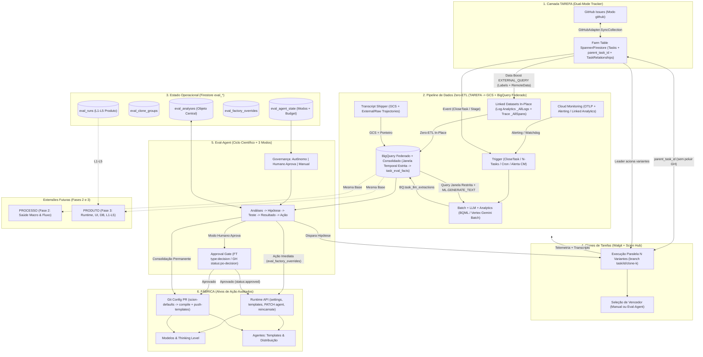
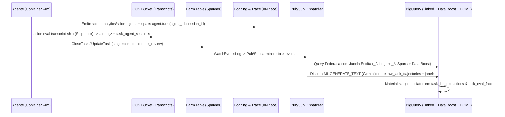
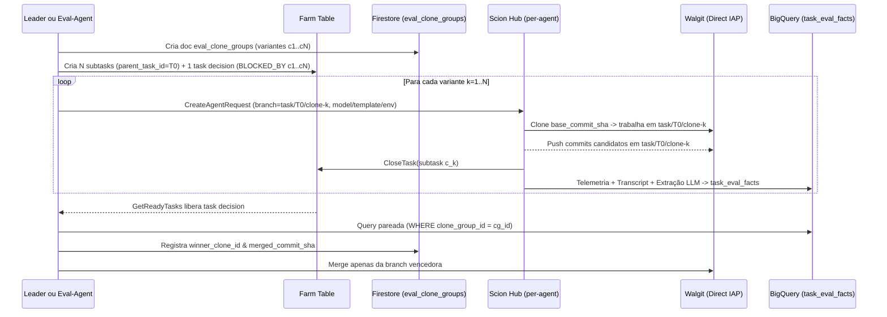
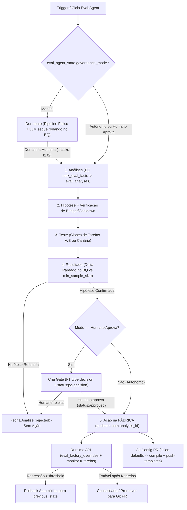

# Especificação Técnica e de Produto: `EVAL FÁBRICA`

> [!NOTE]
> **Status:** Rascunho para Revisão Técnica · **Escopo Primário:** Fase 1 (`TAREFA` + `FÁBRICA` + `Análises` + `Eval-Agent` + `Clones de Tarefas`) · **Fases Subsequentes Mapeadas:** Fase 2 (`PROCESSO`) e Fase 3 (`PRODUTO`).

---

## 1. Visão Geral, Propósito e Escopo Faseado

### 1.1 Contexto e Evolução do `scion-eval`
Conforme definido em [`scion-repos/scion-extensions/custom/eval-kit/PRODUCT.md`](file:///usr/local/google/home/vixavier/sources/scion-workspace/scion-repos/scion-extensions/custom/eval-kit/PRODUCT.md), o `scion-eval` foi concebido como um framework sem servidor de observabilidade e avaliação em três lentes (`trajectories`, `agents`, `system`) com publicação de snapshots estáticos imutáveis em GCS/Firebase Hosting.

Entretanto, a auditoria atual da base de código revela que a operação de avaliação ainda é **passiva, desconectada por tarefa e majoritariamente sintética**:
- Os coletores principais de `scion-eval` (`run_collect_trajectories`, `run_collect_agents`, `run_system_evaluation`) operam sobre fixtures hardcoded;
- Não há foreign key de tarefa (`task_id`) na telemetria de runtime (`telemetrycontract.Envelope`), impossibilitando atribuição de custo e retrabalho por unidade de trabalho em SQL;
- Os `transcript.jsonl` / `transcript_full.jsonl` residem apenas localmente nos containers efêmeros (`--rm`) dos agentes;
- Não existe um motor de experimentação controlada (`Clones de Tarefas`) nem um ciclo científico fechado (`Eval-Agent`) capaz de formular hipóteses no BigQuery e agir sobre modelos, templates e distribuição da fábrica.

O **`EVAL FÁBRICA`** transforma o `scion-eval` em um sistema fechado de **Observabilidade Analítica, Experimentação Paralela e Auto-Otimização Governada** para fábricas Scion.

### 1.2 Os Três Pilares de Avaliação (Escopo Faseado)

A arquitetura organiza o ecossistema sob o pilar central **`EVAL FÁBRICA`**, utilizando uma **única fundação de dados (BigQuery + GCS + Firestore)** para suportar três dimensões evolutivas:

| Fase | Pilar | Foco Principal | Entidades / Métricas-Chave | Relação com a Base Atual |
|---|---|---|---|---|
| **Fase 1 (Esta Spec)** | **`TAREFA`** | Eficiência, qualidade e custo na execução de cada tarefa individual (`TAREFA`) e suas subtarefas/clones, atuando na **`FÁBRICA`** (`Modelos`, `Agentes -> Templates & Distribuição`). | `task_id`, `parent_task_id`, `clone_group_id`, FinOps 3-buckets (`productive`, `rework`, `heartbeat_tax`), thrashing, aderência a `AGENTS.md`, comparações A/B pareadas. | Evolui `trajectories` + `agents` (`eval-kit`), `telemetrycontract`, `farmtable-analytics` e `factory_store.py`. |
| **Fase 2 (Extensível)** | **`PROCESSO`** | Saúde macro e dinâmica organizacional da fábrica ao longo de múltiplas tarefas, sprints e releases. | WIP médio vs `max_wip`, gargalos no DAG (`GetCriticalPath`, `GetBottlenecks`), tempo em fila por estágio (`stage_transitions_fact`), `activity_buckets_5m`, taxa de heartbeat ocioso (`heartbeat_tax` agregado), eficiência de coordenação do `lead`. | Consome diretamente `farmtable_analytics` + `BQ.task_eval_facts` + `factory_agent_status` sem alterar schemas da Fase 1. |
| **Fase 3 (Extensível)** | **`PRODUTO`** | Qualidade funcional e desempenho em runtime do software produzido pela fábrica (SUT), correlacionando decisões de fábrica com impacto no produto final. | Latência HTTP/gRPC, renderização UI (`browser` CDP), desempenho de queries/DB, zero-PII traces (`gcp-trace`), e conformidade da pirâmide de 5 camadas (`L1–L5`) em [`docs/verification-and-eval.md`](file:///usr/local/google/home/vixavier/sources/scion-workspace/scion-repos/scion-defaults/docs/verification-and-eval.md). | Conecta `eval_runs` (Firestore), `system.schema.json` e probes reais do `scion-eval` (`http`, `browser`, `gcp-trace`, `gcp-monitoring`, `prom-query`) via `commit_sha` / `task_id` no BQ. |

### 1.3 Inventário de Realidade Atual: Funcional vs. Stub vs. Lacuna

| Camada | Funcional Hoje (Verificado) | Stub / Parcial Hoje | Lacuna Crítica a Construir |
|---|---|---|---|
| **Telemetria Runtime (`scion-extensions`)** | `pkg/telemetrycontract` (`Envelope` v1, `agent.lifecycle`, `agent.usage`, `telemetry.health`) gravando JSON estruturado no Cloud Logging `AnalyticsLogID = "scion-analytics"`; OTLP Cloud Monitoring (`gen_ai.api.calls`, `scion.usage.tokens`, `agent.session.count`); Cloud Trace via `/home/scion/.scion/trace-state.json`. | `usage_analytics.go` lê apenas campos allowlisted (correto para privacidade, mas sem contexto de tarefa); `Envelope` e spans trazem `agent_id`, `incarnation_id`, `session_id` e `trace_id`, mas sem `task_id`. | 1. Habilitar **BigQuery Linked Datasets** (Log Analytics `_AllLogs` / Trace `_AllSpans`) em `deploy/terraform/` ou `custom/infra/post-install-observability-iam.sh`.<br>2. Registrar o vínculo `(task_id, clone_id, template) ↔ (agent_id, incarnation_id, session_id, janela)` em `BQ.task_agent_sessions` via `custom/` para JOIN sem alterar Go upstream. |
| **Transcripts dos Agentes** | Gerados localmente nos containers (Antigravity `/home/scion/.gemini/antigravity-cli/brain/<id>/.system_generated/logs/transcript_full.jsonl`, Claude `~/.claude/projects/.../<session>.jsonl`); `agent-home` tem bind mount no Docker ou `gcp.SyncToGCS` sob demanda em volumes GCS, mas `assistant-reply` foi aposentado e `sciontool` ignora `transcriptPath`. | `pkg/sciontool/` não lê nem envia transcripts; `SyncToGCS` não é estruturado por tarefa nem roda por turno. | **Perda no encerramento (`--rm`) / Spot preemption**: falta **`scion-eval transcript-ship`** em `custom/` (disparado no hook `Stop`/`session.idle` + `scion-tracker`) para GCS + `BQ.raw_task_trajectories`. |
| **Tracker & Spanner → BQ (`farmtable-extensions`)** | `Tasks`, `TaskRelationships`, `Changes`, `Comments`, `WatchEventsLog` (Spanner) / `watch_events` (Firestore); `internal/analytics/sync.go` sincroniza Spanner → `farmtable_analytics` via Data Boost (`ft-spanner-conn`). | `WebhookEvent` e `EventType` definidos em `proto/farmtable.proto:165-181,469-485`, mas sem dispatcher de saída nem receiver de webhooks GitHub. `WithDisableWatch(true)` desabilita gRPC `WatchTasks` no Cloud Run sem `?live=1`. | 1. `tasks_snapshot` em `sync.go` **omite `Labels` e `RemoteData`**.<br>2. Falta emissor de eventos (Pub/Sub / Eventarc) em `CloseTask` e transições de estágio para acionar sync + análise LLM. |
| **Eval Kit (`custom/eval-kit`)** | Schemas JSON validados (`trajectories`, `agents`, `system`, `manifest`, `registry`), `scion-eval validate`, `publish` (GCS/Firebase), `probe http`, `probe gcp-logs`, `probe repo`. | `run_collect_trajectories()` ignora `--input-jsonl`/`--workspace` e gera steps hardcoded por `sha256(project_slug)` (`attribute_turn()` sem uso); `run_collect_agents()` roda `git log -n 5 -p` real só para `ANTI_GAMING_PATTERNS`, mas profiles/thrashing/patches são hardcoded; `gcp-trace`, `gcp-monitoring`, `prom-query`, `browser` e `run_system_evaluation()` são stubs. | Substituir stubs por leitores reais de BQ + GCS transcripts + git; adicionar loader de snapshots para BQ; implementar extração implícita via LLM no ecossistema BQ. |
| **Control Plane (`scion-defaults` + Hub)** | Firestore (`factory_agent_status`, `eval_runs`, `factory_control_state`, `factory_fleet`, `factory_fleet_snapshots`) via `factory_store.py`; Hub APIs (`CreateAgentRequest`, `PATCH /api/v1/agents/{id}`, `reincarnate`, `PUT /api/v1/projects/{id}/settings`); Walgit + `git-wrapper.sh`. | `docs/specs/factory-orchestration-v2-design.md` (draft) especifica clones `per-agent`; prompts atuais de `scion-defaults` não invocam `ft` / `scion-tracker` diretamente e restringem fechamento de issue ao PO. | Faltam coleções `eval_*` no Firestore (`eval_analyses`, `eval_clone_groups`, `eval_agent_state`, `eval_factory_overrides`), orquestrador de `Clones de Tarefas`, e o `Eval-Agent` com modos de governança e guardrails. |

### 1.4 Estratégia de Estado (3 Camadas), Princípio "Peças de Lego" & Framework Anexo Serverless

Para preservar a simplicidade operacional e o custo ocioso zero do `eval-kit` original, o **`EVAL FÁBRICA`** adota três princípios arquiteturais inegociáveis:

1. **Zero Cloud Run por Projeto (Framework Anexo Único Serverless):**
   - Não há deploy de servidor/painel Cloud Run dedicado por projeto. Toda a camada de avaliação (App Shell estático no GCS/Firebase Hosting, coleções Firestore `eval_*`, dataset BigQuery e funções/triggers event-driven) forma um **framework anexo único ao Scion**, provisionado uma única vez e compartilhado *cross-project* (com isolamento lógico multi-tenant por `project_id` / `project_slug` / `org_id`).
2. **Arquitetura de Estado em 3 Camadas (GCS + Firestore + BigQuery):**
   - **Por que GCS sozinho não basta:** Objetos no GCS são excelentes para artefatos finais imutáveis e Time Travel, mas não oferecem transações atômicas nem consultas indexadas para estado operacional vivo (concorrência entre clones, locks de orçamento, cursores do `Eval-Agent`, queries por `status`/`hypothesis`/`task_id`, ou índice de variantes em andamento).
   - **Fluxo de Referência Firestore → GCS:** O Firestore armazena todo estado vivo/mutável e **sempre grava links canônicos (`report_url`, `snapshot_url`, `diff_url`) apontando para os documentos JSON/HTML imutáveis publicados no GCS**.
   - **Dashboard Único Estendido & ACL Configurável por Domínio:** O mesmo App Shell estático único em GCS/Firebase Hosting (`shell/{index.html,styles.css,app.js}` descrito em `PRODUCT.md`) continua servindo Time Travel de snapshots (`?project=<slug>&snapshot=<id>`) e ganha a rota **`?view=factory&analysis=<id>`** para renderizar **Análises da Fábrica**, hipóteses e comparações de clones lendo os JSONs consolidados no GCS (e/ou Firestore client-side via Firebase Auth). **Atenção à ACL:** hoje `custom/eval-kit/firebase/{auth-config.json,firestore.rules,storage.rules}` restringe o domínio exclusivamente a `@google.com`; a spec exige tornar a lista de domínios permitidos parametrizável por organização/ambiente (incluindo explicitamente **`@vixavier.altostrat.com`**, ex: `allowed_domains: ["vixavier.altostrat.com", "google.com"]` e regex equivalente nas Rules, bloqueando acesso anônimo e self-signup).

| Camada | Papel no `EVAL FÁBRICA` | Características & Escopo | Exemplos de Artefatos / Tabelas |
|---|---|---|---|
| **GCS (+ Firebase Hosting)** | **Artefatos Imutáveis, Transcripts & App Shell Estático** | Custo quase zero, versionamento/Time Travel via URL, leitura direta pelo App Shell único (`?project=...&snapshot=...` e `?view=factory&analysis=...`). | `shell/{index.html,styles.css,app.js}`, `registry.json`, `projects/<slug>/manifest.json`, `snapshots/<id>/{trajectories,agents,system}.json`, `analyses/<analysis_id>/report.json`, `transcripts/.../transcript_full.jsonl.gz`. |
| **Firestore (`eval_*`)** | **Estado Operacional Vivo & Metadados Serverless** | Transacional, serverless (zero custo ocioso), queries indexadas por status/projeto/tarefa, controle de concorrência, cursores e **links (`report_url`, `snapshot_url`, `diff_url`) para o GCS**. | `eval_analyses`, `eval_clone_groups`, `eval_agent_state`, `eval_factory_overrides`, `eval_runs`, `factory_agent_status`, `factory_control_state`, `factory_fleet`. |
| **BigQuery** | **Warehouse Analítico Cross-Factory** | Append-oriented, particionado, joins em escala entre tracker (`farmtable_analytics`), telemetria (`scion_telemetry`) e inferência LLM nativa (`ML.GENERATE_TEXT`). | `tasks_snapshot`, `changes_fact`, `raw_task_trajectories`, `task_llm_extractions`, `task_eval_facts`, `eval_snapshot_facts`. |

3. **Princípio "Peças de Lego" (Agentes Previsíveis, Ferramentas Compositáveis):**
   - Os agentes da fábrica (`lead`, `backend`, `frontend`, `reviewer`, `eval-lead`, `Eval-Agent`) permanecem **genéricos, previsíveis e guiados por contratos fixos** (`_shared/agents.md` e templates enxutos).
   - Toda a variabilidade específica de cada projeto/SUT (como coletar logs, qual endpoint HTTP/browser testar, como publicar no GCS ou atualizar o Firestore) fica isolada em **pequenas ferramentas CLI composáveis ("peças de Lego")** dentro de `custom/` — `scion-eval` (incluindo `scion-eval transcript-ship`), `factory_store.py`, `scion-tracker` e probes (`http`, `gcp-logs`, `gcp-trace`, `browser`, `repo`), mantendo **zero alteração intrusiva no código Go upstream de `cmd/sciontool/`** para preservar rebases limpos em `scion-extensions`.

### 1.5 Decisão Arquitetural (ADR): Fim do Projeto-Irmão `<project>-eval` 1:1 Obrigatório & `Eval-Agent` Externo Efêmero

No desenho original de [`PRODUCT.md`](file:///usr/local/google/home/vixavier/sources/scion-workspace/scion-repos/scion-extensions/custom/eval-kit/PRODUCT.md), cada projeto `<project>` exigia um projeto-irmão pareado `<project>-eval` (`scion-eval pair`). Em escala de dezenas ou centenas de projetos heterogêneos (ex.: 53 empresas de segmentos distintos como varejo, supermercado, passagens aéreas, vinhos e educação modernizadas em paralelo), manter pares 1:1 permanentes dobra o número de projetos no Scion Hub e gera *heartbeat tax* ocioso; por outro lado, manter **1 único `Eval-Agent` conversacional** olhando todos os projetos juntos contaminaria contextos de negócio distintos e criaria gargalo.

A especificação adota o modelo intermediário **Multi-Tenant nos Dados + Execução Externa Efêmera em 2 Níveis**:

1. **Nos projetos de build (os N projetos no Hub):** vivem **apenas** os agentes de produção (`lead`, `backend`, `frontend`, `reviewer`) e os **`Clones de Tarefas`** (que escrevem código no repositório daquela empresa). **Zero** `Eval-Agent` permanente dentro do time do projeto (evitando conflito de interesse/*anti-gaming*, auto-mutação de settings e poluição de `factory_agent_status`).
2. **No Plano Anexo Central de Eval (fora dos N projetos):** os dados (BigQuery, Firestore `eval_*`, GCS App Shell) são compartilhados e particionados por `project_id`/`org_id`, enquanto o **`Eval-Agent` executa como worker externo efêmero** (Cloud Run Job ou container `--rm` em um runner administrativo `scion-eval-control`), acionado por fila Pub/Sub com paralelismo controlado (`max_concurrency`), atuando de fora para dentro via **Scion Hub API + Farm Table API + Git PR**.
3. **Legado `<project>-eval` (Fase 3 `PRODUTO` opcional):** o pareamento 1:1 (`scion-eval pair`) é aposentado para **Fase 1 (`TAREFA`)** e **Fase 2 (`PROCESSO`)**. Na **Fase 3 (`PRODUTO`)**, testes *black-box* por empresa rodam via runner efêmero `eval-verifier` lendo o `system-eval-plan.yaml` do próprio projeto (ou projeto-irmão opcional apenas em sistemas críticos que exijam isolamento estrito de rede/segredos).

### 1.6 Diagrama de Arquitetura Geral (`EVAL FÁBRICA`)



---

## 2. Definição de `TAREFA` (Dual-Mode Tracker)

### 2.1 Os Dois Modos Operacionais (`scion-tracker`)
A entidade **`TAREFA`** representa a unidade raiz de demanda e atribuição de valor na fábrica. Conforme implementado em `scion-repos/scion-extensions/custom/antigravity/scion-tracker` (`detect_tracker_mode()`), existem dois modos suportados de ponta a ponta:

1. **Modo `github` (Dual-Plane):**
   - Ativado quando o projeto possui remote GitHub e CLI `gh` funcional.
   - **Plano Macro (PO):** GitHub Issues representam a demanda original pedida pelo usuário/PO (`remote_id: owner/repo#N`).
   - **Plano Micro (Agentes):** `GitHubAdapter.SyncCollection` (`internal/platform/github/github.go`) espelha a issue como um registro `Task` no Farm Table (`open` → `PhaseOpen`/`StageAccepted`; `closed` → `PhaseClosed`/`StageCompleted`) e `syncSubIssueLinks` sincroniza `ParentTaskId` ↔ GitHub GraphQL `subIssues` (profundidade máxima `≤ 8`). Subtarefas operacionais e clones ficam exclusivamente no Farm Table para evitar poluição no GitHub.
2. **Modo `farmtable` (Unificado, ex. Walgit / Git Local):**
   - Ativado automaticamente para repositórios Walgit/locais ou explicitamente via `SCION_TRACKER_MODE=farmtable` / `SCION_DISABLE_GITHUB_TRACKER=1`.
   - O Farm Table (`ft` CLI e gRPC/MCP) assume **ambos** os planos Macro e Micro utilizando labels compartilhadas (`status:po-decision`, `status:po-review`, `status:approved`, `status:verified`, `digest`, `eval-finding`, `factory:<slug>`). A **`TAREFA`** do usuário é o item-pai (`ParentTaskId = NULL`) criado diretamente na `Collection` (1:1 com projeto/repositório).

### 2.2 Modelo de Dados e Transições (`farmtable-extensions`)
A tabela `Tasks` no Spanner (`internal/gcpbackend/spanner/ddl.go`) e seu contrato protobuf (`proto/farmtable.proto`) já fornecem a estrutura relacional necessária:
- **Identidade e Contexto:** `TaskId` (UUID), `CollectionId`, `Title`, `Description`, `AcceptanceCriteria`, `Type` (`epic`, `story`, `task`, `bug`, `subtask`, `decision`, `digest`), `Priority`, `Labels` (`ARRAY<STRING(256)>`), `AssigneeId`, `Repo`, `Branch`, `CiStatus`, `PullRequests` (JSON), `RemoteData` (JSON), `Version` (optimistic locking CAS).
- **Hierarquia & DAG:** `ParentTaskId` (indexado por `IDX_Tasks_Collection_Parent`, exposto via MCP `task_create`/`task_update`/`task_list` em `internal/mcp/server.go`) e `TaskRelationships` (`BLOCKS`, `BLOCKED_BY`, `RELATED`, `DUPLICATE`) que alimentam `GetReadyTasks`, `GetBlockedTasks`, `GetDependencyTree`, `GetCriticalPath` e `GetBottlenecks`.
- **Ciclo de Vida em 3 Camadas (`internal/server/transitions.go`):**
  - `TaskPhase`: `OPEN`, `IN_PROGRESS`, `ON_HOLD`, `CLOSED`.
  - `TaskStage`: `triage` → `accepted` → `working` → `in_review` → `in_qa` → `deploying` → terminais (`completed`, `wont_fix`, `duplicate`, `cancelled`).
  - `TaskHoldReason`: `waiting_for_input`, `deferred`.
  - **RBAC:** sair de `triage`/reabrir exige `ScopeTaskAccept`; `ClaimTask` exige `ScopeTaskClaim`; `working` → handoff exige `ScopeTaskWrite`; `CloseTask` exige `ScopeTaskClose`.

> [!IMPORTANT]
> **Fronteira de Fechamento em `scion-defaults`:** Hoje, `_render_human_on_the_loop` em `scion_factory.py` determina que *"only the PO closes the issue"*, e os prompts de `scion-defaults` não invocam `ft` nem `scion-tracker` diretamente. Na Fase 1 do `EVAL FÁBRICA`, **subtarefas técnicas e clones** devem ser fechados via `CloseTask` no Farm Table pelo `lead`/`deployer` assim que verificados (`status:verified`), enquanto a **tarefa-pai** (item Macro do usuário) continua respeitando o fechamento pelo PO (ou transição para `in_review` / `status:po-review` como gatilho alternativo configurável de análise).

### 2.3 Convenção de Atribuição via `Labels` e `RemoteData` (Sem Alterar DDL do Spanner)
Para vincular tarefas, clones e análises sem exigir migração imediata de schema no Spanner:
- **Em `Labels` (`ARRAY<STRING(256)>`):**
  - `clone-group:<clone_group_id>`
  - `clone:<clone_id>` e `clone-role:control|treatment`
  - `eval-analysis:<analysis_id>`
  - `model:<model_slug>` e `template:<template_name>`
- **Em `RemoteData` (JSON):**
  ```json
  {
    "eval_fabrica": {
      "base_commit_sha": "a1b2c3d4...",
      "clone_group_id": "cg-20261111-01",
      "clone_id": "c2",
      "analysis_id": "an-20261111-04",
      "applied_template": "backend-v2",
      "applied_template_hash": "sha256:...",
      "applied_model": "gemini-4-argon",
      "thinking_level": "high"
    }
  }
  ```

---

## 3. Pipeline de Dados: `TAREFA` → `BigQuery` + `GCS`

O pipeline divide-se em **Dado Físico Pronto Coletável** (telemetria determinística, estado do tracker e transcripts brutos) e **Dado Implícito / Análise LLM** (enriquecimento semântico acionado por triggers).

### 3.1 Dado Físico Pronto Coletável → Zero-ETL Federado no `BQ` + `GCS`

O Scion já emite telemetria rica para **Cloud Logging**, **Cloud Trace** e **Cloud Monitoring** (documentada em [`docs/telemetry/hooks-and-traces.md`](file:///usr/local/google/home/vixavier/sources/scion-workspace/scion-repos/scion-defaults/docs/telemetry/hooks-and-traces.md) e [`docs/telemetry/reproduce-telemetry.md`](file:///usr/local/google/home/vixavier/sources/scion-workspace/scion-repos/scion-defaults/docs/telemetry/reproduce-telemetry.md)). **Princípio de Arquitetura Zero-ETL:** em vez de construir pipelines de ETL ou Cloud Logging Sinks que duplicam armazenamento e custo de ingestão no BigQuery, o **`EVAL FÁBRICA`** explora **Linked Datasets do BigQuery (Observability Analytics)** e **Queries Federadas (Spanner Data Boost / GCS)** para consultar os dados *in-place*, materializando no BQ apenas os fatos compactos consolidados por tarefa (`BQ.task_eval_facts` e `BQ.task_llm_extractions`).

| Fonte Nativa GCP | Como o BigQuery acessa (Zero-ETL) | Papel no `EVAL FÁBRICA` (Fase 1) | Guardrail de Janela / Lacuna a Fechar |
|---|---|---|---|
| **Cloud Logging** (`scion-analytics`, `scion-agents`, `scion_hub`) | **Log Analytics + Linked Dataset no BQ** (`_AllLogs` sobre o Log Bucket, sem Sink nem cópia de storage). | Consulta *in-place* eventos `agent.usage`, `agent.lifecycle` e erros operacionais (`scion-agents`, `scion_hub`) correlacionados por `(agent_id, session_id)` + janela `[claimed_at, closed_at]`. | **Filtro obrigatório por janela de `timestamp`** (`[task_start - 5m, task_end + 5m]` ou janela móvel). Gravar ponte `BQ.task_agent_sessions` via `custom/` (sem alterar Go upstream). |
| **Cloud Trace** (`trace-state.json`) | **Linked Dataset de Trace no BQ** (`<project>.<loc>._Trace.Spans._AllSpans`, substituindo legacy sinks). | Latência granular de `agent.turn/<slug>` → `gen_ai.api.response/<model>` e `agent.tool.result/<tool>`, com JOIN direto via `trace_id` / `session_id` com `_AllLogs`. | **Filtro obrigatório por `start_time BETWEEN ...`**. Ler `trace_id` / `session_id` de `/home/scion/.scion/trace-state.json` no hook `Stop` (`scion-eval transcript-ship`) e des-stubar `probe gcp-trace`. |
| **Cloud Monitoring** (`workload.googleapis.com/*`, `scion.usage.tokens`) | **Tempo real via Monitoring API / Alerting + Observability Analytics** (sem ETL de séries temporais; retenção nativa ~6 semanas). | Watchdog, `sync-factory-agents.py` → `factory_agent_status`, e **Triggers de Anomalia** (`gen_ai.api.duration`, erro em `agent.tool.calls`); agregados de tarefa consolidados em `task_eval_facts` ao fechar a tarefa. | **Não** inserir `task_id` em labels OTLP (alta cardinalidade). Criar Alert Policies roteando anomalias para Pub/Sub `farmtable-task-events`. |
| **Spanner (Farm Table)** | **Query Federada via Spanner Data Boost (`EXTERNAL_QUERY("ft-spanner-conn", ...)`)**, já usada em `farmtable-analytics/sync.go`. | Estado vivo de `Tasks`, `TaskRelationships`, `Changes` e `Comments` consultado on-demand por janela ou sync incremental em `tasks_snapshot`. | Incluir `Labels` e `RemoteData` na projeção de `sync.go` e respeitar `require_partition_filter = true` (`DATE(updated_at)`). |
| **GCS (Transcripts)** | **Shipper em `custom/` → GCS + Tabela Externa / `BQ.raw_task_trajectories`** (`scion-eval transcript-ship`). | Único dado que exige export explícito porque `transcript_full.jsonl` morre quando o container `--rm` encerra (e `SyncToGCS` de `agent-home` não roda por turno nem estrutura por tarefa). | Disparar `scion-eval transcript-ship` nos hooks `Stop` / `session.idle` do harness + `scion-tracker` no fechamento/handoff (zero alteração em `cmd/sciontool/`). |

#### A. Linked Datasets (Cloud Logging & Cloud Trace) e Correlação Zero-Fork (`custom/`)
Hoje, `pkg/telemetrycontract/envelope.go` define `AnalyticsLogID = "scion-analytics"` (`SchemaVersion = 1`) com os três tipos fechados `agent.lifecycle`, `agent.usage` e `telemetry.health`, respeitando `MaxSafeInteger = 1<<53 - 1`. Além disso, `scion-agents` e `scion_hub` registram erros operacionais e dispatches, e o `sciontool` gera traces em 3 níveis gravando `trace_id` / `session_id` em `/home/scion/.scion/trace-state.json`.
1. **Provisionamento Zero-ETL (Lacuna 1):** Em `deploy/terraform/` e `custom/infra/post-install-observability-iam.sh`, **sem criar Sinks de duplicação**:
   - Habilitar **Log Analytics** no Log Bucket que recebe `scion-analytics`, `scion-agents` e `scion_hub` e criar **1 Linked BigQuery Dataset** (`scion_logs_linked`, expondo `_AllLogs`).
   - Criar **1 Linked BigQuery Dataset** no bucket `_Trace` (`scion_trace_linked`, expondo `Spans._AllSpans`).
   - Preservar os **6 semanas de retenção** do Cloud Monitoring apenas para tempo real/alertas, gravando resumos per-task em `BQ.task_eval_facts` para histórico longo.
2. **Correlação de Tarefa sem Modificar Go Upstream (Zero Conflito de Rebase):**
   - **Por que não patchear `cmd/sciontool/` nem `pkg/telemetrycontract/` no fork:** `cmd/sciontool/` recebe alterações constantes do upstream `GoogleCloudPlatform/scion`, e `pkg/telemetrycontract/envelope.go` possui contrato congelado; manter a customização isolada dentro de `custom/` (como já ocorre no commit `4ba425d2c`) elimina conflitos de rebase e recompilações desnecessárias. *(Opcionalmente, adicionar `task_id` ao `Envelope` pode ser proposto no futuro como PR limpo direto ao upstream.)*
   - **Atenção ao contrato OTLP (Cloud Monitoring):** `MetricUsageTokens` (`scion.usage.tokens`) aceita estritamente `{harness, model, token_type}` (+ labels `scion_*`). `task_id` nunca deve entrar como label OTLP.
   - **Ponte de Sessão (`BQ.task_agent_sessions` + `RemoteData`):** Quando o agente executa `scion-tracker claim` (ou inicia um clone), grava `/home/scion/.scion/task-context.json` (`task_id`, `parent_task_id`, `clone_group_id`, `clone_id`, `template_name`, `template_hash`, `agent_role`) e registra a sessão em `BQ.task_agent_sessions` (e em `Tasks.RemoteData`) cruzando `(agent_id, incarnation_id, session_id, trace_id, claimed_at, closed_at)`. Como `_AllLogs` e `_AllSpans` já carregam `agent_id`, `session_id` e `timestamp`/`start_time`, o BigQuery realiza o `JOIN` determinístico de 100% dos custos, logs e spans daquela tarefa sem alterar uma linha do `sciontool`.
3. **Disciplina Obrigatória de Janela Temporal (Proteção contra Scans Caros):**
   - Como `_AllLogs`, `_AllSpans` e `EXTERNAL_QUERY` consultam dados federados/in-place em larga escala, **toda query gerada pelo `Eval-Agent`, por `scion-eval` ou por triggers batch DEVE obedecer a três travas:**
     1. **Predicado de partição/tempo obrigatório:** `timestamp BETWEEN TIMESTAMP_SUB(@task_start, INTERVAL 5 MINUTE) AND TIMESTAMP_ADD(@task_end, INTERVAL 5 MINUTE)` (em `_AllLogs`) e `start_time BETWEEN ...` (em `_AllSpans`); para varreduras batch, janela máxima de `24h` ou desde `eval_agent_state.cursors.last_bq_sync_ts`.
     2. **Teto de bytes por job (`maximum_bytes_billed`):** configurado no cliente BigQuery de cada ferramenta Lego (`scion-eval`, `eval-agent`) para abortar qualquer query acidental sem filtro de tempo.
     3. **Materialização incremental de resumos:** o trigger de fim de tarefa lê a janela estreita daquela tarefa nos datasets federados uma única vez e grava o resultado enxuto em `BQ.task_eval_facts`, evitando re-escanear `_AllLogs` / `_AllSpans` em análises futuras.

#### A2. Des-stubbing de Probes & Papel do Cloud Monitoring
- **Cloud Trace (`probe gcp-trace`):** Des-stubar já na **Fase 1** para consultar `_Trace.Spans._AllSpans` (ou Cloud Trace API em fallback) filtrado pelos `trace_id`s / `session_id`s vinculados em `BQ.task_agent_sessions` e janela `start_time`, trazendo latência real de `gen_ai.api.response` e `agent.tool.result` (separado dos traces de SUT da Fase 3).
- **Cloud Monitoring (Tempo Real + Trigger de Anomalias):**
  1. Preservar [`scripts/sync-factory-agents.py`](file:///usr/local/google/home/vixavier/sources/scion-workspace/scion-repos/scion-defaults/scripts/sync-factory-agents.py) (`gen_ai.api.calls`, `agent.tool.calls` → Firestore `factory_agent_status`) e `GET /api/v1/agents/<id>/metrics?window=24h`.
  2. Configurar **Cloud Monitoring Alert Policies** sobre `workload.googleapis.com/gen_ai.api.duration` (latência anômala) e `workload.googleapis.com/agent.tool.calls` (`status="error"` acima do limiar) publicando no Pub/Sub `farmtable-task-events` para acionar o **Trigger 4 (Anomalia)** do `Eval-Agent`.
  3. Des-stubar `scion-eval probe gcp-monitoring` para consultas pontuais via Monitoring API / PromQL durante investigações de incidentes.

#### B. Evolução do `farmtable-analytics` (`internal/analytics/sync.go`)
Atualmente, `executeDataBoostSync()` projeta 20 colunas de `Tasks` via `EXTERNAL_QUERY("ft-spanner-conn", ...)` para `farmtable_analytics.tasks_snapshot`, mas **omite `Labels` e `RemoteData`**.
- **Alteração requerida em `sync.go`:** Incluir `Labels AS labels` e `TO_JSON_STRING(RemoteData) AS remote_data_json` (ou tipo `JSON`) na projeção de `Tasks` e no DDL correspondente, além de extrair colunas virtuais/calculadas via `JSON_VALUE(remote_data_json, '$.eval_fabrica.clone_group_id')` em views analíticas.
- Como `tasks_snapshot` possui `require_partition_filter = true` (`PARTITION BY DATE(updated_at)`), todas as queries do `Eval-Agent` devem incluir filtro de partição ou consumir views materializadas particionadas.

#### C. Transcript & Artifact Shipper 100% em `custom/` (`scion-eval transcript-ship`)
Para resolver a perda de `transcript.jsonl` e `transcript_full.jsonl` quando containers `--rm` encerram, **sem criar subcomando novo no Go de `cmd/sciontool/`**:
1. **Novo comando `scion-eval transcript-ship`** (instalado na imagem via `custom/antigravity/Dockerfile` / `scion-eval-bootstrap.sh`, respeitando o isolamento do overlay `custom/`):
   - **Acionamento por turno e no encerramento:**
     1. Nos **hooks `Stop` / `session.idle`** do harness (via `hooks.json` / `scion-bridge.js`, padrão já usado em `custom/eval-kit/skills/eval-agents/hooks.json`), executando flush incremental não-bloqueante ao final de cada turno (garantindo resiliência contra OOM ou preempção Spot sem envolver `sciontool init` em subshell);
     2. No **`scion-tracker`**, no momento do handoff / fechamento de tarefa (`CloseTask`), garantindo o envio do último delta antes da destruição do container.
   - Lê `transcriptPath` / `transcript_path` do payload do hook (ou localiza o transcript nativo: `/home/scion/.gemini/antigravity-cli/brain/<id>/.system_generated/logs/transcript_full.jsonl`, Claude `~/.claude/projects/.../<session>.jsonl`, OpenCode/Hermes), lê `/home/scion/.scion/task-context.json` e `/home/scion/.scion/trace-state.json` (`trace_id`, `session_id`).
   - Comprime em `.jsonl.gz` e envia via IAM para o bucket GCS estruturado:
     `gs://<EVAL_GCS_BUCKET>/transcripts/<project_id>/<task_id_or_unassigned>/<agent_id>/<incarnation_id>/transcript_full.jsonl.gz`
   - Normaliza apenas os steps novos (checkpoint de offset local) em linhas estruturadas e insere em `BQ.raw_task_trajectories` (e atualiza `BQ.task_agent_sessions`):

```sql
CREATE TABLE IF NOT EXISTS `scion_eval.raw_task_trajectories` (
  trajectory_id STRING NOT NULL,          -- <agent_id>:<incarnation_id>:<step_index>
  project_id STRING NOT NULL,
  hub_id STRING,
  task_id STRING,
  parent_task_id STRING,
  clone_group_id STRING,
  clone_id STRING,
  agent_id STRING NOT NULL,
  agent_role STRING,
  incarnation_id STRING NOT NULL,
  session_id STRING,
  template_name STRING,
  template_hash STRING,
  harness STRING,
  model STRING,
  step_index INT64 NOT NULL,
  step_type STRING,                       -- USER_INPUT | PLANNER_RESPONSE | TOOL_RESULT
  tool_names ARRAY<STRING>,
  tool_errors_count INT64,
  input_tokens INT64,
  output_tokens INT64,
  cache_read_tokens INT64,
  thinking_excerpt STRING,                -- truncado/sanitizado para custo de armazenamento
  content_excerpt STRING,
  gcs_transcript_uri STRING NOT NULL,     -- ponteiro completo no GCS
  trace_id STRING,                        -- correlaciona com Cloud Trace (agent.turn)
  step_ts TIMESTAMP,
  ingested_at TIMESTAMP NOT NULL
)
PARTITION BY DATE(ingested_at)
CLUSTER BY project_id, task_id, agent_id;
```

#### D. Substituição dos Stubs em `custom/eval-kit/bin/scion-eval`
- `collect-trajectories`: deixa de gerar `step-001`..`step-006` sintéticos e passa a executar query no BigQuery (`scion_analytics` + `farmtable_analytics` + `raw_task_trajectories`) invocando `attribute_turn()` para atribuir 100% do custo aos três buckets (`productive_cost_usd`, `rework_cost_usd`, `heartbeat_tax_usd`) com `conservation_drift_usd = 0.0`, gerando `trajectories.json` válido contra `trajectories.schema.json`.
- `collect-agents`: consome `raw_task_trajectories` (ou `.jsonl.gz` do GCS) + `git log` real para calcular `context_curve`, `avg_cache_bloat_ratio`, `worst_cache_bloat_slope_tok_per_turn`, `thrashing_incidents`, `anti_gaming_audit`, `protocol_compliance` e `agents_md_patches` reais conforme `agents.schema.json`.
- O output continua sendo publicado via `scion-eval publish` para Time Travel estático, e simultaneamente gravado em `BQ.eval_snapshot_facts` para histórico cross-factory.

---

### 3.2 Dado Implícito / Análise LLM (`[Trigger → Batch + LLM + Analytics] → Estruturado → BQ`)

Métricas puramente físicas não respondem *por que* um agente entrou em loop semântico, violou uma convenção implícita de `AGENTS.md`, ou falhou por especificação ambígua do `lead`. Para isso, o pipeline de **Análise Implícita** executa extração via LLM diretamente dentro do ecossistema BigQuery.

#### A. Triggers Configuráveis
O Farm Table atualmente define `WebhookEvent` e `EventType` (`EVENT_TYPE_TASK_PHASE_CHANGED`, `EVENT_TYPE_TASK_STAGE_CHANGED`) em `proto/farmtable.proto:165-181,469-485`, mas sem dispatcher implementado. A especificação introduz um **Outbox/PubSub Event Dispatcher** lendo `WatchEventsLog` (Spanner) / `watch_events` (Firestore) e publicando no tópico Pub/Sub `farmtable-task-events`, alimentando quatro tipos de trigger:
1. **Fim de Tarefa (Principal):** `CloseTask` (`EventType=4` no `WatchEventsLog` / `TASK_EVENT_TYPE_CLOSED`) ou transição para `stage IN ('in_review', 'completed')` / label `status:verified`. Aciona imediatamente: `POST /api/analytics/sync` (Data Boost) + verificação do transcript no GCS/BQ + extração LLM para aquele `task_id`.
2. **Acúmulo de N Tarefas:** Quando o contador de tarefas fechadas ainda não consolidadas atingir `N` (default `N = 10` em `eval_agent_state`), dispara job batch de síntese comparativa.
3. **Cron Diário:** Cloud Scheduler diário varrendo tarefas em `ON_HOLD`, `cancelled`, `wont_fix` ou sem análise LLM nas últimas 24h.
4. **Anomalia de Custo / Falha:** Disparo reativo por **Cloud Monitoring Alerting** (`gen_ai.api.duration`, taxa de erro em `agent.tool.calls`), alerta de `factory-watchdog.py` (`factory_control_state`) ou anomalia em `agent.usage` (custo > 3x mediana da coleção ou `tool_errors_count` acima do limiar).

#### B. Extração Estruturada dentro do BigQuery (`ML.GENERATE_TEXT` / Vertex Gemini Batch)
A partir de `BQ.raw_task_trajectories` agregado por `(project_id, task_id, clone_id)` e cruzado com `farmtable_analytics.tasks_snapshot`, `changes_fact` e `scion_analytics`, uma query/pipeline BQ executa inferência em lote via **BQML `ML.GENERATE_TEXT`** (usando Cloud Resource Connection com modelo remoto Vertex AI Gemini) ou **Vertex AI Gemini Batch Prediction** gravando diretamente no BigQuery.

O prompt exige saída JSON estrita (`response_schema`), gravada em **`BQ.task_llm_extractions`**:

```sql
CREATE TABLE IF NOT EXISTS `scion_eval.task_llm_extractions` (
  extraction_id STRING NOT NULL,
  project_id STRING NOT NULL,
  task_id STRING NOT NULL,
  parent_task_id STRING,
  clone_group_id STRING,
  clone_id STRING,
  llm_model STRING NOT NULL,
  prompt_version STRING NOT NULL,
  task_category STRING,                   -- feature | bugfix | refactor | infra | ui | docs
  complexity_tier STRING,                 -- S | M | L | XL
  rework_root_cause STRING,               -- none | ambiguous_spec | missing_context | tool_error_loop | model_capability_gap | bad_handoff | test_flakiness
  semantic_thrashing_detected BOOL,
  semantic_thrashing_summary STRING,
  anti_patterns ARRAY<STRING>,            -- ex: assertion_dilution, silent_exception_swallow, linter_suppression
  agents_md_adherence_score FLOAT64,      -- 0.0 a 100.0
  violated_rules ARRAY<STRING>,
  suggested_agents_md_patch STRING,
  handoff_quality_score FLOAT64,          -- 0.0 a 100.0
  confidence FLOAT64,
  raw_llm_json JSON,
  extracted_at TIMESTAMP NOT NULL
)
PARTITION BY DATE(extracted_at)
CLUSTER BY project_id, task_id, rework_root_cause;
```

#### C. Tabela Unificada de Fatos por Tarefa (`BQ.task_eval_facts`)
Uma view materializada / tabela consolidada une **Tracker (`tasks_snapshot` + `changes_fact`) + Telemetria Física (`scion_analytics`) + Extração LLM (`task_llm_extractions`) + Estado de Eval de Produto (`eval_runs` exportado)** em uma linha por `(project_id, task_id, clone_id)`:

- **Dimensões:** `project_id`, `task_id`, `parent_task_id`, `clone_group_id`, `clone_id`, `template_name`, `template_hash`, `model`, `harness`, `agent_role`, `task_category`, `complexity_tier`.
- **Métricas Físicas:** `total_cost_usd`, `productive_cost_usd`, `rework_cost_usd`, `heartbeat_tax_usd`, `input_tokens`, `output_tokens`, `cache_read_tokens`, `cache_bloat_slope`, `lead_time_minutes`, `rework_cycles`, `tool_calls_count`, `tool_errors_count`, `stage_thrash_count`, `final_stage`, `ci_passed`.
- **Métricas Implícitas (LLM):** `rework_root_cause`, `semantic_thrashing_detected`, `anti_patterns`, `agents_md_adherence_score`, `handoff_quality_score`.



### 3.3 Modelo de Análise de Custo por Tarefa e por `Análise` (FinOps Rollup & ROI)

A análise de custo opera em **três níveis encadeados** sobre os mesmos dados físicos do `agent.usage` (em `_AllLogs`) e `BQ.task_eval_facts`:

1. **Custo Unitário por Chamada / Turno (com Fallback de Preço):**
   - Usa prioritariamente `reported_cost_micros / 1e6` do `telemetrycontract.Envelope` (`agent.usage`).
   - Quando `reported_cost_micros` vier nulo/zero (comum quando `SCION_USAGE_SOURCE=hooks` em Antigravity/OpenCode ou cobrança direta Vertex AI), aplica **fallback determinístico via tabela versionada `BQ.model_pricing_dim`** (preço por 1M tokens de `input`, `output`, `cache_read`, `cache_write` e `reasoning` por `model` e vigência).
2. **Decomposição em 3 Buckets por Tarefa & Rollup Hierárquico:**
   - Cada turno é classificado via `attribute_turn()` + transições do Farm Table em:
     - **`productive_cost_usd`:** trabalho direto que avançou a tarefa até `completed`/merge;
     - **`rework_cost_usd`:** turnos após rejeição em `in_review`/`in_qa`, correção de falhas de CI ou loops de erro;
     - **`heartbeat_tax_usd`:** acordadas ociosas de cron/heartbeat sem progresso em tarefa (`is_heartbeat`).
   - **Lei de Conservação (`conservation_drift_usd == 0.0`):** `total_cost_usd == productive_cost_usd + rework_cost_usd + heartbeat_tax_usd`.
   - **Dois níveis de leitura:** custo **da subtarefa/clone** (`task_id`) e **rollup da Tarefa-Pai** (`SUM` recursivo sobre `parent_task_id = root_task_id`, incluindo a fração de coordenação do `lead` atribuída àquela tarefa).
3. **Custo Consolidado em uma `Análise` (`eval_analyses`) e ROI:**
   - Quando uma `Análise` agrupa $N$ tarefas (`task_ids`), o `Eval-Agent` consolida em `bq_evidence` e `results`:
     - **Baseline (`N` tarefas):** `total_build_cost_usd`, `avg_cost_per_task_usd`, `rework_pct` (quanto do gasto foi desperdício em retrabalho), `heartbeat_pct`, breakdown por `agent_role` e `model`, e impacto de `cache_bloat_slope`;
     - **Custo do Próprio Eval ("Eval Tax" — `eval_experiment_cost_usd`):** soma do custo de execução dos **`Clones de Tarefas`** + chamadas `ML.GENERATE_TEXT` / `Eval-Agent` — rastreado separadamente (`eval_factory_cost_usd` no schema de `trajectories.schema.json` e `eval_agent_state.spend`) para garantir que o experimento não custe mais do que a economia gerada;
     - **Delta & ROI Projetado (`results`):** em testes pareados por `clone_group_id`, calcula `delta_cost_usd` / `delta_pct` por tarefa e a **economia líquida projetada** (`projected_monthly_savings_usd - eval_experiment_cost_usd`) antes de propor a `Ação` na `FÁBRICA`.

---

## 4. Nova Base Operacional no Firestore (`eval_*`)

Seguindo o padrão serverless já estabelecido em [`scion-defaults/config/firestore/README.md`](file:///usr/local/google/home/vixavier/sources/scion-workspace/scion-repos/scion-defaults/config/firestore/README.md) e [`scripts/factory_store.py`](file:///usr/local/google/home/vixavier/sources/scion-workspace/scion-repos/scion-defaults/scripts/factory_store.py) (Firestore Native mode via REST + IAM, compatível com `FIRESTORE_EMULATOR_HOST`), o BigQuery permanece como data warehouse analítico e **quatro novas coleções operacionais** passam a conviver com `eval_runs`, `factory_agent_status`, `factory_control_state`, `factory_fleet` e `factory_fleet_snapshots`:

| Coleção Firestore | ID do Documento | Propósito | Principais Campos |
|---|---|---|---|
| **`eval_analyses`** | `<analysis_id>` | **Objeto de primeira classe "Análise"**: representa uma investigação científica completa ligando N tarefas a uma hipótese, experimento, resultado e ações na fábrica. | `analysis_id`, `project_slug`, `collection_id`, `status` (`drafting` \| `testing` \| `awaiting_approval` \| `applying` \| `monitoring` \| `completed` \| `rolled_back` \| `rejected`), `created_by` (`eval-agent` \| `leader` \| `human`), `task_ids` (`[]string`), `bq_evidence` (`{query_sql_hash, summary_metrics, anomaly_detected}`), `hypothesis` (`{statement, target_dimension, target_role, proposed_change, expected_delta}`), `experiment` (`{type: task_clone|canary_override|replay, clone_group_ids: [], override_id}`), `results` (`{control_metrics, treatment_metrics, delta_pct, statistical_verdict, winner_variant}`), `artifacts` (`{report_url, snapshot_url, diff_url}` apontando para GCS + rota `?view=factory&analysis=<id>`), `governance` (`{mode, approval_task_id, approval_status, approved_by}`), `action_log` (`[]object`), `eval_run_ids` (`[]string`), `created_at`, `updated_at`. |
| **`eval_clone_groups`** | `<clone_group_id>` | Rastreia um grupo de `Clones de Tarefas` disparado pelo Leader ou pelo Eval-Agent. | `clone_group_id`, `project_slug`, `source_task_id`, `source_tracker_mode` (`github` \| `farmtable`), `base_commit_sha`, `triggered_by` (`leader` \| `eval_agent` \| `human`), `analysis_id` (opcional), `isolation_mode` (`worker_branch` \| `ephemeral_project`), `decision_task_id` (FT task `BLOCKED_BY` clones), `variants` (`[{clone_id, ft_task_id, branch, hub_project_id, agent_id, model, thinking_level, template, harness_config, profile, status, cost_usd, duration_s, passed, snapshot_url, transcript_uri}]`), `winner_clone_id`, `selection_mode` (`manual` \| `eval_agent`), `merged_commit_sha`, `diff_url`, `created_at`, `closed_at`. |
| **`eval_agent_state`** | `<project_slug>` | Configuração de governança, cursores de processamento, cooldowns e orçamento de experimentos por projeto/fábrica. | `project_slug`, `governance_mode` (`autonomous` \| `human_approval` \| `manual`), `enabled`, `policy` (`{daily_experiment_budget_usd, monthly_experiment_budget_usd, max_concurrent_analyses, min_sample_size, max_clone_variants, rollback_window_tasks, rollback_regression_threshold_pct}`), `cursors` (`{last_bq_sync_ts, last_closed_task_ts, tasks_since_last_batch}`), `spend` (`{daily_usd, monthly_usd, period_reset_ts}`), `cooldown_until`, `updated_at`. |
| **`eval_factory_overrides`** | `<override_id>` | Registro auditável e reversível de cada mudança aplicada em runtime via Scion Hub API, habilitando rollback determinístico. | `override_id`, `analysis_id`, `project_slug`, `hub_project_id`, `target_scope` (`project_settings` \| `template` \| `agent_patch` \| `schedule`), `api_endpoint`, `target_id`, `previous_state` (JSON snapshot antes da mutação), `applied_state` (JSON aplicado), `status` (`active` \| `promoted_to_git` \| `rolled_back` \| `expired`), `rollback_after_tasks`, `tasks_observed_since_apply`, `applied_at`, `resolved_at`. |

**Extensão de `factory_store.py`:** Adicionar subcomandos `put-analysis`, `get-analysis`, `list-analyses`, `put-clone-group`, `get-agent-state`, `put-agent-state`, `put-override`, `list-active-overrides` usando os mesmos helpers REST (`to_value`, `from_fields`, `commit` em lotes ≤ 500) e testes com emulador.

---

## 5. `Clones de Tarefas` (Execução Paralela Multi-Variante)

### 5.1 Acionamento Dual: Leader vs. Eval-Agent
Os **Clones de Tarefas** permitem executar a mesma tarefa (ou subtarefa) em paralelo com N configurações distintas (`2` a `5` variantes) em isolamento total:

1. **Acionamento pelo Coordinator / Leader (Uso Tático de Produto/Arquitetura):**
   - Cenário: Uma tarefa exige decisão exploratória (ex: 3–5 variantes visuais de UI com modelos rápidos/baratos, ou 2 abordagens arquiteturais de backend).
   - O `lead` invoca o orquestrador (`scion-eval clone-task --task <id> --variants spec.json --triggered-by leader`), inspeciona os resultados (ou delega para o `reviewer`/PO escolher visualmente) e integra o vencedor.
2. **Acionamento pelo Eval-Agent (Uso Científico / Otimização da Fábrica):**
   - Cenário: Testar uma `Hipótese` (`H1`) de uma `Análise` (ex: *"trocar template `@backend` para `backend-v2` com `thinking_level=medium` reduz custo em 35% sem perda de pass rate"*).
   - **Modo Próxima Tarefa Elegível:** Na próxima tarefa aberta compatível com o perfil da hipótese, o Eval-Agent dispara 2 clones pareados (Controle = config atual vs. Tratamento = config proposta).
   - **Modo Replay Determinístico:** Seleciona uma tarefa histórica já fechada que sofreu retrabalho, fixa o `base_commit_sha` pré-tarefa no Walgit e executa Controle vs. Tratamento sobre exatamente o mesmo ponto de partida.

### 5.2 Arquitetura de Isolamento: Scion Hub + Walgit + Farm Table

#### A. Isolamento no Tracker (Zero Poluição no GitHub)
- A tarefa original (`source_task_id`) permanece única no GitHub (modo `github`) ou como item-pai no Farm Table (modo `farmtable`).
- Para cada variante `k` (`c1..cN`), cria-se uma sub-tarefa no Farm Table com:
  - `ParentTaskId = source_task_id` (indexada via `IDX_Tasks_Collection_Parent`);
  - `Type = "subtask"`, `Branch = "task/<source_task_id>/clone-<k>"`;
  - `Labels = ["clone-group:<cg_id>", "clone:c<k>", "clone-role:<control|treatment>", "model:<m>", "template:<t>"]`;
  - `RemoteData.eval_fabrica` preenchido com `base_commit_sha`, `analysis_id`, etc.
- Cria-se também 1 tarefa de fechamento (`Type = "decision"`, `Title = "Selecionar vencedor para <source_task_id>"`) com relacionamentos `BLOCKED_BY` apontando para todas as N sub-tarefas de clone. Assim que todos os N clones executam `CloseTask`, o `GetReadyTasks` do Farm Table libera automaticamente a tarefa de seleção.

#### B. Isolamento no Git e Workspace (Walgit + `per-agent`)
- O projeto Hub deve utilizar `workspaceMode: "per-agent"` (`SharingModeClonePerAgent` em `pkg/store/models.go`). *Justificativa técnica:* `shared` compartilha um único `/workspace` e causaria corrupção imediata entre clones concorrentes; `worktree-per-agent` exige NFS no Kubernetes e **recusa `reincarnate`** (`pkg/runtimebroker/handlers.go:1639`).
- Cada agente clone recebe `branch = "task/<source_task_id>/clone-<k>"` no `CreateAgentRequest.Branch` (`opts.Branch` em `pkg/runtimebroker/start_context.go:990`), partindo de `base_commit_sha` clonado do `WALGIT_URL` via `custom/antigravity/git-wrapper.sh` (autenticado via Direct IAP `signJwt` + `X-Walgit-Authorization` + `X-Walgit-Capabilities: client-authorization`).
- Os clones realizam commits e push exclusivamente para suas respectivas branches `task/<id>/clone-<k>` no Walgit; **nenhum clone tem permissão de push para `main`**.

#### C. Dois Níveis de Escopo: Worker Clone vs. Topology Clone
| Característica | Nível 1: Clone de Worker (Mesmo Projeto Hub) | Nível 2: Clone de Topologia Completa (`lead` + sub-equipe) |
|---|---|---|
| **Quando usar** | Testar variação de `model`, `thinking_level`, `template` de um especialista (`@frontend`, `@backend`), `harnessConfig` ou `profile` (`spot` vs `remote`). | Testar mudanças no próprio `lead`, na distribuição de papéis (`build_roles`), no `max_wip` ou em `templates/_shared/agents.md`. |
| **Mecanismo no Hub** | `POST /api/v1/projects/{pid}/agents` criando agentes `<task>-c1`..`<task>-ck` com overrides em `CreateAgentRequest` e env vars propostas `SCION_TASK_ID`, `SCION_CLONE_GROUP_ID`, `SCION_CLONE_ID`. | **Preferencial: Projeto Hub Efêmero** (`POST /api/v1/projects` com `workspaceMode: "per-agent"`, `gitRemote: WALGIT_URL`) por variante, isolando `templates`, `schedules`, `project.settings` e `/scion-volumes/scratchpad`. **Alternativo (mesmo projeto, via novas convenções de env a implementar no `lead`/runtime):** `AGENT_PREFIX=c<k>-` (já existente em `monorepo.agent_prefix`) + `SCION_SCRATCHPAD_DIR=/scion-volumes/scratchpad/clones/<cg_id>/c<k>/` em `config.env`. |
| **Custo de Provisionamento** | Mínimo (~segundos). | Médio (setup/teardown de projeto Hub efêmero). |

### 5.3 Seleção de Vencedor e Comparação Pareada no BigQuery
- **Seleção Manual (Leader / PO):** O `lead` ou humano inspeciona previews/diffs das branches `task/<id>/clone-<k>`, define `winner_clone_id` em `eval_clone_groups`, faz merge/cherry-pick da branch vencedora para a branch da tarefa original (ou `main` via PR), e fecha a task de decisão (`CloseTask`).
- **Seleção Automatizada (Eval-Agent):** Avalia uma função composta sobre `BQ.task_eval_facts` filtrada por `clone_group_id`:
  1. **Gate Obrigatório:** `ci_passed == true` e ausência de `anti_patterns` críticos (`assertion_dilution`, `silent_exception_swallow`).
  2. **Score Composto:** ponderação configurável de `agents_md_adherence_score`, ausência de `semantic_thrashing_detected`, `lead_time_minutes` e `total_cost_usd`.
- **Comparação Pareada A/B:** Porque Controle e Tratamento executam sobre a **mesma tarefa e mesmo `base_commit_sha`**, queries no BQ agrupam por `clone_group_id` calculando deltas pareados (`treatment.cost_usd - control.cost_usd`, `treatment.rework_cycles - control.rework_cycles`), eliminando ruído de complexidade entre tarefas distintas.



---

## 6. `Eval-Agent`: Topologia em 2 Níveis, Ciclo Científico, 3 Modos e Guardrails

### 6.0 Topologia de Execução: Auditor Externo Efêmero em 2 Níveis

Para escalar de dezenas a centenas de projetos de negócios heterogêneos sem contaminação de contexto nem explosão de agentes permanentes, o `Eval-Agent` opera **fora do time de build dos projetos**, em execuções *stateless*/efêmeras acionadas via fila Pub/Sub (Cloud Run Job ou worker `--rm` em `scion-eval-control`, limitado por `max_concurrency` — ex. 5–10 workers paralelos drenando picos de 53+ projetos):

| Nível | Escopo de Dados & Sessão | Papel na Fábrica | Isolamento & Escala |
|---|---|---|---|
| **Nível 1: Escopo de Projeto** *(por trigger / tarefa / análise)* | Sessão efêmera parametrizada com `--project-slug <slug>`; queries travadas em `WHERE project_id = @project_id`. | Diagnostica retrabalho da empresa específica, dispara `Clones de Tarefas` naquele projeto, ajusta `Modelos`/`Templates`/`settings` do projeto via Hub API ou abre PR no repo daquela empresa. | **Zero contaminação de domínio:** a análise de uma loja de vinhos nunca vê prompts ou regras de passagens aéreas; termina o ciclo e encerra (`--rm`). |
| **Nível 2: Escopo de Frota / Plataforma** *(batch periódico por `org` / `stack` / `template_hash`)* | Lê **apenas métricas estruturadas agregadas** (`BQ.task_eval_facts` + `BQ.task_llm_extractions` agrupadas por `template_name`, `template_hash`, `model`, `harness`, `stack`, `complexity_tier`) — **sem** texto de domínio de negócio. | Detecta padrões transversais de engenharia (ex.: regressão em `backend-go`, custo/qualidade por modelo em tarefas `S`) e propõe atualizações nos presets/templates globais em `scion-defaults`. | Separa **engenharia da plataforma Scion** (compartilhada pela frota) de **regras de produto** (isoladas por projeto). |

### 6.1 O Ciclo Científico Contínuo
Dentro de cada execução escopada, o `Eval-Agent` executa um ciclo em cinco etapas, sempre ancorado em um documento `eval_analyses` no Firestore:

1. **`Análises` (Descoberta no BQ + Tasks):** Consulta `BQ.task_eval_facts` identificando padrões de desperdício, retrabalho recorrente (`rework_root_cause`), `cache_bloat_slope` elevado, ou oportunidades de redução de custo de modelo sem perda de qualidade. Abre/atualiza documento em `eval_analyses`.
2. **`Hipótese`:** Formula uma proposição falsificável vinculando a evidência a uma mudança específica em `Modelos`, `Templates` ou `Distribuição` (ex: *"Substituir `gemini-4-argon` thinking=high por thinking=medium em tarefas `complexity_tier='S'` de `@frontend` reduz custo em >=30% mantendo `ci_passed=true`"*).
3. **`Teste`:** Executa validação controlada via **`Clones de Tarefas`** (A/B pareado ou replay) ou **`eval_factory_overrides`** canário limitado por janela de tarefas.
4. **`Resultado`:** Consolida os fatos físicos + LLM do BQ após conclusão do teste, compara contra `min_sample_size` e critérios de aceite, registrando veredito em `eval_analyses.results`.
5. **`Ação`:** Se a hipótese for confirmada, promove a melhoria na `FÁBRICA` (Runtime API e/ou Git Config PR) auditada por `analysis_id`; se refutada ou neutra, descarta sem mutar produção e arquiva o aprendizado no histórico da análise.

### 6.2 Os 3 Modos de Governança Configuráveis
O comportamento do `Eval-Agent` é governado por `eval_agent_state.governance_mode` por fábrica/projeto:

| Modo | Gatilho & Ciclo | Papel do Humano (PO / Engenheiro) | Execução de Testes & Ações |
|---|---|---|---|
| **1. `Autônomo`** | Roda continuamente após coleta/LLM batch (a cada fim de tarefa ou N tarefas). | Observador on-the-loop via dashboard / `eval_analyses` / PRs gerados. | Executa clones dentro do budget, aplica **Runtime API** (`eval_factory_overrides`) com janela de rollback automático e abre **Git Config PR** em `scion-defaults`. |
| **2. `Humano Aprova` (Semiautônomo)** | Roda análises, formula hipóteses e pode rodar testes exploratórios dentro do budget aprovado. | **Gate obrigatório** antes de aplicar mudanças persistentes na fábrica (ou antes de experimentos acima do teto canário). | Cria **Approval Gate** compatível com o tracker ativo (ver §6.3) e move `eval_analyses.status` para `awaiting_approval`. Só executa `Ação` na `FÁBRICA` após transição para `status:approved`. |
| **3. `Manual`** | **Eval-Agent dormente** (não inicia análises nem cria clones proativamente). | Aciona o agente explicitamente sob demanda apontando tarefas ou escopos específicos. | **Crucial:** A coleta física (`scion-analytics`, `farmtable-analytics`, `transcript-shipper`) e a extração LLM a cada fim de tarefa **continuam rodando 24/7 no BQ**. Quando o humano cria uma task `eval-analysis` ou executa `eval-agent analyze --tasks <t1,t2>`, o agente lê os dados já prontos do BQ e executa o ciclo apenas para aquele escopo. |

### 6.3 Implementação do Approval Gate (Modo `Humano Aprova`)
Alavancando os mecanismos já existentes em `scion_factory.py` (`team.autonomy: supervised`) e `scion-tracker po-ask`, sem alteração de schema no Farm Table:
- **No Farm Table (modos `farmtable` e `github`):** O `Eval-Agent` cria uma tarefa de decisão:
  - `Type = "decision"`, `Stage = "accepted"`, `Priority = "HIGH"`
  - `HoldReason = "waiting_for_input"` (quando inline) ou relacionamento `BLOCKS` bloqueando a task de execução da `Ação` (quando gate explícito)
  - `Labels = ["status:po-decision", "hold:waiting_for_input", "eval-analysis:<analysis_id>", "factory:<slug>"]`
  - `Description`: resumo executivo da `Hipótese`, evidência BQ, delta do teste em clones, e diff proposto (Runtime API / PR).
- **No GitHub (modo `github`, opcional para visibilidade do PO):** Espelha um comentário/issue com label `status:po-decision` referenciando o `analysis_id`.
- Quando o humano aprova (`status:approved` / `CloseTask` no gate), `GetReadyTasks` desbloqueia a task de execução e o `Eval-Agent` aplica a `Ação`.

### 6.4 Guardrails Obrigatórios
1. **Orçamento de Experimentação (`daily_experiment_budget_usd` / `monthly_experiment_budget_usd`):** Antes de disparar qualquer clone ou job LLM pesado, o `Eval-Agent` verifica `eval_agent_state.spend`. Se exceder o teto, bloqueia novos experimentos e muda para coleta passiva até o próximo ciclo ou liberação manual.
2. **Amostra Mínima & Cooldown:** Nenhuma mudança estrutural de `Modelos` ou `Templates` pode ser promovida com menos de `min_sample_size` execuções pareadas/observadas (default `≥ 5` pares em clones ou `≥ 10` tarefas). Após qualquer `Ação` aplicada, ativa-se `cooldown_until` (ex: 6 horas ou `K` tarefas) para impedir oscilação de parâmetros.
3. **Janela de Rollback Automático:** Toda mudança via Runtime API cria um documento em `eval_factory_overrides` contendo o `previous_state` exato e `rollback_after_tasks` (ex: `10` tarefas). Se durante a janela o indicador primário regredir além de `rollback_regression_threshold_pct` (ex: `+20%` em custo de retrabalho ou queda de pass rate de CI/testes), o `Eval-Agent` reaplica automaticamente `previous_state` via Runtime API, atualiza `eval_factory_overrides.status = "rolled_back"`, marca `eval_analyses.status = "rolled_back"` e registra incidente.



---

## 7. `Ação` na `FÁBRICA`: Modelos, Templates & Distribuição

Toda `Ação` emitida pelo `Eval-Agent` atua sobre os três vetores da **`FÁBRICA`** — **Modelos** (`model`, `thinking_level`, `ModelAliases`), **Templates** (`system-prompt.md`, `agents.extra.md`, `_shared/agents.md`, `skills`, `scion-agent.yaml`) e **Distribuição de Agentes** (`build_roles`, `eval_roles`, `max_wip`, `harnessConfig`, `profile`, `schedules`) — utilizando um **mecanismo dual** onde **toda operação carrega `analysis_id`** para rastreabilidade completa.

### 7.1 Via A — Runtime API (Ajustes Imediatos, Experimentos e Canários)

Utilizada para respostas rápidas e testes controlados sem aguardar ciclo de PR, sempre registrando `previous_state` em `eval_factory_overrides`:

1. **Defaults do Projeto (`PUT /api/v1/projects/{id}/settings`):**
   - Atualiza `annotations["scion.io/default-template"]`, `default-harness-config`, `default-model`, `active-profile` (`spot` vs `remote`), `defaultGCPIdentityMode` e `agent_defaults.*`.
   - Afeta **novos agentes** criados a partir daquele momento (respeitando a precedência em `deriveAgentConfig`: `request > project > template > hub`).
2. **Catálogo de Templates em Runtime (`POST /api/v1/templates`, `/upload`, `/finalize`, `PATCH /api/v1/templates/{id}`):**
   - Publica nova versão de template (`contentHash` atualizado) escopada ao projeto para testes A/B ou rollout imediato. *Nota:* atualizar um template no catálogo **não** altera agentes já em execução.
3. **Patch In-Place de Agentes (`PATCH /api/v1/agents/{id}`):**
   - Respeita rigorosamente a matriz de mutabilidade definida em `pkg/hub/agent_config_mutability.go` (`agentEditFields`):
     - **`T0` (`immediate`):** `name`, `labels`, `annotations` (ex: gravar `eval.scion.io/analysis-id`), `taskSummary`, `messageMode`.
     - **`T1` (`now` se parado/criado/suspenso; `held` se rodando com `hub.agent_edit_held`):** `config.model`, `config.thinking_level`, `config.max_turns`, `config.max_model_calls`, `config.max_duration`, `config.resources`, `config.env`, `config.telemetry`, `config.mcp_servers`, `config.volumes`, `config.kubernetes`, `config.task`, `config.image`, `config.auth_selectedType`.
     - **`T2` (`reincarnate`, ou `now` se o broker suportar `changedFields`):** `config.system_prompt`, `config.agent_instructions`, `config.skills`, `config.services`, `config.secrets`.
     - **`T3` (`reincarnate`):** `agentRole`, `gcp_identity`.
     - **`TX` (imutável — bloqueado):** `projectId`, `template`, `harnessConfig`, `runtimeBrokerId`, `profile`, `branch`, `config.branch`, `config.explicit_workspace`.
4. **Reincarnação (`POST /api/v1/projects/{pid}/agents/{id}/reincarnate` e `/api/v1/agents/{id}/reincarnate`):**
   - Para o agente, re-executa `deriveAgentConfig` contra os templates atualizados preservando ID/slug, e aplica patches de `ReincarnateAgentRequest` (`model`, `thinkingLevel`, `image`, `role`, `serviceAccount`, `harnessAuth`, `targetBroker`, `handoff`).
   - **Limitações Conhecidas que o `Eval-Agent` deve contornar:**
     - `reincarnate` retorna **HTTP 400 (`hasUnsupportedOverrides`)** se forem enviados overrides de `harnessConfig`, `env` ou `templateHash`;
     - Projetos em modo `worktree-per-agent` **recusam `reincarnate`** (`pkg/runtimebroker/handlers.go:1639`).
     - **Regra de contorno:** Quando a ação exigir alteração de campo `TX` (ex: `harnessConfig`, `profile`, `template`) ou quando o projeto usar `worktree-per-agent`, o `Eval-Agent` deve **criar um novo agente** via `POST /api/v1/projects/{pid}/agents` (`CreateAgentRequest`) e encerrar o antigo após handoff limpo.
5. **Schedules & Steering (`POST /api/v1/projects/{pid}/schedules`, `POST /api/v1/projects/{pid}/agents/{agent}/message`):**
   - Ajuste dinâmico da frequência de heartbeat do `lead` (para reduzir `heartbeat_tax_usd`) ou envio de instrução direta.

### 7.2 Via B — Git Config PR (Consolidação Permanente e Auditada)

Mudanças validadas em runtime (após passarem pela janela de estabilidade sem rollback) ou alterações estruturais de topologia devem ser consolidadas em Git como fonte de verdade declarativa em `scion-repos/scion-defaults/`:

1. O `Eval-Agent` gera uma branch `eval/analysis-<analysis_id>` no repositório de configuração da fábrica (`scion-defaults`), aplicando alterações nos arquivos canônicos:
   - `presets/<factory>.factory.yaml` / `factory.yaml` (`ScionFactorySpec`: `team.build_roles`, `team.eval_roles`, `team.max_wip`, `team.heartbeat_cron`, `model`, `harness` por papel);
   - `templates/<role>/{system-prompt.md,agents.extra.md,scion-agent.yaml}` e `templates/_shared/agents.md` (ex: incorporando `suggested_agents_md_patch` validado);
   - `config/opencode-models.json` ou `config/hub-settings.example.yaml`.
2. Abre PR incluindo no corpo: `analysis_id`, link para `eval_analyses` no Firestore, query/resumo do BigQuery com delta antes/depois, e lista dos `clone_group_ids` que comprovaram a hipótese.
3. No merge do PR (CI/CD ou script de sincronização da fábrica):
   - Executa `scion-factory compile` (`scripts/scion_factory.py` + `scripts/render-templates.py`) para materializar os templates compilados;
   - Executa `scripts/push-templates.py --apply` (`POST /api/v1/templates`, `/upload`, `/finalize`) e, se houver alteração de harness config, `scripts/make-factory-harness-configs.py --via-api --apply` (`POST /api/v1/harness-configs`);
   - Atualiza `eval_factory_overrides.status = "promoted_to_git"` e encerra `eval_analyses.status = "completed"`.

---

## 8. Plano de Implementação Faseado (Milestones M1–M4)

### 8.1 Roadmap de Milestones

| Milestone | Escopo & Entregáveis | Dependências | Critérios de Aceite (Definition of Done) |
|---|---|---|---|
| **M1: Fundação Zero-ETL & Correlação `custom/`-Only** | 1. Habilitar **Log Analytics** (`scion-analytics`, `scion-agents`, `scion_hub`) e **Trace Linked Dataset** (`_Trace.Spans._AllSpans`) no BigQuery em `deploy/terraform/` e `custom/infra/post-install-observability-iam.sh` (sem Sinks duplicados).<br>2. Implementar ponte `BQ.task_agent_sessions` + `/home/scion/.scion/task-context.json` no `scion-tracker` / `custom/` (correlacionando `(agent_id, session_id, trace_id, janela)` com `_AllLogs` e `_AllSpans` **sem alterar Go upstream** em `cmd/sciontool/` ou `pkg/telemetrycontract/`).<br>3. Atualizar `farmtable-analytics/sync.go` (Spanner Data Boost) para incluir `Labels` e `RemoteData` em `tasks_snapshot`.<br>4. Implementar **`scion-eval transcript-ship`** em `custom/` (disparado via hooks `Stop`/`session.idle` + `scion-tracker` → GCS + `BQ.raw_task_trajectories` com `trace_id`).<br>5. Substituir stubs de `collect-trajectories`, `collect-agents`, `probe gcp-trace` (nível agente) e `probe gcp-monitoring` em `custom/eval-kit/bin/scion-eval` por queries com janela temporal estrita e `maximum_bytes_billed`. | Acesso ao GCP BigQuery/Logging/Trace/Monitoring/GCS no projeto sandbox; `ft-spanner-conn` ativo. | 1. Zero conflito de rebase no código Go de `cmd/sciontool/` e `pkg/telemetrycontract/`.<br>2. 100% dos eventos `agent.usage`, `agent.lifecycle` e spans `agent.turn` são correlacionados via `BQ.task_agent_sessions` em `_AllLogs` / `_AllSpans` com `task_id`.<br>3. A cada fim de turno (`Stop`/`session.idle`) e encerramento, `transcript_full.jsonl.gz` existe no GCS e suas linhas estão em `BQ.raw_task_trajectories`.<br>4. `scion-eval collect-trajectories`, `collect-agents` e `probe gcp-trace`/`gcp-monitoring` operam sobre dados reais com janela restrita (`conservation_drift_usd == 0.0`). |
| **M2: Pipeline LLM Implícito & Base Operacional Firestore** | 1. Implementar Outbox/PubSub dispatcher no Farm Table (`WatchEventsLog` / `watch_events` → tópico `farmtable-task-events`) para `CloseTask` e mudanças de stage.<br>2. Criar worker/workflow trigger (fim de tarefa, N tarefas, cron diário, anomalia) chamando `POST /api/analytics/sync` + extração via BQML `ML.GENERATE_TEXT` / Gemini Batch.<br>3. Criar tabelas/views `BQ.task_llm_extractions` e `BQ.task_eval_facts`.<br>4. Estender `scripts/factory_store.py` com coleções `eval_analyses`, `eval_clone_groups`, `eval_agent_state`, `eval_factory_overrides` (incluindo links `report_url`/`snapshot_url`/`diff_url` para GCS) + índices Firestore.<br>5. Estender o App Shell estático único no GCS (`shell/{index.html,styles.css,app.js}`) com a visão `?view=factory&analysis=<id>` (zero Cloud Run por projeto). | M1 concluído; Cloud Resource Connection BQ ↔ Vertex AI configurada. | 1. Fechar uma tarefa no Farm Table (`CloseTask`) dispara automaticamente sync Data Boost + linha estruturada em `BQ.task_llm_extractions` em < 3 min.<br>2. `factory_store.py` realiza CRUD completo nas 4 novas coleções `eval_*` com testes passando contra `FIRESTORE_EMULATOR_HOST`.<br>3. App Shell único renderiza análises e links de snapshots sem servidor Cloud Run dedicado por projeto. |
| **M3: `Clones de Tarefas` End-to-End** | 1. Implementar orquestrador `scion-eval clone-task` integrado a Farm Table (`parent_task_id` + task `decision` `BLOCKED_BY`), Walgit (`task/<id>/clone-<k>` via `git-wrapper.sh`) e Scion Hub (`workspaceMode: per-agent`).<br>2. Suportar Nível 1 (worker clones no mesmo projeto) e Nível 2 (topology clones via projeto Hub efêmero ou `AGENT_PREFIX` + scratchpad isolado).<br>3. Habilitar acionamento pelo `lead` (via prompt/skill) e query de comparação A/B pareada no BQ + fluxo de merge da branch vencedora. | M1 e M2 concluídos; Walgit Direct IAP operacional. | 1. Disparar 3 clones de uma tarefa gera 3 branches isoladas no Walgit e 3 subtasks no Farm Table **sem criar nenhuma issue no GitHub**.<br>2. Query no BQ retorna comparação pareada por `clone_group_id` com custo, tempo, thrashing e aderência por variante.<br>3. Seleção do vencedor faz merge limpo apenas da branch escolhida e fecha a task `decision`. |
| **M4: `Eval-Agent`, 3 Modos & `Ação` Dual na Fábrica** | 1. Implementar o motor `Eval-Agent` como worker **externo efêmero em 2 níveis** (Nível 1 isolado por `project_slug` via Cloud Run Job/`scion-eval-control` com `max_concurrency` no Pub/Sub + Nível 2 agregado por `template_hash`/`stack` sem domínio de negócio).<br>2. Implementar os 3 modos (`Autônomo`, `Humano Aprova` com Approval Gate `type:decision` + `status:po-decision`, e `Manual` sob demanda).<br>3. Implementar guardrails (budget diário/mensal, `min_sample_size`, cooldown, auto-rollback via `eval_factory_overrides`).<br>4. Implementar executores de `Ação` via Runtime API (respeitando matriz `T0–TX` e fallback para novo agente quando `reincarnate` não suporta) e via Git Config PR em `scion-defaults` (`scion-factory compile` + `push-templates.py --apply`). | M1, M2 e M3 concluídos. | 1. Em simulação multi-projeto, `Eval-Agent` Nível 1 analisa projeto A sem carregar contexto do projeto B e encerra sem deixar agente permanente no projeto de build.<br>2. Em modo `Humano Aprova`, o agente cria o gate `status:po-decision` e **não** aplica alteração na fábrica até aprovação explícita.<br>3. Em modo `Manual`, nenhuma análise proativa é iniciada, mas dados físicos+LLM continuam sendo populados no BQ e uma análise sob demanda roda normalmente.<br>4. Simulação de regressão > threshold após `eval_factory_overrides` dispara rollback automático para `previous_state`. |
| **M5+ (Fases 2 & 3): `PROCESSO` & `PRODUTO`** | **Fase 2 (`PROCESSO`):** Painéis e análises transversais sobre `stage_transitions_fact`, `activity_buckets_5m`, `GetCriticalPath` e `heartbeat_tax` agregado.<br>**Fase 3 (`PRODUTO`):** Des-stubbing completo de `probe gcp-trace`, `gcp-monitoring`, `prom-query`, `browser` CDP, runner efêmero `eval-verifier` lendo `system-eval-plan.yaml` por projeto (ou `<project>-eval` opcional black-box) e exportação de `eval_runs` (`L1–L5`) para BQ ligados por `task_id`/`commit_sha`. | M1–M4 estáveis em produção. | Correlação SQL end-to-end unindo `template_hash` + `model` -> `task_eval_facts` -> métricas L1–L5 e latência P95 do SUT. |

### 8.2 Riscos Técnicos e Mitigações

| Risco | Impacto | Mitigação Arquitetural |
|---|---|---|
| **Quebra da ingestão OTLP de `MetricUsageTokens` / Conflito de Rebase** | Labels extras quebram Cloud Monitoring; alterações em `cmd/sciontool/` ou `pkg/telemetrycontract/` geram conflitos frequentes em rebases do upstream. | Manter `MetricUsageTokens` intocado em `{harness, model, token_type}` e **zero patch em Go upstream** no M1: correlação via `BQ.task_agent_sessions` e ferramentas 100% isoladas em `custom/`. |
| **Perda de transcripts em containers `--rm` ou VMs Spot preemptadas** | `BQ.raw_task_trajectories` incompleto impede análise LLM de causa-raiz. | Flush incremental não-bloqueante via `scion-eval transcript-ship` a cada hook `Stop`/`session.idle` do harness + flush final no `scion-tracker` (`CloseTask`/handoff), preservando `sciontool init` intacto como PID 1. |
| **Custo descontrolado de Clones + LLM Batch** | Multiplicação por 3–5x do consumo de tokens em tarefas grandes e chamadas Gemini sobre transcripts extensos. | Limites rígidos em `eval_agent_state.policy` (`daily_experiment_budget_usd`, `max_clone_variants`, seleção de modelos econômicos para variantes exploratórias), e truncamento/sumarização de `thinking_excerpt` antes do envio ao BQ. |
| **Falha ou bloqueio em `reincarnate` no Runtime API** | `reincarnate` retorna 400 para `harnessConfig`/`env`/`templateHash` e recusa projetos `worktree-per-agent`. | Executor de `Ação` consulta `workspaceMode` e tabela `T0–TX`: para mudanças compatíveis (`T1/T2`), usa `PATCH` ou `reincarnate`; para `harnessConfig`/`worktree-per-agent`/`TX`, executa criação de agente substituto (`CreateAgentRequest`) + drenagem do antigo. |
| **Oscilação de parâmetros (Parametric Thrashing)** | `Eval-Agent` alterna continuamente entre modelo A e modelo B por ruído amostral. | Exigência de `min_sample_size`, comparação A/B **pareada** por `clone_group_id` no mesmo `base_commit_sha`, e `cooldown_until` após cada alteração aplicada. |
| **Poluição de GitHub Issues por Clones e Gates internos** | Backlog humano no GitHub inundado com subtarefas experimentais. | Todos os clones (`ParentTaskId`) e subtarefas técnicas vivem exclusivamente no Farm Table; apenas a tarefa macro do PO (ou gates explícitos configurados) aparecem no GitHub. |
| **Scans Caros em Datasets Federados/Linked (`_AllLogs`, `_AllSpans`, `EXTERNAL_QUERY`)** | Queries sem filtro temporal varrem meses de logs/spans ou sobrecarregam Data Boost. | Exigir predicado de janela estrita (`[task_start - 5m, task_end + 5m]` / 24h), `maximum_bytes_billed` nos jobs e materialização incremental única em `BQ.task_eval_facts` no fechamento da tarefa. |
| **Contaminação de Contexto / Gargalo em Escala (50–200+ Projetos)** | Um agente único misturaria regras de negócio de empresas distintas; 1:1 permanente dobraria projetos no Hub. | `Eval-Agent` roda **fora** dos projetos de build em execuções efêmeras isoladas por `--project-slug` (Nível 1) + paralelismo controlado (`max_concurrency` no Pub/Sub), reservando visão *cross-project* (Nível 2) apenas para métricas agregadas de engenharia/templates sem texto de negócio. |
