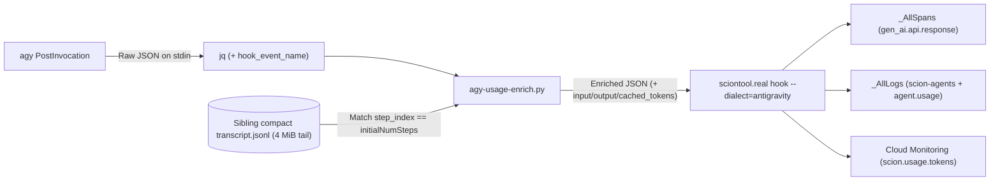

# Antigravity Token Usage Enrichment

This document explains why upstream Antigravity hooks omit token counts and how [`scripts/agy-usage-enrich.py`](../../scripts/agy-usage-enrich.py) restores full token telemetry without core Scion changes.

---

## 1. Why Upstream Antigravity Hooks Are `calls-only`

Upstream Antigravity CLI (`agy` through `1.5.x`) has two telemetry gaps ([`google-antigravity/antigravity-cli#366`](https://github.com/google-antigravity/antigravity-cli/issues/366)):

- `agy` provides no native OpenTelemetry exporter in interactive or hook-driven container sessions.
- `PreInvocation` and `PostInvocation` hook payloads carry `{conversationId, transcriptPath, modelName, invocationNum, initialNumSteps}`, with zero token fields.

Because hook `stdin` omits token counts, upstream Scion configures `antigravity` as `calls-only` (`ptone/scion#2237`):

- `gen_ai.api.calls` increments on each `PostInvocation` event.
- `scion.usage.tokens` receives zero points from the stock `antigravity` harness.

Keep `SCION_USAGE_SOURCE=hooks` for `antigravity`. `SCION_USAGE_SOURCE=native` activates `UsageDeriver`, which registers rules only for `claude`, `codex`, `gemini-cli`, and `copilot`. Setting `native` on `antigravity` suppresses hook counters and produces zero derived tokens.

Upstream Scion rejects parsing harness-private transcript files inside core Go `sciontool` (`.design/hosted/usage-telemetry.md`, Alternative D). Enriching the `PostInvocation` JSON on `stdin` before `sciontool hook --dialect=antigravity` respects that hook boundary with zero core Go edits.

---

## 2. How `agy-usage-enrich.py` Extracts Tokens Without Double-Counting

[`scripts/agy-usage-enrich.py`](../../scripts/agy-usage-enrich.py) runs as a standard-library Python 3 filter ahead of `sciontool.real hook --dialect=antigravity`.



### Step-by-Step Algorithm

1. **Prefer sibling compact `transcript.jsonl`:**
   The script checks `<transcriptPath_dir>/transcript.jsonl` before falling back to `transcriptPath` (`transcript_full.jsonl`). Compact `transcript.jsonl` truncates multi-megabyte tool outputs through `truncated_fields`, while keeping every step's integer token counters identical.
2. **Read a bounded 4 MiB tail:**
   The script seeks to `max(0, size - 4 MiB)` and discards any partial first line when the seek lands mid-line. Each run completes in a few milliseconds regardless of conversation length.
3. **Join `step_index == initialNumSteps`:**
   `PostInvocation` runs after tool calls finish, so one or more `GENERIC` tool-output rows already trail the `PLANNER_RESPONSE` row. Reading `lines[-1]` misses every tool-using turn and risks double-counting an earlier step on API errors. Matching `step_index == initialNumSteps` (`source == "MODEL"`, `status == "DONE"`) pairs 1:1 with each invocation.
4. **Handle `PreInvocation` `injectSteps` and flush races:**
   If a `PreInvocation` hook injects `SYSTEM` steps, the script walks contiguous `source == "SYSTEM"` rows from `initialNumSteps` to the model step. If the target step is still `RUNNING`, the script retries once after `30 ms`.
5. **Preserve fail-open `stdout` purity:**
   `agy` requires clean JSON on hook `stdout`. On non-`PostInvocation` events or any read/parse error, the script writes the exact `stdin` bytes back unchanged and exits `0`. Set `SCION_DEBUG_USAGE=1` to write diagnostics to `stderr`.

### Mutually Exclusive Token Mapping

| Transcript Field (`PLANNER_RESPONSE`) | Enriched `stdin` Key | `scion.usage.tokens` `token_type` | Counting Rule |
|---|---|---|---|
| `input_tokens` | `input_tokens` | `input` | Uncached prompt tokens only; `agy` already excludes cache reads from `input_tokens`. |
| `cache_read_tokens` | `cached_tokens` | `cache_read` | Renamed because `sciontool` `extractTokens` reads `cached_tokens` or `cache_read_input_tokens`, not `cache_read_tokens`. |
| `output_tokens` | `output_tokens` | `output` | Total model output tokens; **already includes thinking tokens**. Never add `thinking_tokens` to `output_tokens`. |
| `cache_write_tokens` / `cache_creation_input_tokens` (optional) | `cache_write_tokens` | `cache_write` | Emitted only when positive; map `.cache_write_tokens` in `~/.scion/harness/dialect.yaml` if needed. |
| `reasoning_tokens` / `thinking_tokens` (optional) | `reasoning_tokens` | `reasoning` | Informational subset of `output_tokens`; map `.reasoning_tokens` in `~/.scion/harness/dialect.yaml` if needed. |

Total billed/context tokens for an invocation equal `input_tokens + cached_tokens + output_tokens`.

---

## 3. Comparison with Community and Vendor Approaches

| Approach | Transport & Packaging | Trace & Quota Mechanics | Trade-Offs in Scion Containers |
|---|---|---|---|
| **`antigravity_usage_hook.py`** ([`antigravity-cli#366`](https://github.com/google-antigravity/antigravity-cli/issues/366)) | Standalone `PostInvocation` script exporting OTLP/HTTP `antigravity.token_usage` logs | Requires an external OTel Collector `signal_to_metrics` connector | Introduces a parallel OTLP export path outside Scion's PID 1 pipeline and Hub `session-metrics.json`. |
| **SigNoz / `antigravity-otel`** ([SigNoz guide](https://signoz.io/docs/antigravity-cli-monitoring/)) | Passive `PostToolUse`, `PostInvocation`, and `Stop` hooks (or `~/.gemini/config/plugins/<name>/plugin.json`); double-forks Python `opentelemetry.*` | Hashes `SHA-256(conversationId)` for `trace_id`; polls `agy -p /usage --output-format json` every 5 min on `Stop` for `agy.quota.remaining_fraction` | ~200 ms Python SDK import per fork; `/usage` tracks consumer subscription buckets rather than Vertex AI project quotas (`AGY_ADC_AUTH=true`). |
| **`scripts/agy-usage-enrich.py`** (Scion hook filter) | Zero-dependency Python stdlib filter (<10 ms) before `sciontool hook --dialect=antigravity` | Reuses Scion's turn-scoped `trace-state.json` waterfalls, PID 1 loopback OTLP receiver, Cloud Monitoring epoch exporter, and `agent.usage` outbox | Zero extra daemons, zero duplicate spans, and zero core Scion Go modifications. |

---

## 4. Pairing with `patches/sciontool-stacked-traces/`

> [!IMPORTANT]
> Unpatched upstream `sciontool` keeps `spanStore` in memory only. Across separate `PreInvocation` and `PostInvocation` processes, `PostInvocation` falls back to `singleSpan`, which calls `eventToAttributes` without `eventToEndAttributes`. Unpatched `sciontool` therefore populates `scion.usage.tokens` and `_AllLogs`, **but writes zero `gen_ai.usage.*` attributes onto `_AllSpans`**.

Pair `scripts/agy-usage-enrich.py` with a `sciontool.real` binary built from [`patches/sciontool-stacked-traces/`](../../patches/sciontool-stacked-traces/README.md) so every signal populates together:

1. `PreInvocation` records `PendingModel` (`SpanID`, `StartNano`) in `/home/scion/.scion/trace-state.json`.
2. `PostInvocation` pipes `stdin` through `agy-usage-enrich.py` into `sciontool.real hook --dialect=antigravity`.
3. `crossProcessEndSpan` calls both `eventToAttributes` and `eventToEndAttributes`, writing `gen_ai.usage.{input_tokens,output_tokens,cached_tokens}` onto child span `gen_ai.api.response/<model>` and rolling totals into root span `agent.turn/<agent_slug>`.
4. The same invocation writes correlated `_AllLogs` (`scion-agents`), durable `agent.usage` outbox records, Hub `~/.scion/session-metrics.json`, and Cloud Monitoring `scion.usage.tokens` (`input`, `output`, `cache_read`).

### Wrapper Integration Snippet

Install `scripts/agy-usage-enrich.py` at `/usr/local/bin/scion-agy-usage-enrich` (`chmod 755`) and enrich `PostInvocation` payloads inside `/usr/local/bin/sciontool`:

```sh
if [ "${1:-}" = "hook" ] && [ "${SCION_HARNESS:-}" = "antigravity" ]; then
  PAYLOAD="$(cat)"
  case "$PAYLOAD" in
    *'"PostInvocation"'*)
      if [ -x /usr/local/bin/scion-agy-usage-enrich ]; then
        ENRICHED="$(printf '%s' "$PAYLOAD" | /usr/local/bin/scion-agy-usage-enrich 2>/dev/null || true)"
        [ -n "$ENRICHED" ] && PAYLOAD="$ENRICHED"
      fi
      ;;
  esac
  printf '%s' "$PAYLOAD" | exec /usr/local/bin/sciontool.real "$@"
fi
```

### Verify Locally

Run the deterministic self-test and unit test suite from the repository root:

```bash
DRY_RUN=1 ./scripts/agy-usage-enrich.py
python3 -m unittest -v scripts/test_agy_usage_enrich.py
```
